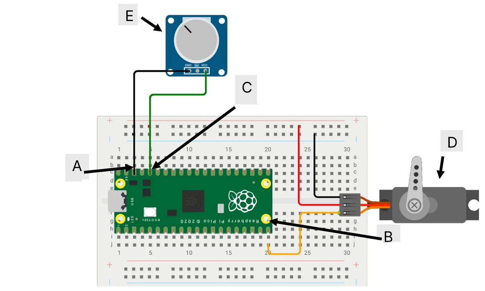
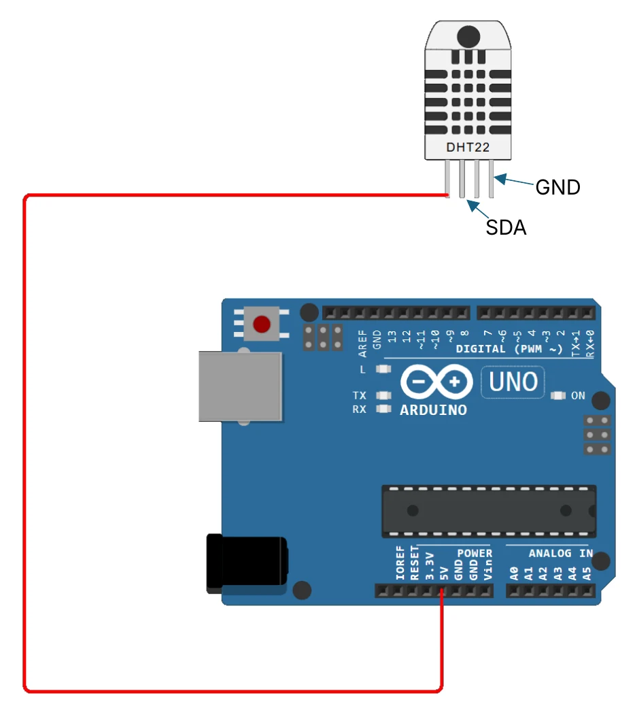
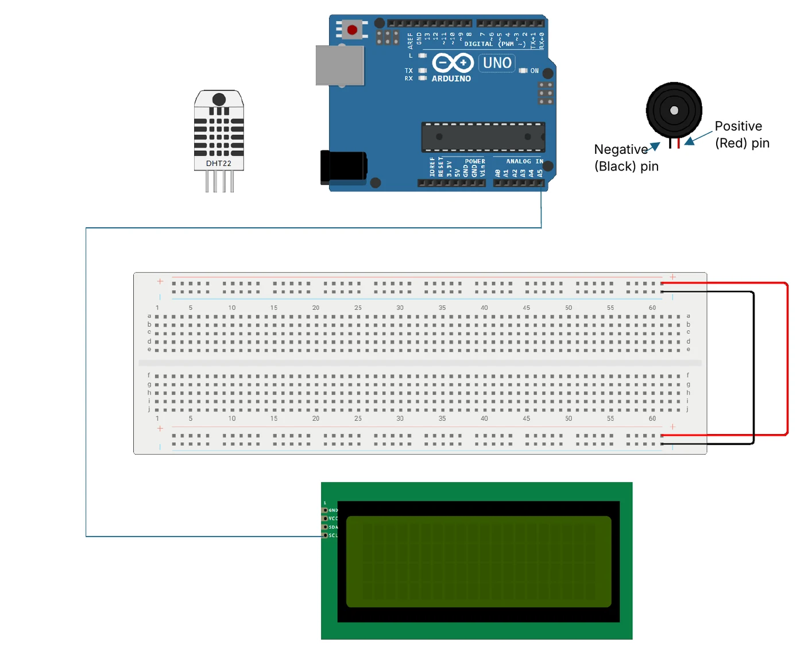
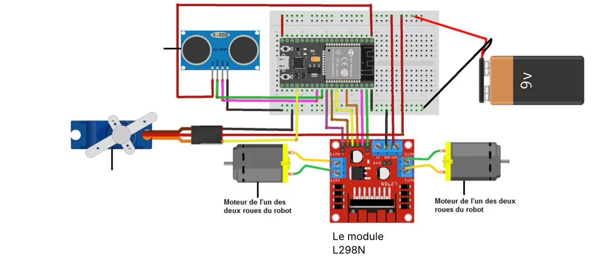

:::note[L'épreuve]
- **Module :** M.5.3.2. Développement des applications embarquées
- **Filière :** 3ACI – Option ISITD
- **Sujet du :** 15/01/2026 (V2)
- **Durée :** 60 minutes
:::

| Exercice | Carte | Points |
|---|---|---|
| 1 | Raspberry Pi Pico | 5 |
| 2 | Arduino UNO | 10 |
| 3 | ESP32 | 5 |
| **Total** | | **20** |

:::tip[Pour vous entraîner]
Imprimez cette page, ou enregistrez-la en PDF, pour compléter directement les schémas au stylo, comme sur le sujet papier.
:::

## Exercice 1 : carte Raspberry Pi Pico (5 points)

*Schéma 1*

**1.1.** Selon le montage du schéma 1, compléter le nom de la broche (pin) mentionnée avec la lettre A :

<ol type="A">
  <li>Pico : GND8</li>
  <li>Pico : GP1</li>
  <li>Pico : I2C</li>
  <li>Pico : Sys</li>
</ol>

**1.2.** Selon le montage du schéma 1, compléter le nom de la broche (pin) mentionnée avec la lettre B :

<ol type="A">
  <li>Pico : GND1</li>
  <li>Pico : GP15</li>
  <li>Pico : I2C</li>
  <li>Pico : Sys</li>
</ol>

**1.3.** Selon le montage du schéma 1, compléter le nom de la broche (pin) mentionnée avec la lettre C :

<ol type="A">
  <li>Pico : 5V</li>
  <li>Pico : GP5</li>
  <li>Pico : 3,3V</li>
  <li>Pico : VCC</li>
</ol>

**1.4.** L’équipement mentionné par la lettre D est un {"_".repeat(24)} qui sert à {"_".repeat(24)}

{"_".repeat(48)}

**1.5.** L’équipement mentionné par la lettre E est un {"_".repeat(24)} qui sert à {"_".repeat(24)}

{"_".repeat(48)}

## Exercice 2 : carte Arduino UNO (10 points)

**Question 1 (2 points)**

Sachant que le fil numéro 1 est relié avec (VCC – Voltage Common Collector). Sachant que le capteur DHT22 mesure des valeurs continues de température et d'humidité, mais il communique ces données à l'Arduino via une broche numérique.

**Relier les deux autres fils (GND et SDA) sur le schéma 2.**

*Schéma 2*

**Question 2 (1 point)**

La communication série est fréquemment utilisée pour déboguer et surveiller les programmes Arduino en affichant des messages, des données de capteurs, etc., sur le moniteur série de l'IDE Arduino. Dans une communication synchrone (SPI, I²C), qu'est-ce qui synchronise l'émetteur et le récepteur ?

<ol type="a">
  <li>La vitesse de transmission (baud rate)</li>
  <li>Par la même vitesse de transmission (baud rate) et des bits de start/stop</li>
  <li>Un bit de start et un bit de stop</li>
  <li>Une ligne d'horloge partagée (SCLK pour SPI, SCL pour I²C)</li>
</ol>

*Schéma 3*

**Question 3 (1 point)**

Comment appelle-t-on l’actionneur avec 2 pins (Positive & Negative Pin) sur le schéma 3 ?

{"_".repeat(48)}

**Question 4 (1 point)**

Le LCD est un actionneur permettant d’afficher la valeur de l’humidité, il communique avec la carte Arduino via une communication de type {"_".repeat(30)} en utilisant les broches analogiques suivantes A5 pour (SCL) et A4 pour (SDA).

**Question 5 (5 points)**

**Sachant que le Positive (Red) pin est relié à une broche numérique, relier la carte, le capteur DHT22 et les actionneurs sur le schéma 3 (<u>vous aurez besoin de 10 fils</u>).**

## Exercice 3 : carte ESP32 (5 points)

Nous souhaitions contrôler un robot à distance via une application web ou mobile. Le robot détecte un obstacle en émettant une onde ultrasonore et en mesurant le temps que met l'écho à revenir. Le système utilise des moteurs à courant continu de 5V. La carte ESP32 peut être utilisée pour concevoir et exécuter le programme de contrôle du robot, tandis que le module L298N peut être utilisé pour contrôler la vitesse et la direction des moteurs, ce n’est ni capteur ni actionneur, c'est un intermédiaire entre le microcontrôleur (ESP32) et les actionneurs.

*Schéma 4*

**3.1.** Identifiez et écrivez directement sur le schéma fourni (3 points) :

- Les capteurs utilisés
- Les actionneurs utilisés
- Le contrôleur principal

**3.2.** Expliquer pourquoi il est recommandé d’utiliser la carte ESP32 dans ce scénario. (2 points)
