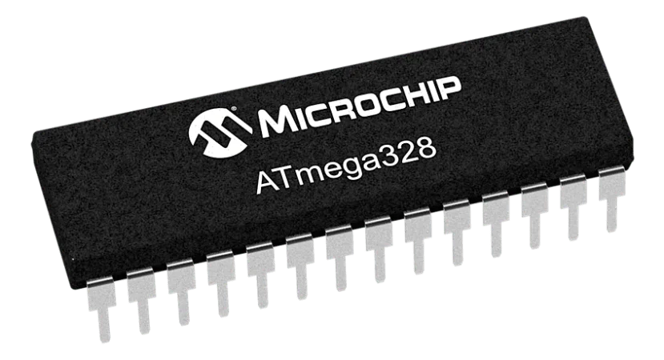
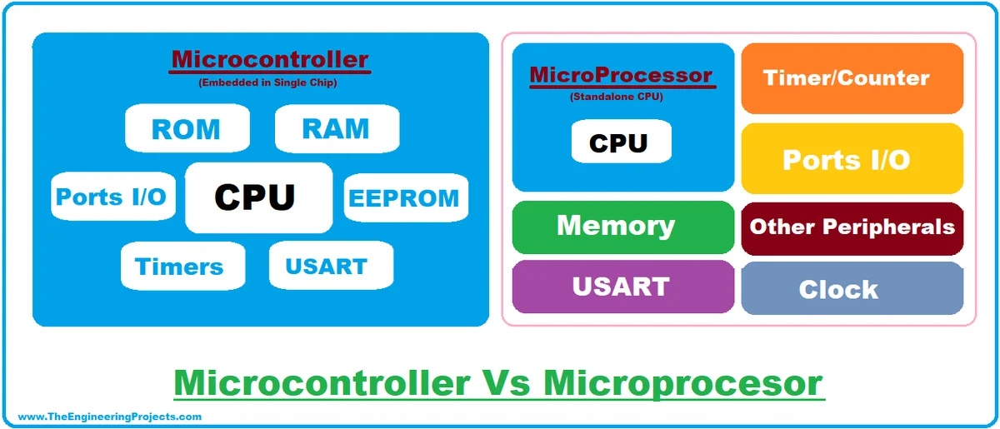
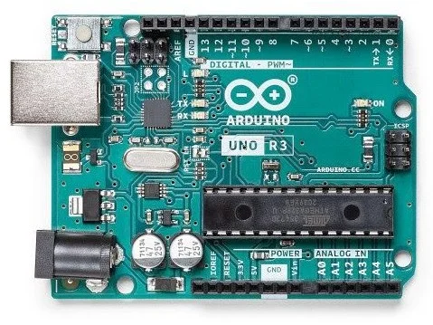
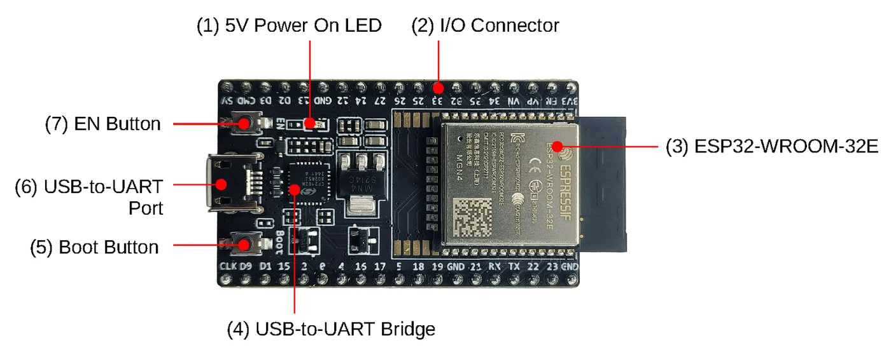

:::note[Objectifs de l'atelier]
À la fin de  cette partie, vous serez capables de :
- expliquer la différence entre une carte de développement, un microcontrôleur (MCU) et un microprocesseur (MPU) ;
-
:::

## Trois mots, trois choses différentes

On confond souvent ces trois termes. Pourtant, ils désignent des objets différents :

| Terme | C'est… | Exemple |
|---|---|---|
| **Microcontrôleur (MCU)** | une **puce** qui contient processeur, mémoires et entrées-sorties | ATmega328P |
| **Microprocesseur (MPU)** | une puce de **calcul puissante**, qui a besoin de composants autour | processeur d'un PC ou d'un Raspberry Pi |
| **Carte de développement** | une **carte** qui entoure la puce de tout le nécessaire pour l'utiliser | Arduino UNO |

## Le microcontrôleur (MCU) : tout dans une puce

Un MCU est un **mini-ordinateur sur une seule puce**. Il réunit un processeur, de la mémoire (Flash, SRAM, EEPROM) et des périphériques (broches, convertisseur analogique, liaisons série).

*Un microcontrôleur ATmega328 : une puce de quelques centimètres, c'est le « cerveau » de l'Arduino UNO.*

Il est peu coûteux, consomme très peu et pilote directement des capteurs et des actionneurs.

## Le microprocesseur (MPU) : la puissance de calcul

Un MPU est **beaucoup plus puissant**, mais il ne contient ni mémoire ni périphériques : il faut les ajouter autour. Il sert aux applications lourdes : système d'exploitation comme Linux, écran, vidéo, plusieurs programmes en même temps.

*À gauche, le MCU réunit tout dans une puce. À droite, le MPU a besoin de mémoire et de périphériques extérieurs.*

:::danger[À retenir]
**MCU** : tout est dans la puce, simple et économe, pour une tâche précise.
**MPU** : très puissant, mais il faut ajouter mémoire et périphériques autour.
:::

## La carte de développement : exemple

Un MCU seul est difficile à utiliser : il faut l'alimenter, le programmer, lui connecter des fils. La **carte de développement** règle tous ces problèmes. Elle contient :

- le **microcontrôleur** ;
- une **alimentation** qui fournit les bonnes tensions (5 V, 3,3 V) ;
- un **port USB** et une puce qui permettent de téléverser le programme ;
- des **connecteurs** (broches) pour brancher LED, boutons et capteurs ;
- un bouton **RESET** et des LED témoins.

*Une carte Arduino UNO : le grand circuit noir au centre est le microcontrôleur. Tout le reste est là pour l'alimenter, le programmer et le connecter.*

*Une autre carte de développement, l'ESP32 : on retrouve les mêmes blocs, le microcontrôleur, le port USB et ses boutons.*

:::caution[Important]
Ne confonds pas **la puce et la carte**. L'ATmega328P est le **microcontrôleur**. L'Arduino UNO est la **carte** qui le contient. Un Raspberry Pi 5 est une carte avec un **microprocesseur** : il fait tourner Linux, ce n'est pas un microcontrôleur.
:::

## Pourquoi commencer avec une Arduino UNO ?

:::note[Information]
L'Arduino UNO est une carte à **microcontrôleur**, simple et peu chère. Elle se programme en quelques lignes, se branche en USB et fonctionne seule une fois programmée. Elle est idéale pour comprendre ce qu'est un système embarqué, avant de passer à des cartes plus puissantes.
:::

##  Quizz

1. Que contient un microcontrôleur que ne contient pas un microprocesseur ?
2. L'Arduino UNO est-elle un microcontrôleur ?
3. Cite trois éléments qu'on trouve sur une carte de développement en plus de la puce.

Voir les réponses

1. Il intègre dans la même puce de la **mémoire** (Flash, SRAM) et des **périphériques** (entrées-sorties, convertisseur analogique, liaisons série).
2. Non. C'est une **carte de développement** qui contient un microcontrôleur, l'ATmega328P.
3. Par exemple : l'alimentation, le port USB, les broches, le bouton RESET.

:::note[Prochaine étape]
Valide cette page en bas, puis découvre la carte Arduino UNO broche par broche.
:::
