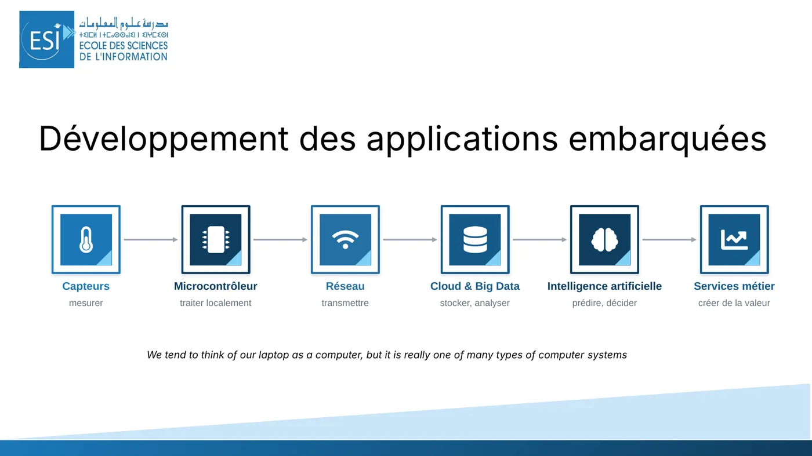
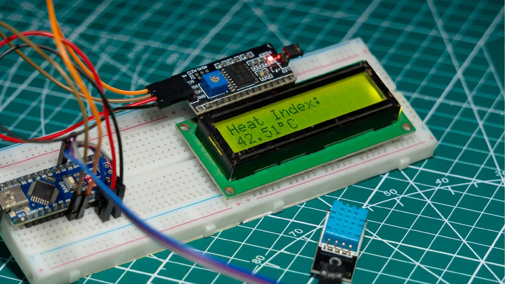
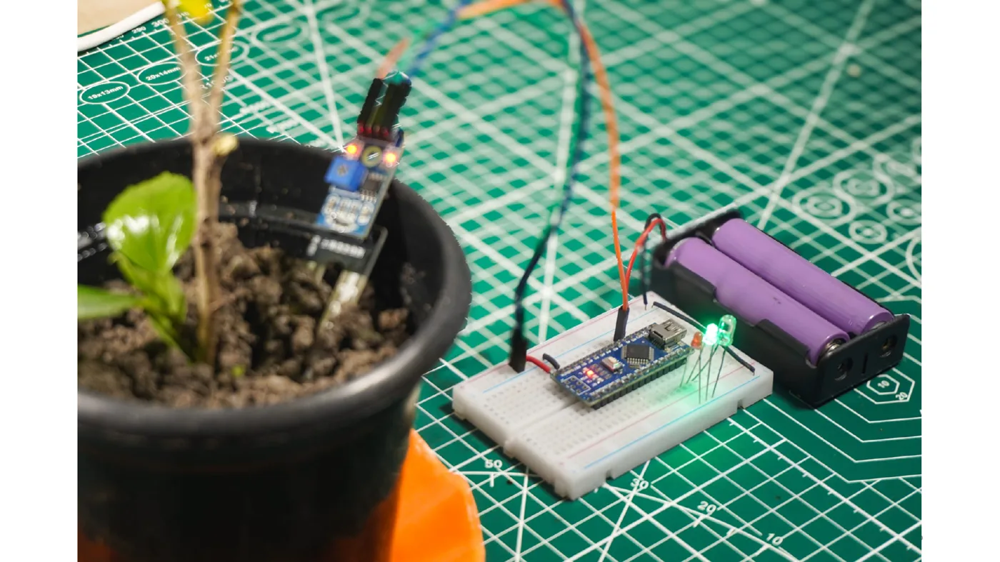
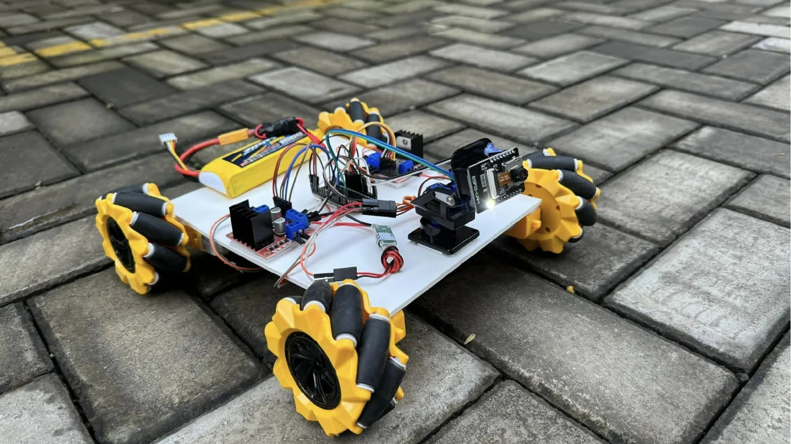
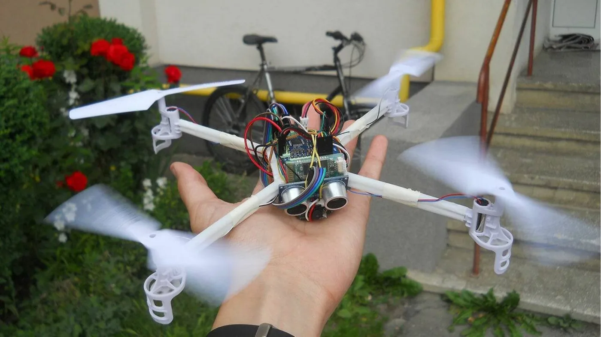
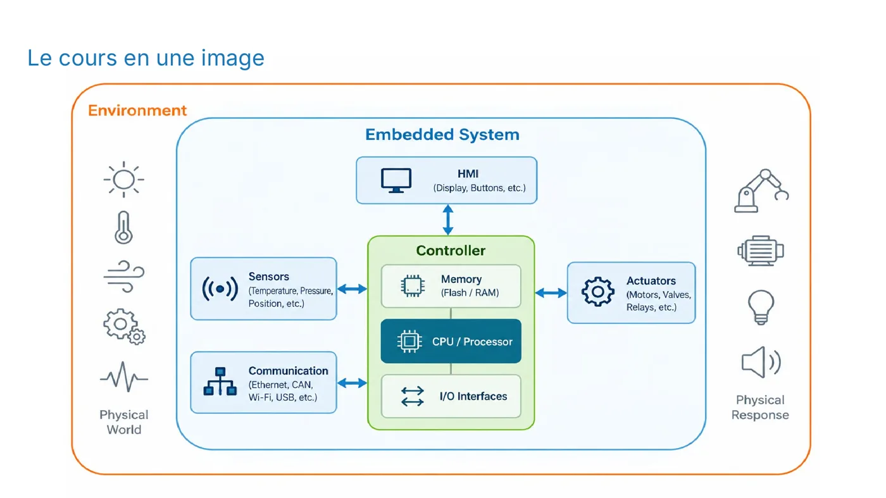
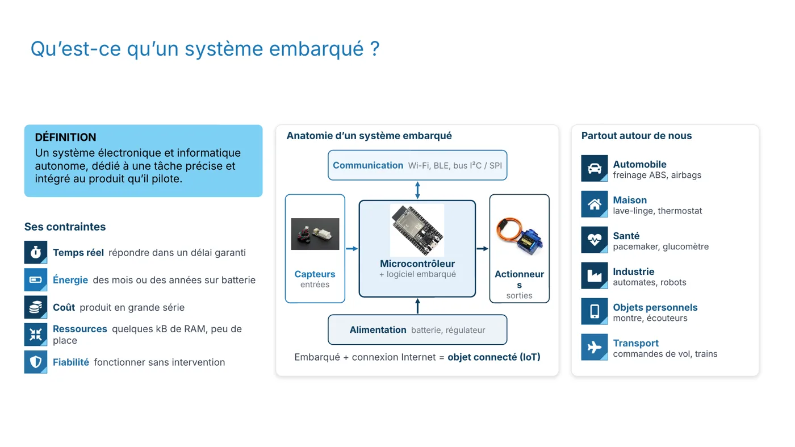
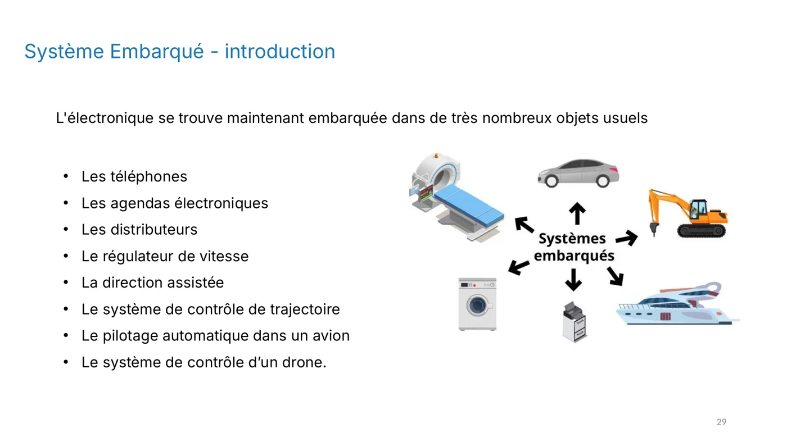
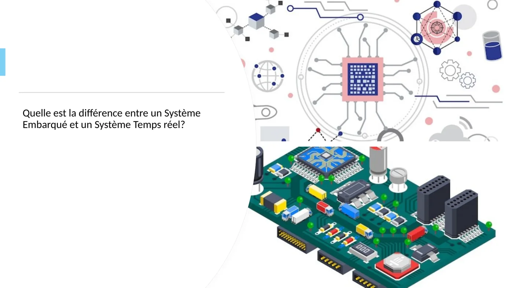
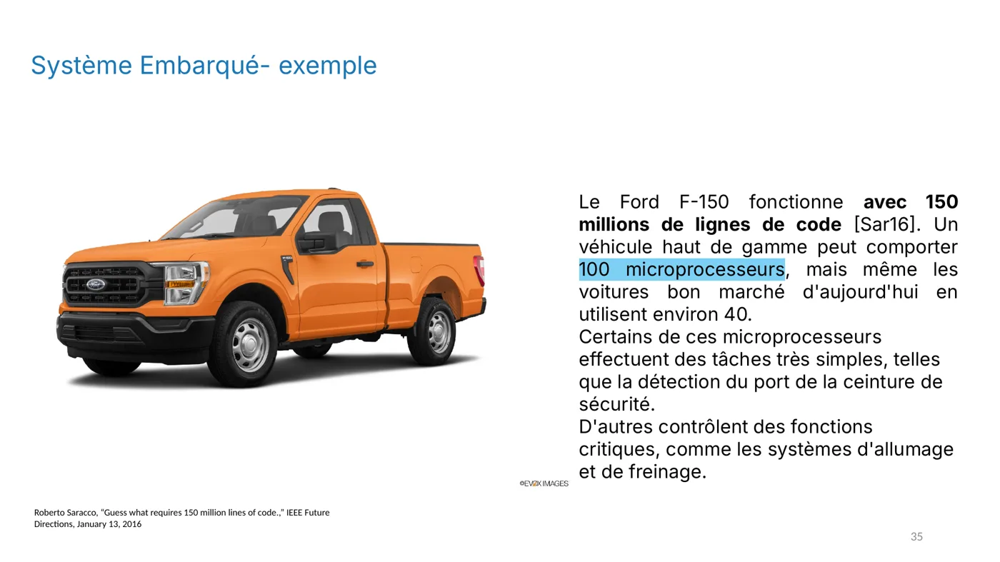

**Objectif :** définir un système embarqué et identifier ses contraintes : temps réel, énergie, coût, mémoire.

## Définition

Un système embarqué est un **système électronique et informatique autonome, dédié à une tâche précise et intégré au produit qu’il pilote**.

Ce n'est pas un ordinateur généraliste : un PC n'est pas un système embarqué, mais un thermomètre construit autour d'un microprocesseur en est un.

## Partout autour de nous

- **Automobile** : freinage ABS, airbags, régulateur de vitesse.
- **Maison** : lave-linge, thermostat.
- **Santé** : pacemaker, glucomètre.
- **Industrie** : automates, robots.
- **Objets personnels** : montre, écouteurs.
- **Transport** : commandes de vol, trains, pilotage automatique.

Une voiture moderne contient des dizaines de microprocesseurs. Certains détectent simplement le port de la ceinture, d'autres contrôlent le freinage ou l'allumage.

## Les contraintes

| Contrainte | Ce que ça signifie |
|---|---|
| **Temps réel** | Répondre dans un délai garanti. |
| **Énergie** | Fonctionner des mois, voire des années, sur batterie. |
| **Coût** | Être produit en grande série à petit prix. |
| **Ressources** | Quelques kilo-octets de RAM, peu de place. |
| **Fiabilité** | Fonctionner sans intervention humaine. |

:::tip[Temps réel]
Les calculs sont déclenchés par un événement extérieur (par exemple une interruption matérielle). La **validité** d'un résultat dépend du moment où il est délivré. Un moniteur cardiaque doit réagir à temps : une bonne réponse en retard est une mauvaise réponse.
:::

## Anatomie d'un système embarqué

1. **Capteurs** : entrées qui mesurent le monde physique.
2. **Microcontrôleur** + logiciel embarqué : traitent les données et prennent les décisions.
3. **Actionneurs** : sorties qui agissent sur le monde physique.
4. **Communication** : Wi-Fi, Bluetooth, bus I²C ou SPI.
5. **Alimentation** : batterie et régulateur.

Un système embarqué relié à Internet devient un **objet connecté** (IoT).

## Pour vérifier ta compréhension

- Pourquoi un PC n'est-il pas un système embarqué ?
- Donne deux contraintes qui s'appliquent à un capteur alimenté par pile.
- Quelle est la différence entre un système embarqué et un système temps réel ?

## Illustrations du cours

:::note
Quand tu as répondu à ces questions, valide cette leçon en bas de page.
:::
