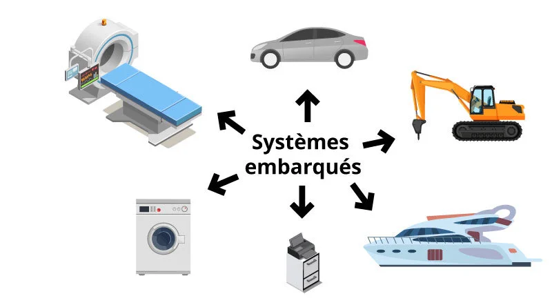
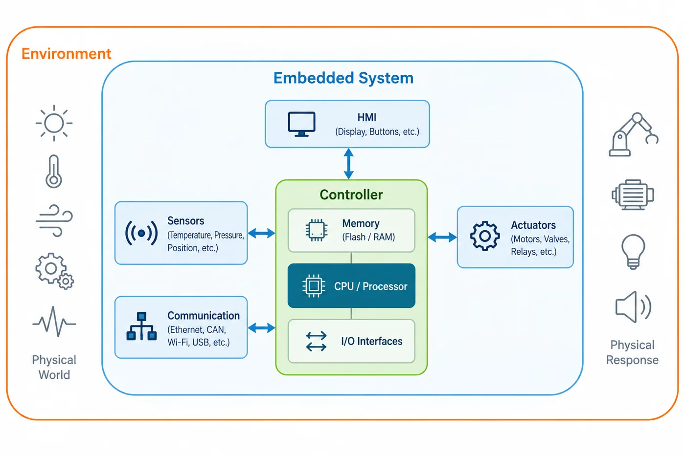
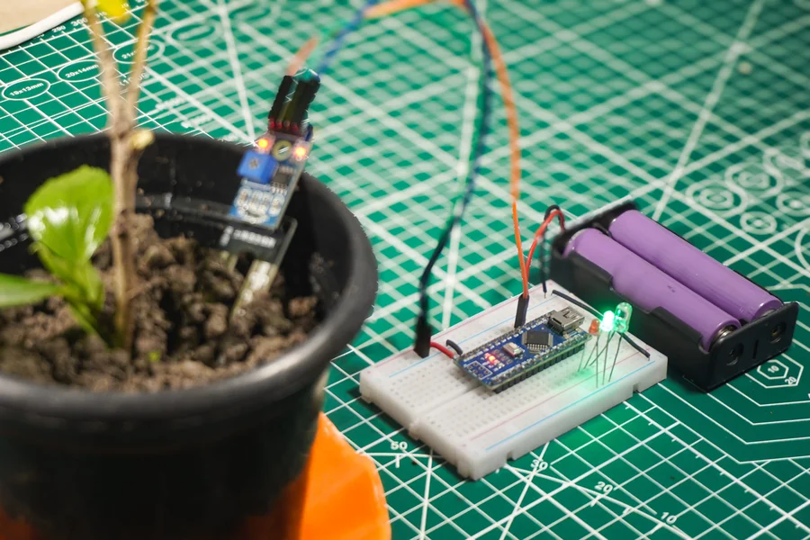
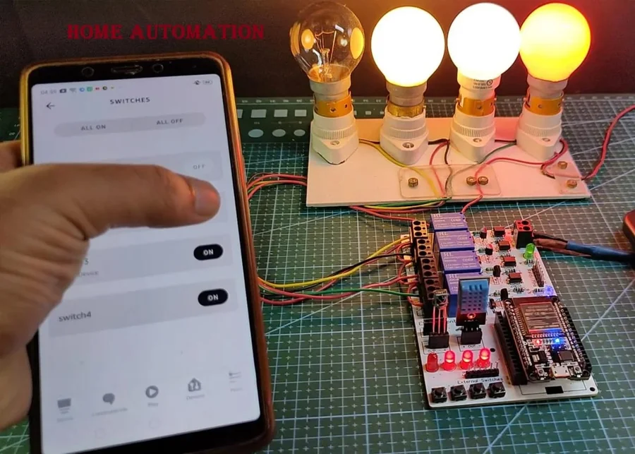
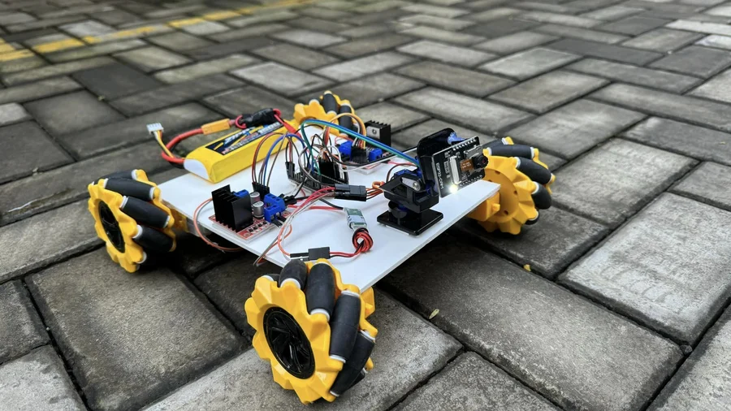

:::note[Objectifs de la leçon]
À la fin de cette leçon, tu seras capable de :
- définir un système embarqué avec tes propres mots ;
- citer des exemples dans la vie quotidienne ;
- expliquer ses cinq contraintes principales, dont le temps réel.
:::

## Un ordinateur caché dans un objet

Quand on pense à un ordinateur, on imagine un portable ou un PC : un écran, un clavier, et la possibilité de lancer n'importe quel logiciel. Un **système embarqué** est tout autre chose. C'est un petit ordinateur **intégré à un objet** pour piloter une fonction précise. L'utilisateur ne le voit presque jamais.

Fais le tour de ta maison ou de ta voiture : le lave-linge, le thermostat, le distributeur de billets, le régulateur de vitesse, la montre connectée... Tous contiennent un système embarqué.

*Des systèmes très différents, qui ont tous un point commun : un ordinateur intégré qui fait une tâche précise.*

## Une définition en une phrase

:::danger[À retenir]
Un système embarqué est un système **électronique et informatique autonome, dédié à une tâche précise et intégré au produit qu'il pilote**.
:::

Chaque mot compte :
- **autonome** : il fonctionne sans qu'une personne le pilote en permanence ;
- **dédié** : il fait une seule chose, mais il la fait très bien ;
- **intégré** : il fait partie du produit, il n'est pas une machine à côté.

Un PC n'est donc pas un système embarqué, car il sert à tout faire. Par contre, un thermomètre construit autour d'un microprocesseur en est un : il n'a qu'une fonction.

:::note[Information]
Un système embarqué **associe du matériel et du logiciel conçus ensemble** pour fournir des fonctionnalités données. On ne peut pas concevoir l'un sans penser à l'autre.
:::

## Comment fonctionne un système embarqué ?

Tous les systèmes embarqués suivent la même logique : **observer, décider, agir**. Ils sont constitués des mêmes éléments :

1. des **capteurs**, qui mesurent le monde physique (température, lumière, distance) ;
2. un **microcontrôleur** avec son logiciel, qui traite les mesures et prend les décisions ;
3. des **actionneurs**, qui agissent sur le monde physique (moteur, LED, buzzer) ;
4. un moyen de **communication** (Wi-Fi, Bluetooth, bus I²C ou SPI) ;
5. une **alimentation** (batterie et régulateur).

*Le système embarqué reçoit des informations de l'environnement physique par ses capteurs, et agit sur lui par ses actionneurs.*

Si ce système est relié à Internet, on parle d'**objet connecté** ou d'**IoT** (Internet des objets). Tu le verras dans la leçon 4.

## Des systèmes que tu peux construire

Les systèmes embarqués ne sont pas réservés aux industriels. Avec une carte Arduino et quelques composants, on construit des projets très variés. Voici quelques exemples de réalisations :

*Afficheur, surveillance d'une plante, lampes pilotées par smartphone, robot et drone : tous reposent sur un microcontrôleur, des capteurs et des actionneurs.*

## Les contraintes : ce qui rend le métier difficile

Un ordinateur de bureau dispose de beaucoup d'énergie et de puissance. Un système embarqué doit composer avec des limites fortes :

| Contrainte | Ce que ça signifie concrètement |
|---|---|
| **Temps réel** | La réponse doit arriver dans un délai garanti. |
| **Énergie** | Il doit fonctionner des mois, voire des années, sur une pile. |
| **Coût** | Il est fabriqué en très grande série, donc chaque centime compte. |
| **Ressources** | Quelques kilo-octets de mémoire, peu de place disponible. |
| **Fiabilité** | Il doit fonctionner seul, parfois pendant des années. |

La voiture illustre bien ces contraintes. Une voiture haut de gamme contient une centaine de microprocesseurs, et même les modèles bon marché en comptent environ quarante. Certains font des tâches simples, comme détecter le port de la ceinture. D'autres contrôlent des fonctions critiques, comme le freinage ou l'allumage.

*Une voiture moderne comme le Ford F-150 fonctionne avec environ 150 millions de lignes de code, réparties dans de nombreux systèmes embarqués.*

## Le temps réel, une contrainte à part

Dans un système temps réel, un calcul est **déclenché par un événement extérieur** (par exemple une interruption matérielle). Surtout, **le résultat n'a de valeur que s'il arrive à temps**.

Imagine un moniteur cardiaque qui surveille l'activité électrique du cœur d'un patient. Une mesure juste, mais délivrée trop tard, ne sert à rien : c'est le moment de la réponse qui compte, pas seulement sa justesse.

:::caution[Important]
Un système embarqué n'est pas forcément un système temps réel, et inversement. Mais **la plupart des systèmes embarqués fonctionnent en temps réel**, parce qu'ils réagissent à des événements du monde physique.
:::

## Teste-toi

1. Pourquoi un PC n'est-il pas un système embarqué, alors qu'un thermomètre à microprocesseur en est un ?
2. Donne deux contraintes qui s'appliquent à un capteur alimenté par une pile.
3. Pourquoi un résultat tardif peut-il être inutile dans un moniteur cardiaque ?

Voir les réponses

1. Le PC est un ordinateur généraliste : il peut exécuter n'importe quel programme. Le thermomètre n'a qu'une fonction, dédiée et intégrée dans l'objet.
2. L'énergie (il doit durer longtemps sur pile) et le coût ou les ressources (peu de mémoire, composants bon marché).
3. Parce que la valeur du résultat dépend du moment où il est délivré : une alerte cardiaque en retard n'a plus d'utilité.

:::note[Prochaine étape]
Quand tu as répondu aux questions, valide cette leçon en bas de page.
:::
