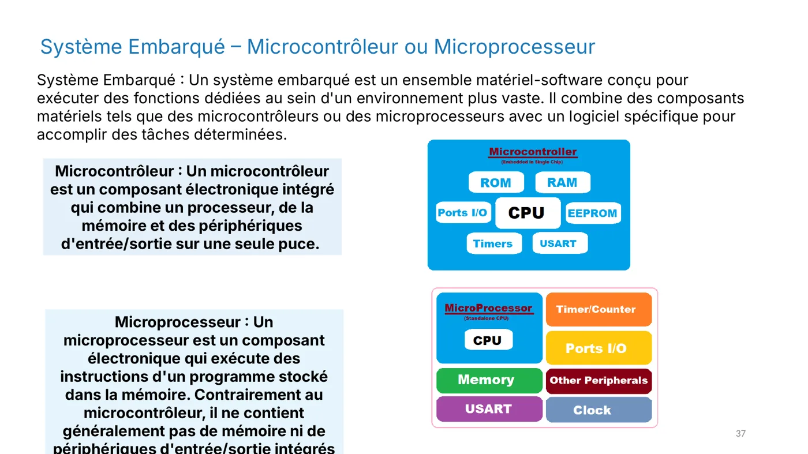
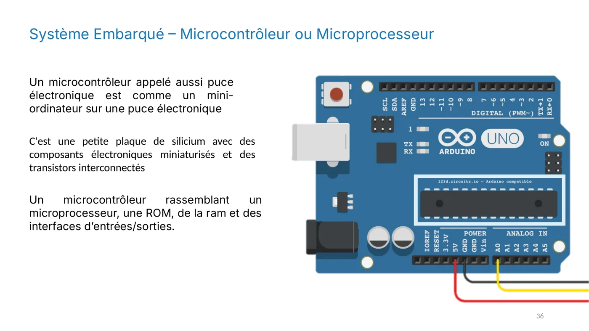
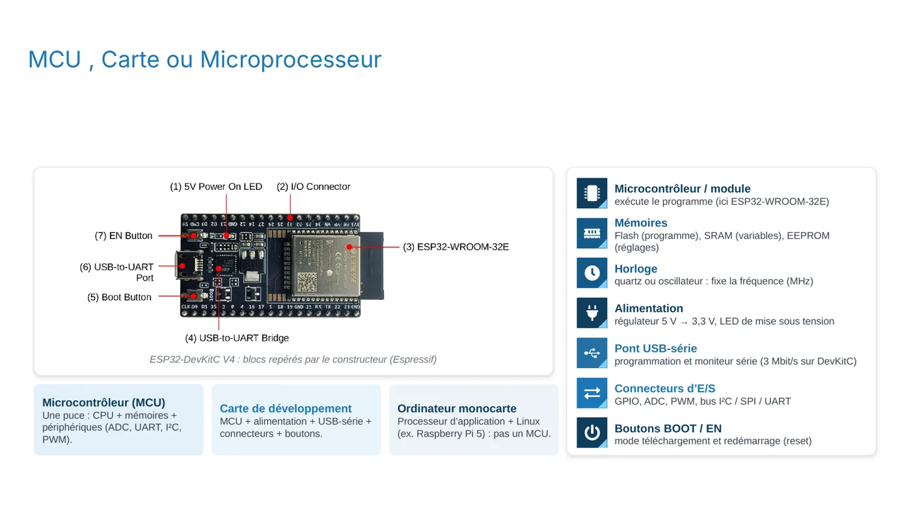
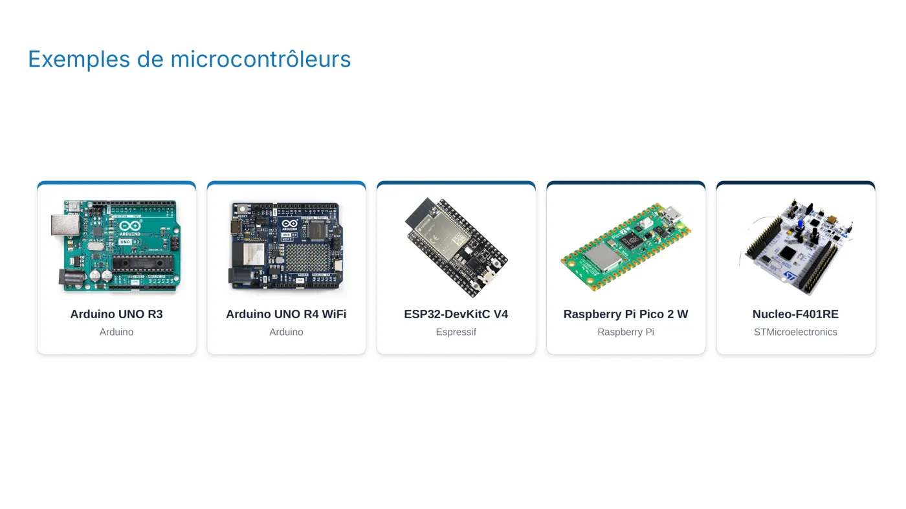
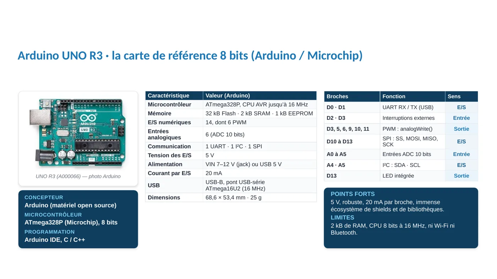
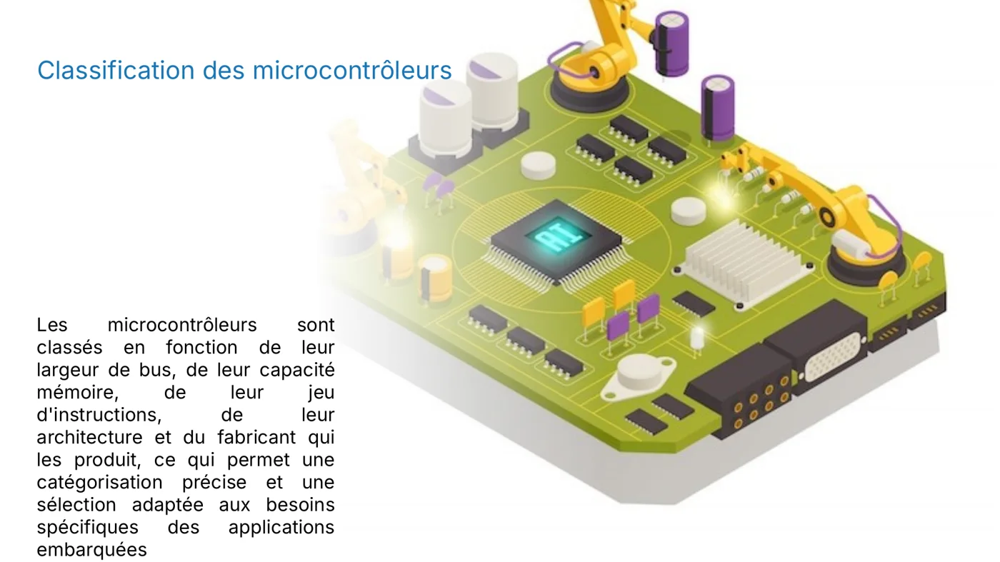

**Objectif :** distinguer un microcontrôleur d'un microprocesseur, et comprendre ce qu'il y a réellement sur une carte de développement.

## Le cerveau du système

Au cœur de chaque système embarqué, il y a un composant qui exécute le programme. Deux familles existent, et on les confond souvent. Un **microprocesseur** exécute des instructions. Un **microcontrôleur** fait la même chose, mais il embarque en plus tout ce qui sert à commander un objet.

*Diapositive 37 : le microcontrôleur regroupe processeur, mémoires et périphériques sur une seule puce, alors que le microprocesseur seul ne contient pas tout cela.*

## Le microcontrôleur : tout dans une puce

Un microcontrôleur est une **puce qui contient tout le nécessaire** :

- un processeur (CPU) qui exécute le programme ;
- des mémoires : la **Flash** pour stocker le programme, la **SRAM** pour les variables, l'**EEPROM** pour les réglages qui doivent survivre à une coupure ;
- des **périphériques** : convertisseur analogique-numérique (ADC), UART, I²C, SPI, PWM.

Cette intégration explique son succès : il est peu coûteux, consomme très peu d'énergie et sait contrôler des capteurs et des actionneurs directement, sans composants supplémentaires.

*Diapositive 36 : un microcontrôleur est souvent décrit comme un mini-ordinateur sur une puce, comme celui de la carte Arduino.*

## Le microprocesseur : la puissance, mais pas tout intégré

Un microprocesseur exécute les instructions d'un programme stocké en mémoire, mais il ne contient généralement **ni mémoire ni périphériques intégrés**. Il faut donc lui ajouter des composants autour.

En contrepartie, il offre une puissance de calcul bien plus élevée et de la flexibilité. C'est le choix pour les applications complexes : multimédia, plusieurs tâches en parallèle, systèmes d'exploitation.

## Quand choisir lequel ?

| Critère | Microcontrôleur | Microprocesseur |
|---|---|---|
| Points forts | Faible consommation, coût bas, contrôle direct des broches | Puissance de calcul, multitâche |
| Mémoire et périphériques | Intégrés dans la puce | Ajoutés autour du composant |
| Usage typique | Commander un capteur, un moteur, une LED | Smartphone, ordinateur |

En résumé : si la tâche est dédiée et doit tenir longtemps sur une pile, on prend un microcontrôleur. Si elle demande beaucoup de calcul, on prend un microprocesseur.

## La carte de développement

Un microcontrôleur seul est difficile à utiliser : il faut l'alimenter, le programmer, pouvoir lire ses résultats. C'est pourquoi on travaille avec une **carte de développement**, qui entoure la puce de tout le nécessaire.

*Diapositive 28 : sur une carte ESP32, on repère le microcontrôleur, l'horloge, l'alimentation, le pont USB-série pour programmer la carte, les connecteurs et les boutons.*

Concrètement, une carte de développement contient :
- le microcontrôleur (ou son module) ;
- une **alimentation** qui convertit la tension, par exemple 5 V vers 3,3 V ;
- un **pont USB-série**, pour envoyer le programme et lire le moniteur série ;
- les **connecteurs** d'entrées-sorties (GPIO, ADC, PWM, bus) ;
- des **boutons** BOOT et EN ou RESET.

:::caution[Attention]
Une carte comme le Raspberry Pi 5 est un **ordinateur monocarte** : son processeur fait tourner Linux. Ce n'est pas un microcontrôleur.
:::

## Quelques exemples

Les cartes ci-dessous sont les plus utilisées en formation. Chacune a ses points forts.

*Diapositive 24 : Arduino UNO R4 WiFi, ESP32, Raspberry Pi Pico 2 W et Nucleo-F401RE.*

| Carte | Fabricant | Caractéristique clé |
|---|---|---|
| Arduino UNO R3 | Arduino (ATmega328P) | Carte de référence 8 bits, 16 MHz, 2 Ko de RAM |
| ESP32-DevKitC V4 | Espressif | Double cœur à 240 MHz, Wi-Fi et Bluetooth |
| Raspberry Pi Pico 2 W | Raspberry Pi (RP2350) | Wi-Fi, blocs PIO programmables |
| Nucleo-F401RE | STMicroelectronics | Carte STM32 pour apprendre le C |

Les fiches techniques détaillées se lisent comme un catalogue. La diapositive ci-dessous présente la carte Arduino UNO avec ses caractéristiques.

*Diapositive 25 : la fiche technique de l'Arduino UNO R3. Nous la détaillerons au chapitre 5.*

Enfin, les microcontrôleurs se classent selon leur largeur de bus, leur mémoire, leur jeu d'instructions et leur fabricant. Cette classification permet de choisir la bonne puce pour un besoin donné.

*Diapositive 44 : une classification des microcontrôleurs selon leurs caractéristiques.*

## Pour vérifier ta compréhension

- Cite trois éléments présents dans un microcontrôleur et absents d'un microprocesseur classique.
- Dans quelle catégorie rangerais-tu un téléphone ? Une machine à laver ?
- Pourquoi une carte de développement est-elle plus pratique qu'un microcontrôleur nu ?

:::note
Quand tu as répondu à ces questions, valide cette leçon en bas de page.
:::
