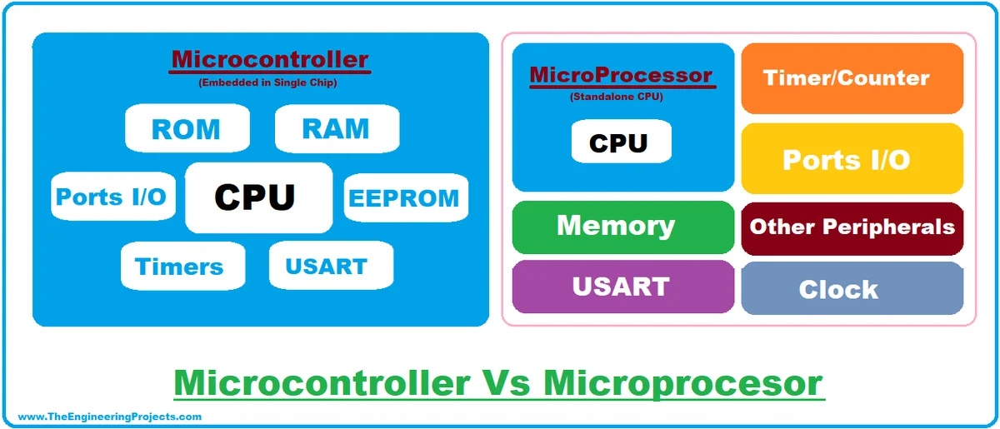
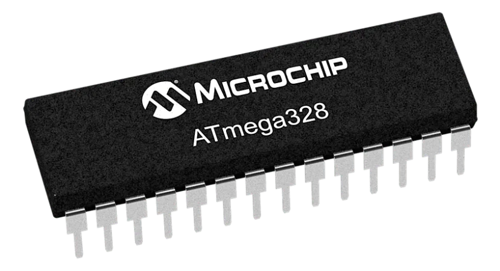
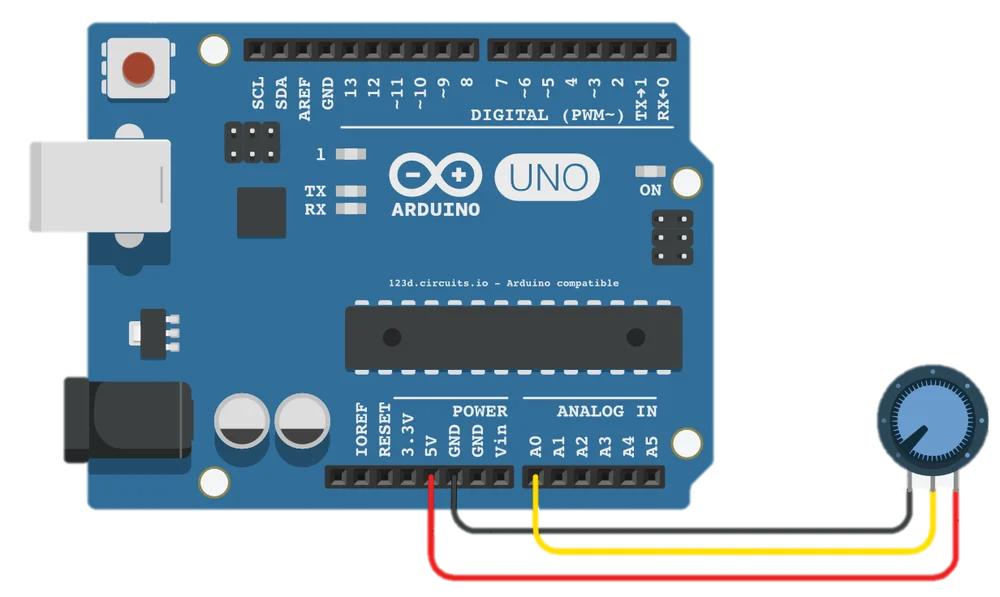
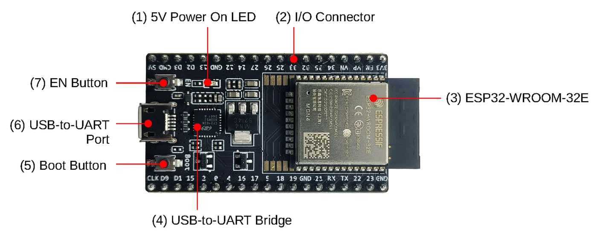
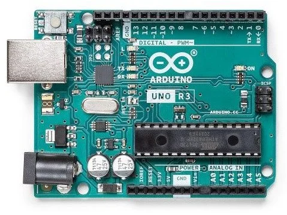
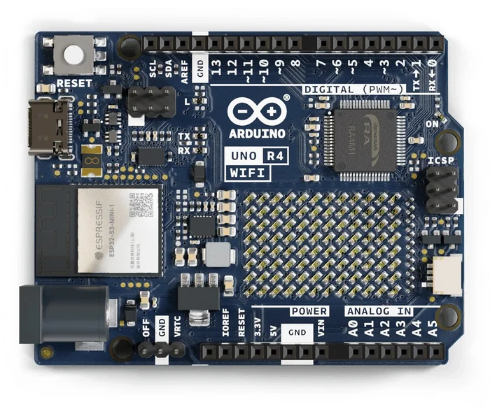
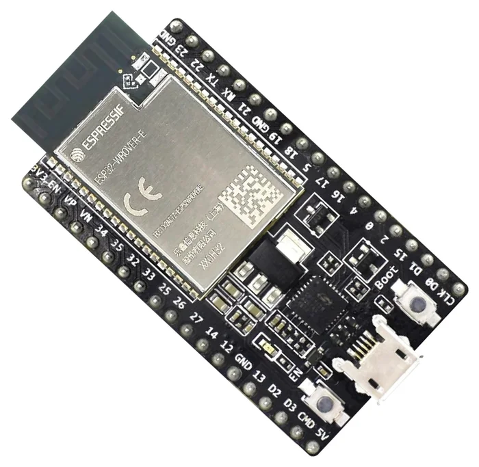
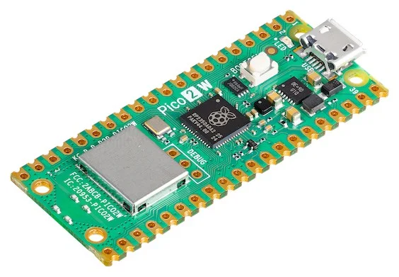
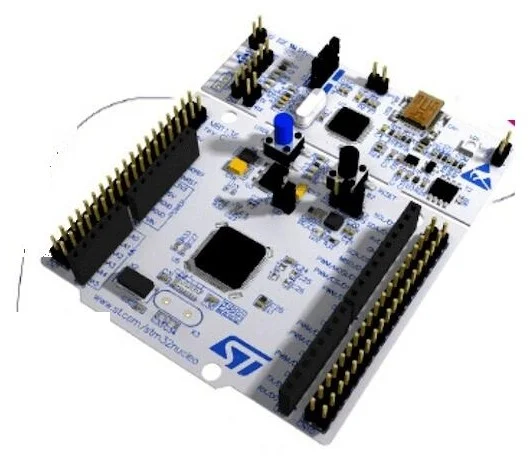

:::note[Objectifs de la leçon]
À la fin de cette leçon, tu seras capable de :
- expliquer la différence entre un microcontrôleur et un microprocesseur ;
- choisir lequel utiliser selon le besoin ;
- repérer les blocs d'une carte de développement.
:::

## Le cerveau du système

Au cœur de tout système embarqué, il y a un composant qui exécute le programme. On en distingue deux familles, que l'on confond souvent. Un **microprocesseur** exécute des instructions. Un **microcontrôleur** fait la même chose, mais il embarque en plus tout ce qu'il faut pour commander un objet.

*Le microcontrôleur réunit dans une seule puce le processeur, les mémoires et les périphériques. Le microprocesseur, lui, a besoin de composants autour de lui.*

## Le microcontrôleur : tout dans une puce

Un microcontrôleur est une **puce qui contient tout le nécessaire** :

- un **processeur** (CPU) qui exécute le programme ;
- des **mémoires** : la *Flash* conserve le programme, la *SRAM* contient les variables, l'*EEPROM* garde les réglages même hors tension ;
- des **périphériques** : convertisseur analogique-numérique (ADC), liaisons UART, I²C, SPI, signaux PWM.

C'est pour cela qu'il est peu coûteux, qu'il consomme très peu d'énergie et qu'il pilote directement des capteurs et des actionneurs.

*À gauche, le microcontrôleur ATmega328 seul. À droite, la carte Arduino UNO qui l'entoure.*

:::note[Pour mieux comprendre]
Un microcontrôleur est comme un **mini-ordinateur sur une puce**, capable de fonctionner seul. C'est ce qui en fait le support idéal pour les systèmes embarqués.
:::

## Le microprocesseur : la puissance avant tout

Un microprocesseur exécute les instructions d'un programme stocké en mémoire, mais il ne contient généralement **ni mémoire ni périphériques intégrés**. Il faut donc lui ajouter des composants autour.

En contrepartie, il offre une puissance de calcul bien supérieure et de la flexibilité. On le choisit pour les applications complexes : multimédia, plusieurs tâches en parallèle, systèmes d'exploitation.

## Comment choisir ?

| Critère | Microcontrôleur | Microprocesseur |
|---|---|---|
| Points forts | Faible consommation, coût bas, contrôle direct des broches | Puissance de calcul, multitâche |
| Mémoire et périphériques | Intégrés à la puce | Ajoutés autour du composant |
| Usage typique | Commander un capteur, un moteur, une LED | Smartphone, ordinateur |

:::danger[À retenir]
Pour une **tâche dédiée** qui doit tenir longtemps sur batterie : un **microcontrôleur**. Pour des **calculs lourds** ou plusieurs applications : un **microprocesseur**.
:::

## La carte de développement

Un microcontrôleur seul est difficile à utiliser : il faut l'alimenter, le programmer, lire ses résultats. C'est pourquoi on travaille avec une **carte de développement**, qui entoure la puce de tout le nécessaire.

*Les blocs d'une carte ESP32 : le microcontrôleur (module ESP32-WROOM-32E), le pont USB-UART pour programmer la carte, les boutons EN et BOOT, la LED d'alimentation et les connecteurs d'entrées-sorties.*

Une carte de développement contient donc :
- le microcontrôleur ou son module ;
- une **alimentation** qui convertit la tension (par exemple 5 V vers 3,3 V) ;
- un **pont USB-série**, pour envoyer le programme et lire le moniteur série ;
- les **connecteurs** d'entrées-sorties (GPIO, ADC, PWM, bus) ;
- des **boutons** BOOT, EN ou RESET.

:::caution[Important]
Ne confonds pas : le **microcontrôleur** est la puce, la **carte** est la puce plus tout ce qui l'entoure, et un **ordinateur monocarte** comme le Raspberry Pi 5 fait tourner Linux avec un processeur d'application. Ce n'est **pas** un microcontrôleur.
:::

## Quelques cartes à connaître

Chaque carte a ses points forts. Les plus courantes en formation sont les suivantes :

*De gauche à droite : Arduino UNO R3, Arduino UNO R4 WiFi, ESP32-DevKitC V4, Raspberry Pi Pico 2 W, Nucleo-F401RE.*

| Carte | Fabricant | Caractéristique clé |
|---|---|---|
| Arduino UNO R3 | Arduino (ATmega328P) | Carte de référence 8 bits, 16 MHz, 2 Ko de RAM |
| ESP32-DevKitC V4 | Espressif | Double cœur à 240 MHz, Wi-Fi et Bluetooth |
| Raspberry Pi Pico 2 W | Raspberry Pi (RP2350) | Wi-Fi, blocs PIO programmables |
| Nucleo-F401RE | STMicroelectronics | Carte STM32 pour apprendre le C |

## Teste-toi

1. Cite trois éléments présents dans un microcontrôleur et absents d'un microprocesseur classique.
2. Dans quelle catégorie rangerais-tu le processeur d'un smartphone ? Celui d'une machine à laver ?
3. À quoi sert le pont USB-série d'une carte de développement ?

Voir les réponses

1. De la mémoire Flash, de la SRAM et des périphériques (ADC, UART, I²C, PWM).
2. Le smartphone utilise un microprocesseur (applications complexes, multitâche). La machine à laver utilise un microcontrôleur (tâche dédiée).
3. Il permet de téléverser le programme depuis l'ordinateur et de lire les messages affichés dans le moniteur série.

:::note[Prochaine étape]
Quand tu as répondu aux questions, valide cette leçon en bas de page.
:::
