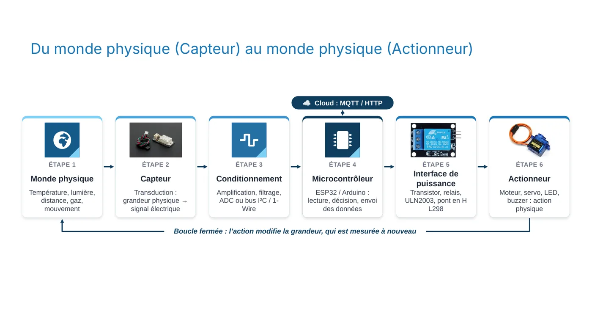
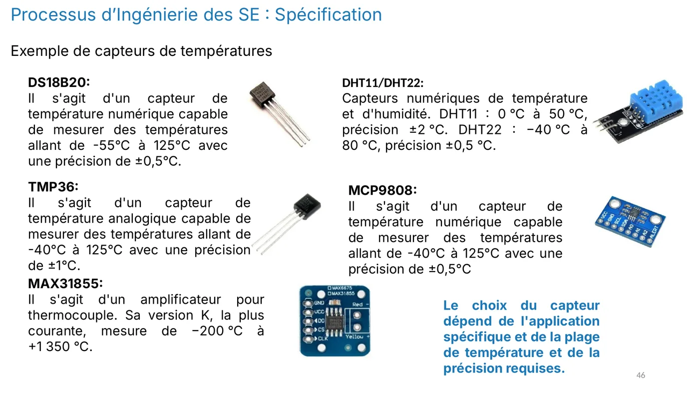
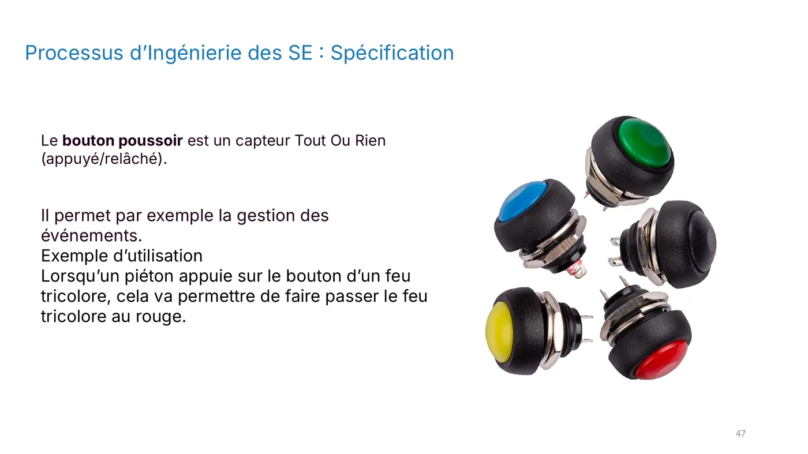
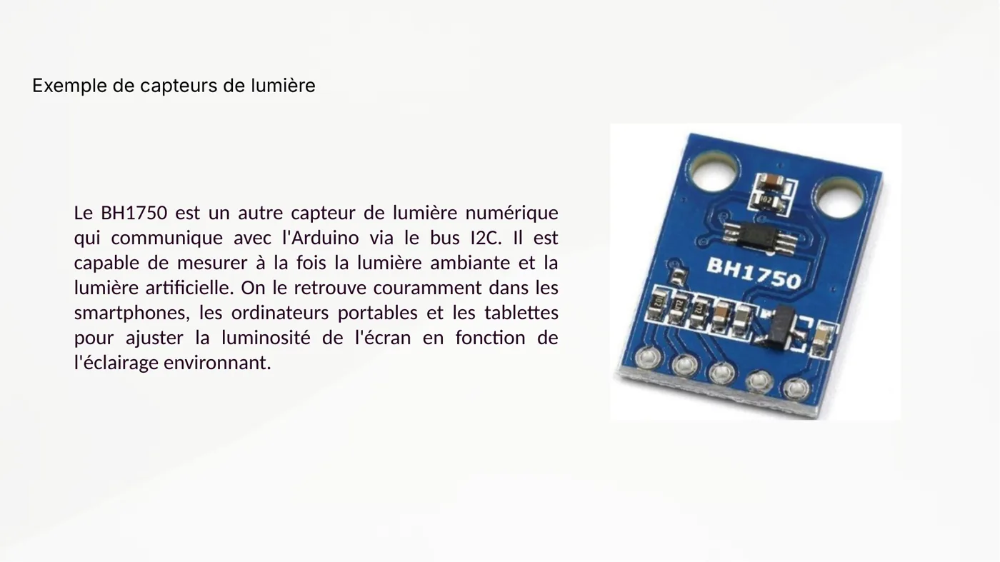
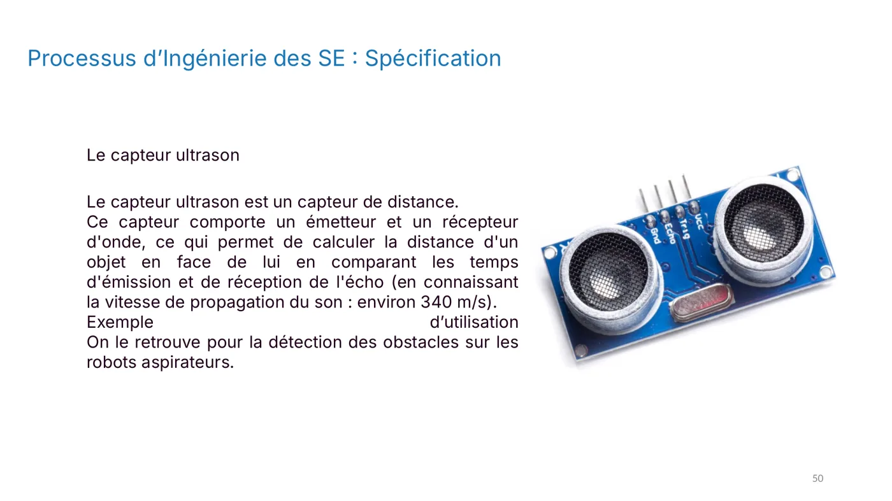
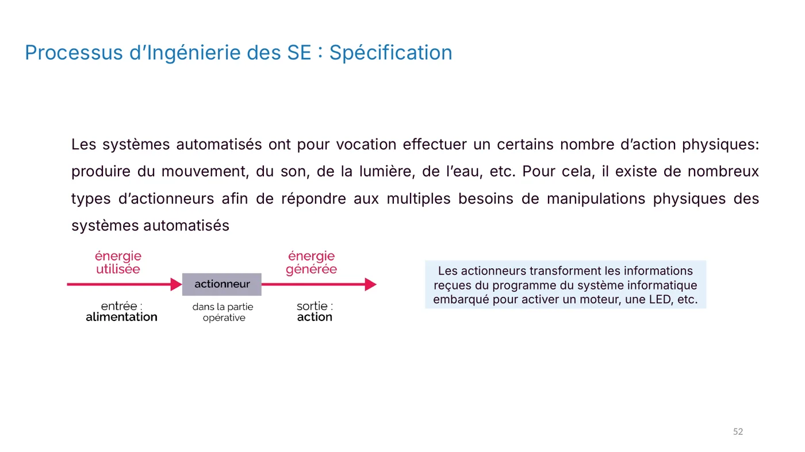
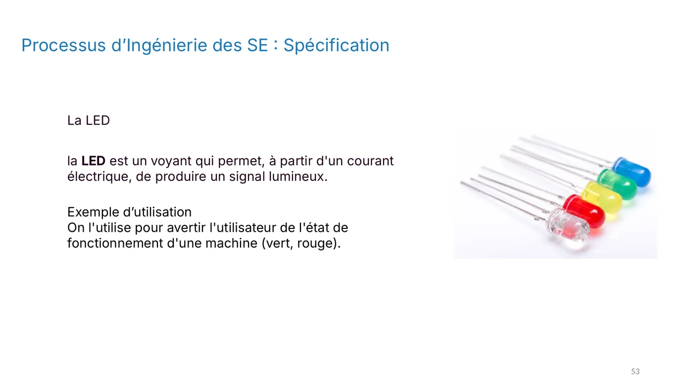
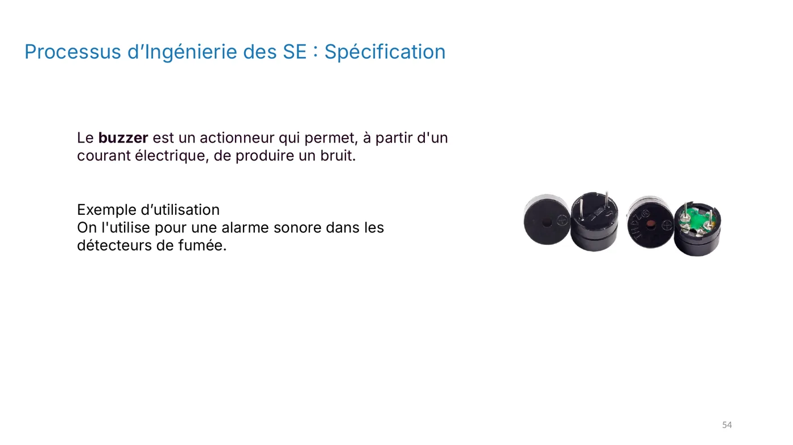
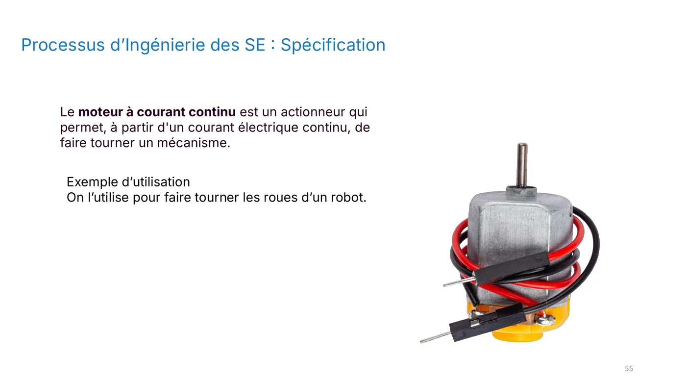
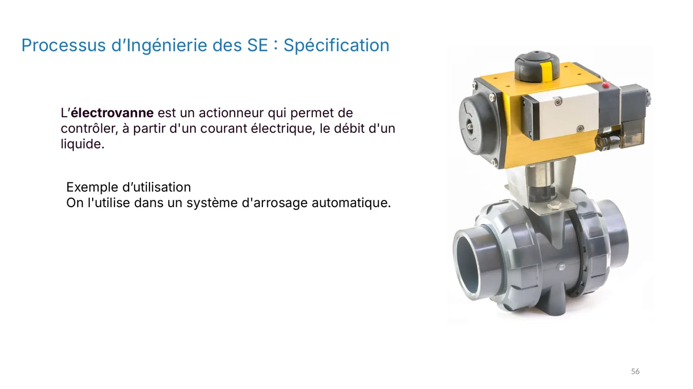

**Objectif :** distinguer un capteur d'un actionneur et comprendre la boucle entre les deux.

## Définitions

- **Capteur** : il mesure une grandeur physique (température, lumière, distance, mouvement) et la convertit en signal électrique. C'est la **transduction**.
- **Actionneur** : il reçoit un signal électrique et produit une action physique (mouvement, lumière, son, eau).

## La chaîne complète

```
Monde physique → Capteur → Conditionnement → Microcontrôleur → Interface de puissance → Actionneur
```

1. **Capteur** : transduction de la grandeur physique.
2. **Conditionnement** : amplification, filtrage, conversion analogique-numérique, ou bus I²C.
3. **Microcontrôleur** : lecture, décision, envoi des données.
4. **Interface de puissance** : transistor, relais ou pont en H (L298) pour alimenter un moteur.
5. **Actionneur** : moteur, servo, LED, buzzer.

L'action modifie la grandeur mesurée, qui est mesurée à nouveau. C'est une **boucle fermée**.

## Quelques capteurs

| Capteur | Mesure | Plage et précision |
|---|---|---|
| DS18B20 | Température (numérique) | −55 à 125 °C, ±0,5 °C |
| DHT22 | Température et humidité | −40 à 80 °C, ±0,5 °C |
| DHT11 | Température et humidité | 0 à 50 °C, ±2 °C |
| TMP36 | Température (analogique) | −40 à 125 °C, ±1 °C |
| Photorésistance (LDR) | Lumière | Sa résistance baisse quand la lumière augmente |
| BH1750 | Lumière ambiante (I²C) | Utilisé pour régler la luminosité des écrans |
| Capteur ultrason | Distance | Calcul à partir du temps d'écho (son à environ 340 m/s) |
| Bouton-poussoir | Tout ou rien | Gestion d'événements |

## Quelques actionneurs

- **LED** : signal lumineux (voyant d'état).
- **Buzzer** : signal sonore (alarme).
- **Moteur à courant continu** : fait tourner les roues d'un robot.
- **Électrovanne** : contrôle le débit d'un liquide (arrosage automatique).

## Comment choisir un capteur ?

Le choix dépend de la plage de mesure, de la précision, de la consommation, du coût et de l'interface. Les capteurs numériques sont en général plus précis et plus simples à utiliser que les analogiques. Les thermocouples servent aux températures très élevées.

:::tip[Exercice]
Tu dois mesurer la température et l'humidité d'une serre, avec une plage de 0 à 50 °C. Quel capteur choisis-tu, et pourquoi ?
:::

<details>
<summary>Voir une réponse possible</summary>

Le **DHT22** : il mesure à la fois la température et l'humidité, sur une plage qui couvre 0 à 50 °C, avec une précision de ±0,5 °C. Le DHT11 fonctionne aussi, mais sa précision est moins bonne (±2 °C).

</details>

## Pour vérifier ta compréhension

- Donne un exemple de capteur et un exemple d'actionneur dans une machine à laver.
- Pourquoi place-t-on un transistor ou un relais entre le microcontrôleur et un moteur ?

## Illustrations du cours






















:::note
Quand tu as répondu à ces questions, valide cette leçon en bas de page.
:::
