:::note[Objectifs de la leçon]
À la fin de cette leçon, tu seras capable de :
- distinguer un capteur d'un actionneur ;
- décrire les étapes entre la mesure et l'action ;
- choisir un capteur ou un actionneur adapté à un besoin.
:::

## Mesurer et agir

Un système embarqué n'a d'intérêt que parce qu'il est en contact avec le monde physique. Pour cela, il dispose de deux familles de composants.

- Un **capteur** mesure une grandeur physique (température, lumière, distance, mouvement) et la transforme en **signal électrique**. Ce passage s'appelle la **transduction**.
- Un **actionneur** fait l'inverse : il reçoit un signal électrique et produit une **action physique** (mouvement, lumière, son, eau).

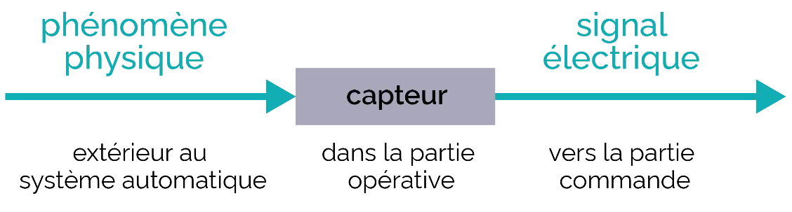

*Le capteur transforme un phénomène physique en signal électrique. L'actionneur transforme de l'énergie en action.*

:::danger[À retenir]
**Capteur** = il **mesure** (entrée du système). **Actionneur** = il **agit** (sortie du système).
:::

## La chaîne complète, du capteur à l'actionneur

Entre la mesure et l'action, le signal traverse plusieurs étapes.

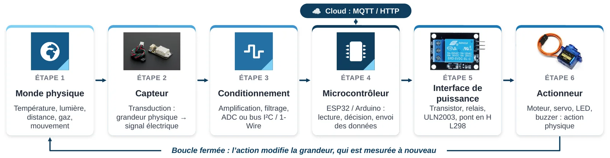

*La chaîne complète. Le cloud peut recevoir les données du microcontrôleur par MQTT ou HTTP.*

1. **Monde physique** : température, lumière, distance, gaz, mouvement.
2. **Capteur** : il transforme la grandeur physique en signal électrique.
3. **Conditionnement** : le signal est amplifié, filtré, puis converti en nombre (ADC) ou envoyé sur un bus comme l'I²C.
4. **Microcontrôleur** : il lit la valeur, décide, et envoie une commande.
5. **Interface de puissance** : une broche de microcontrôleur ne fournit que quelques milliampères. Pour alimenter un moteur, on utilise un transistor, un relais ou un pont en H.
6. **Actionneur** : moteur, servo, LED, buzzer.

:::note[Boucle fermée]
L'action modifie la grandeur mesurée, qui est mesurée à nouveau, et ainsi de suite. Un **thermostat** fonctionne ainsi : il mesure la température, chauffe, mesure à nouveau, et s'arrête quand la consigne est atteinte.
:::

## Les capteurs

Un capteur se choisit selon ce qu'il mesure, sa plage, sa précision et son interface électrique (numérique ou analogique). Les capteurs numériques sont en général plus précis et plus simples à utiliser que les analogiques.

**Capteurs de température**

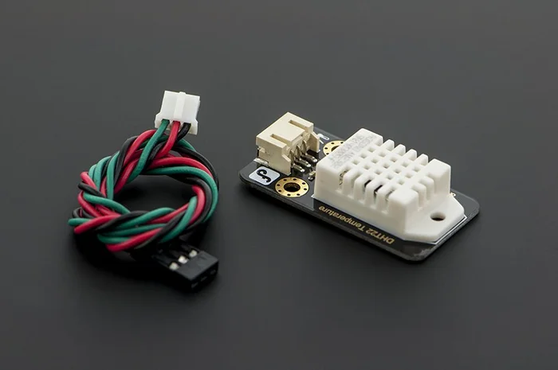
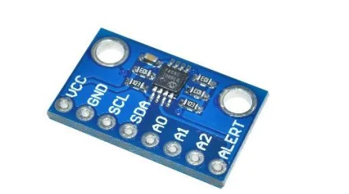
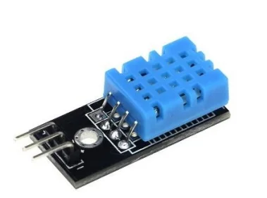
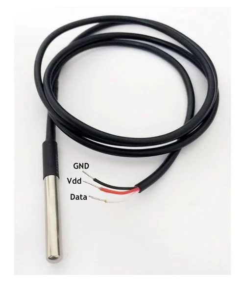

*DHT22, DHT11, TMP36 et DS18B20 : quatre capteurs de température, avec des plages et des précisions différentes.*

| Capteur | Mesure | Plage et précision |
|---|---|---|
| DS18B20 | Température (numérique) | −55 à 125 °C, ±0,5 °C |
| DHT22 | Température et humidité | −40 à 80 °C, ±0,5 °C |
| DHT11 | Température et humidité | 0 à 50 °C, ±2 °C |
| TMP36 | Température (analogique) | −40 à 125 °C, ±1 °C |

**Capteurs de lumière**

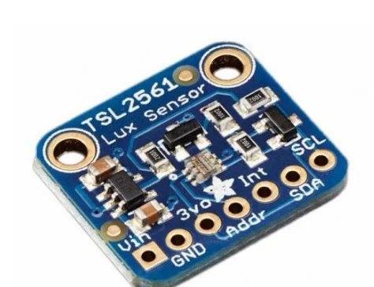
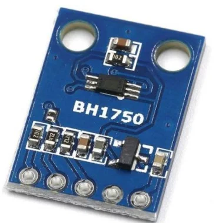

*Le TSL2561 et le BH1750 mesurent la lumière ambiante et communiquent avec l'Arduino par le bus I²C. On les retrouve dans les smartphones, qui ajustent la luminosité de l'écran.*

La **photorésistance (LDR)** est plus simple : sa résistance diminue quand la lumière augmente.

**Capteur de distance**

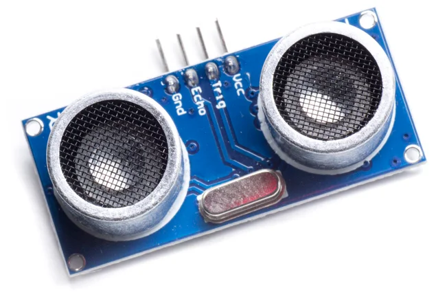

Le capteur à ultrasons contient un émetteur et un récepteur d'onde. Il émet un son, puis mesure le temps que met l'écho à revenir. Connaissant la vitesse du son (environ 340 m/s), il en déduit la distance. C'est ce qui permet à un robot aspirateur d'éviter les obstacles.

**Le plus simple des capteurs : le bouton-poussoir**

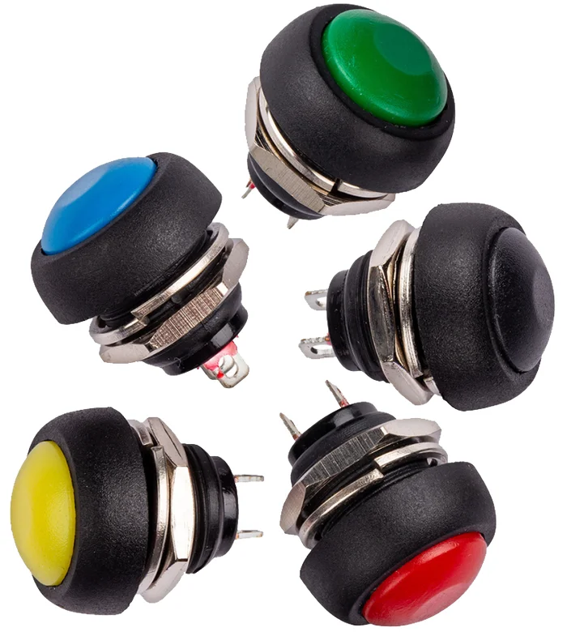

Le bouton-poussoir est un capteur **tout ou rien** : il n'a que deux états, appuyé ou relâché. Pourtant, il sert à déclencher des événements : par exemple, un piéton appuie sur le bouton d'un feu pour le faire passer au rouge.

**Autres capteurs rencontrés dans les exemples**

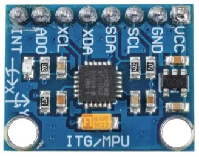
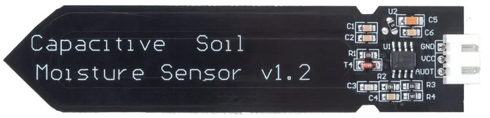

*Un accéléromètre (MPU-6050) pour les vibrations et un capteur d'humidité du sol pour l'agriculture.*

## Les actionneurs

Les actionneurs transforment les informations du programme en action physique. Leur nature dépend de ce que l'on veut produire.

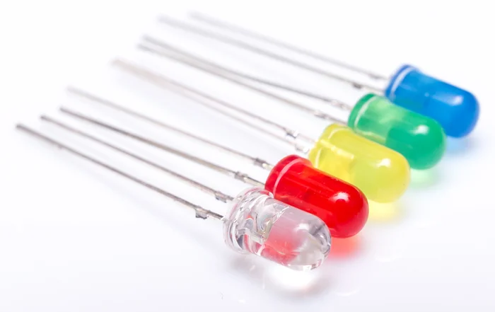
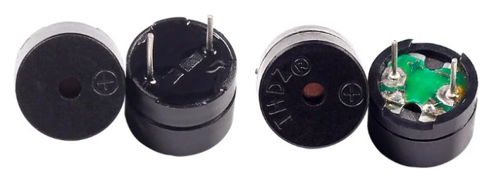
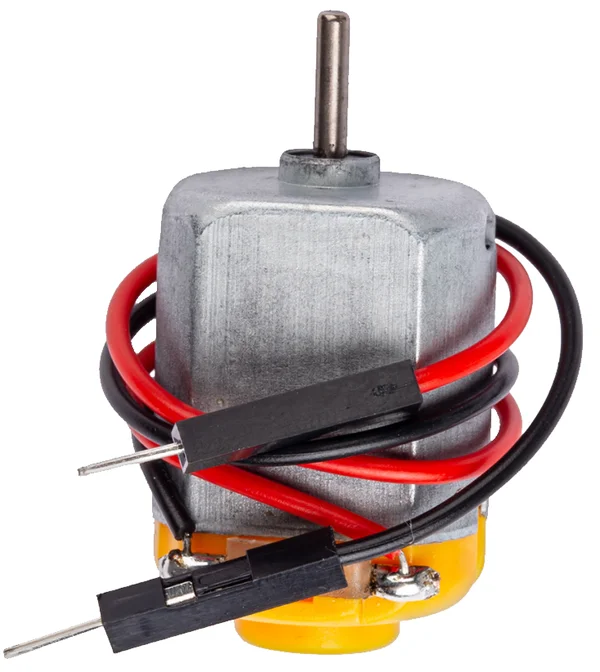
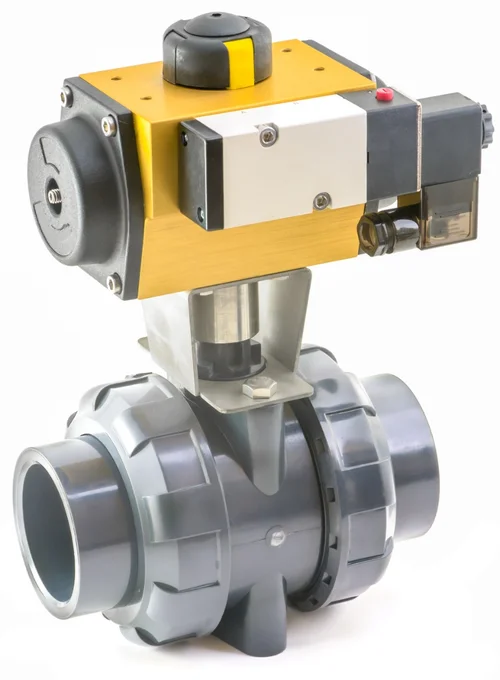

*LED, buzzer, moteur à courant continu et électrovanne.*

| Actionneur | Ce qu'il produit | Exemple d'usage |
|---|---|---|
| **LED** | De la lumière | Voyant vert ou rouge sur une machine |
| **Buzzer** | Un son | Alarme d'un détecteur de fumée |
| **Moteur à courant continu** | Une rotation | Roues d'un robot |
| **Électrovanne** | Le contrôle d'un débit de liquide | Arrosage automatique |

**Quand le courant du microcontrôleur ne suffit pas**

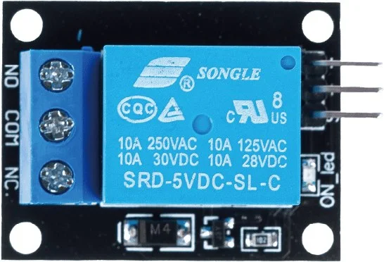
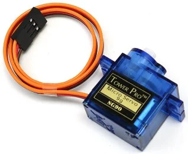
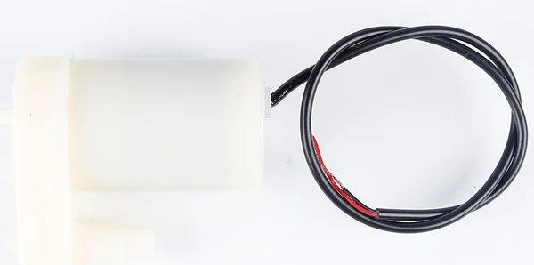

*Un relais, un servomoteur et une pompe : des composants qui ont besoin d'un peu plus que ce qu'une broche peut fournir.*

:::caution[Important]
Une broche de microcontrôleur ne délivre que **quelques milliampères**. Un moteur ou une pompe ne se branche **jamais directement** sur une broche : il faut une **interface de puissance** (transistor, relais ou pont en H).
:::

:::tip[À toi de jouer]
Tu dois mesurer la température et l'humidité d'une serre, avec une plage de 0 à 50 °C. Quel capteur choisis-tu, et pourquoi ?
:::

Voir une réponse possible

Le **DHT22** : il mesure à la fois la température et l'humidité, sur une plage qui couvre 0 à 50 °C, avec une précision de ±0,5 °C. Le DHT11 convient aussi, mais sa précision est moins bonne (±2 °C).

## Teste-toi

1. Donne un exemple de capteur et un exemple d'actionneur dans une machine à laver.
2. Pourquoi ne branche-t-on pas un moteur directement sur une broche du microcontrôleur ?
3. Que signifie « boucle fermée » ?

Voir les réponses

1. Capteur : le niveau d'eau ou la température. Actionneur : l'électrovanne de remplissage, le moteur du tambour ou la résistance de chauffe.
2. Parce qu'une broche fournit trop peu de courant. Il faut un transistor, un relais ou un pont en H.
3. L'action de l'actionneur modifie la grandeur mesurée par le capteur, qui est mesurée à nouveau : le système corrige en permanence.

:::note[Prochaine étape]
Quand tu as répondu aux questions, valide cette leçon en bas de page.
:::
