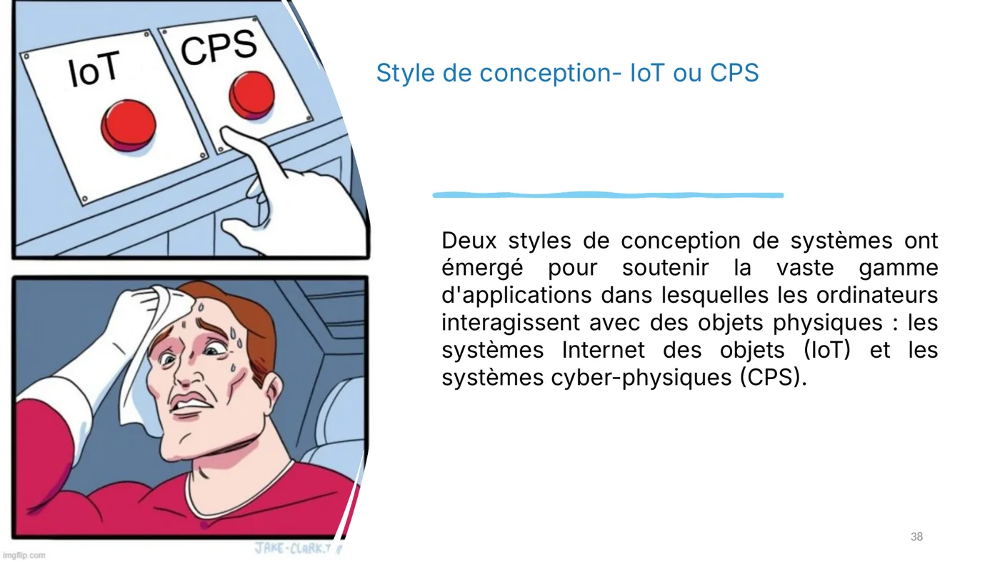
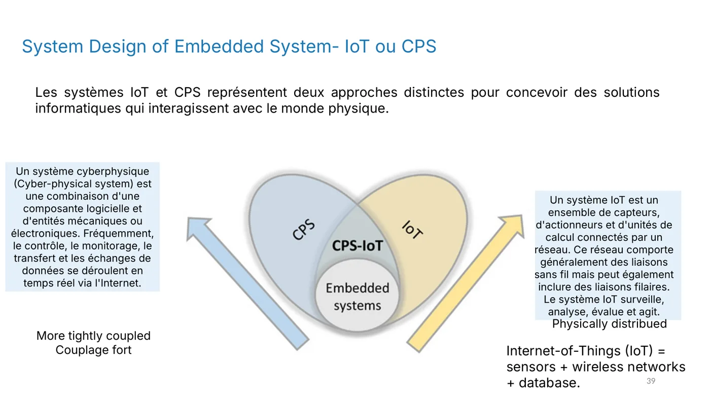
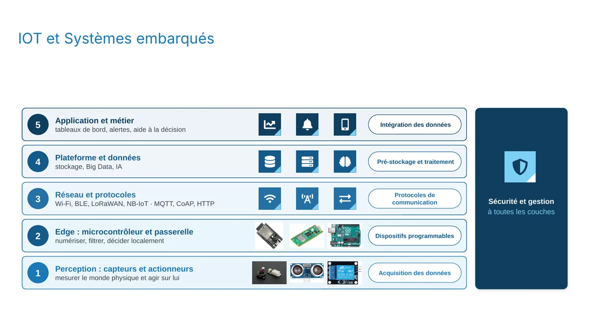
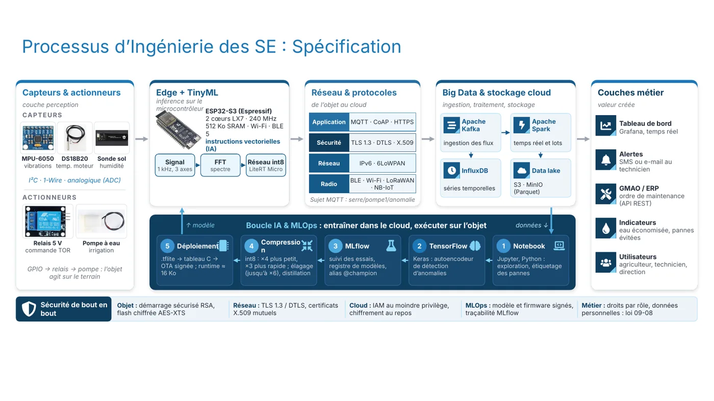
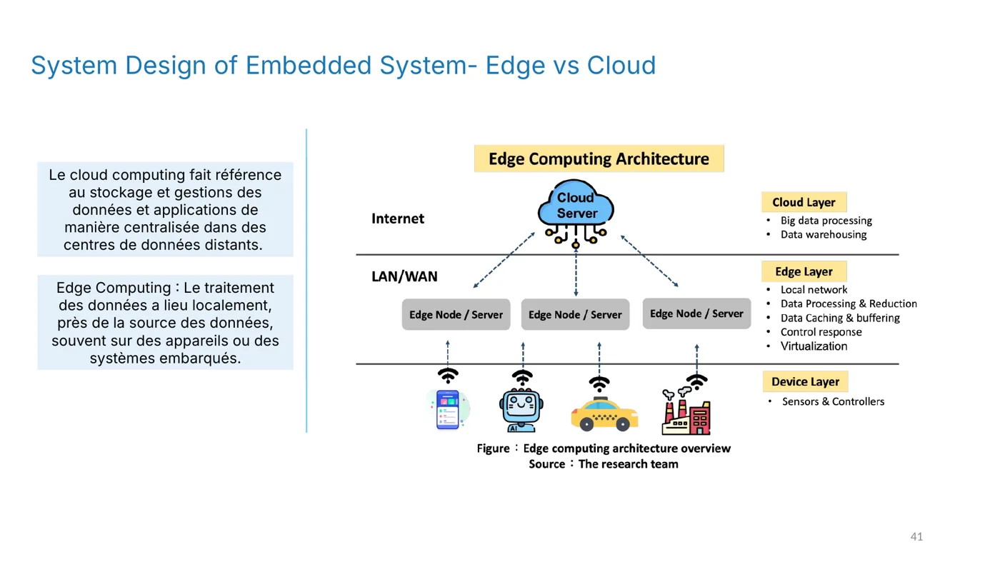
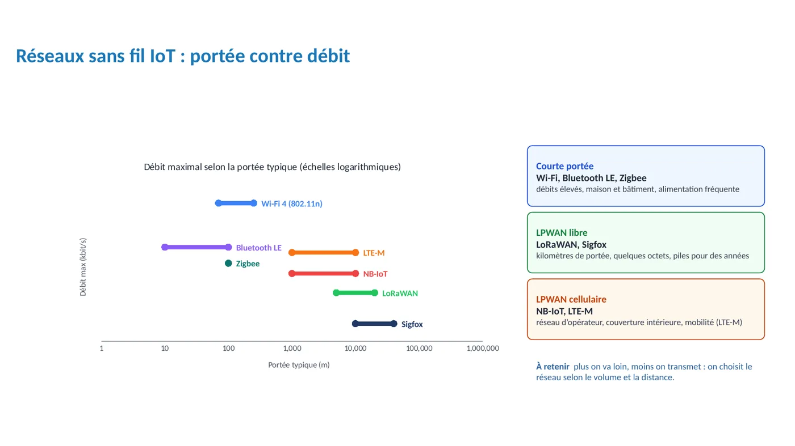
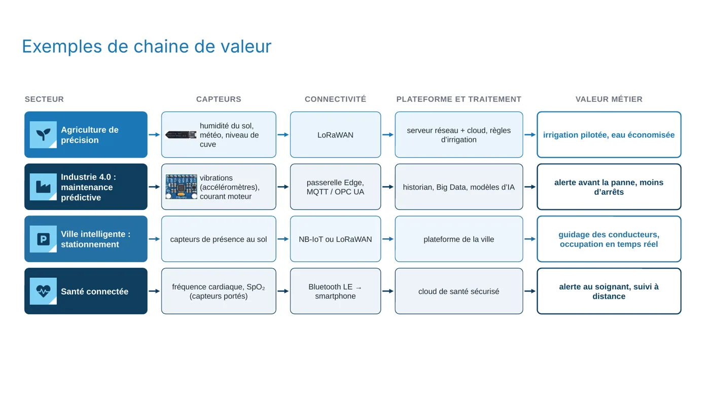
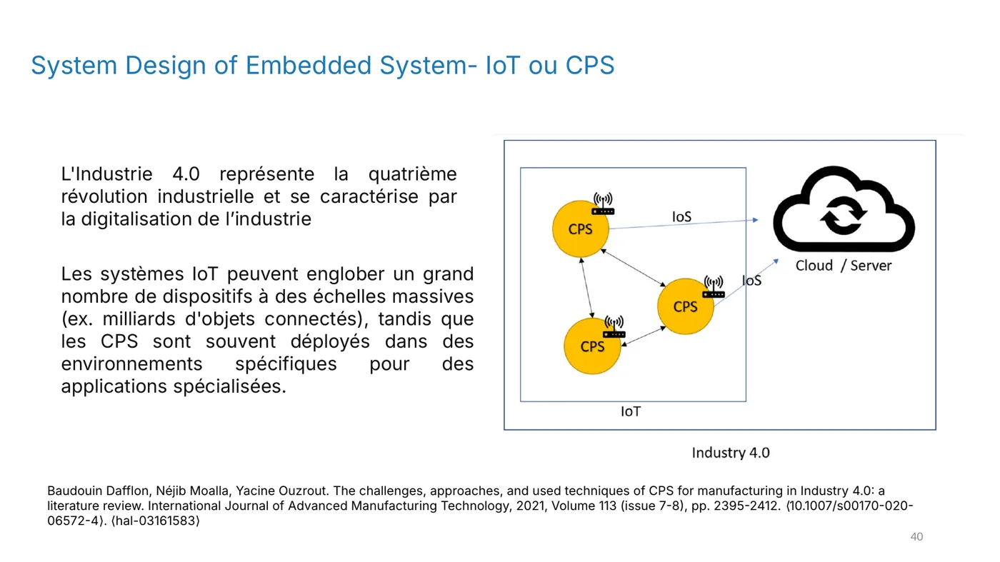
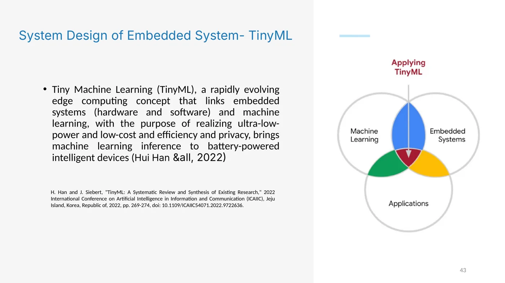

**Objectif :** situer un système embarqué dans une chaîne IoT, du capteur jusqu'au cloud, et comprendre pourquoi on ne fait pas tout dans le même endroit.

## Quand l'objet se connecte

Un système embarqué isolé ne sert qu'à celui qui le regarde. Dès qu'il envoie ses mesures sur un réseau, il devient un **objet connecté**, et l'ensemble prend le nom d'**IoT**, pour *Internet of Things*.

Il existe deux grandes façons de concevoir ces systèmes :

- Un **système IoT** est un ensemble de capteurs, d'actionneurs et de calcul reliés par un réseau, souvent sans fil. Il surveille, analyse, évalue et agit. Il peut regrouper des milliards d'objets.
- Un **système cyber-physique (CPS)** couple très fortement une partie logicielle et des éléments mécaniques ou électroniques, souvent en temps réel. Il est en général déployé dans un environnement précis, comme une usine.

*Diapositive 38 : les systèmes IoT et les systèmes cyber-physiques, deux façons de faire interagir les ordinateurs avec le monde physique.*

*Diapositive 39 : la différence de couplage entre IoT et CPS, illustrée par un diagramme.*

## Les cinq couches d'une chaîne IoT

Une chaîne IoT se découpe en couches. Chacune répond à une question différente : « que mesure-t-on ? », « où décide-t-on ? », « comment transporte-t-on ? », « où stocke-t-on ? », « qu'en fait-on ? ».

*Diapositive 20 : les cinq couches, de la perception jusqu'à l'application métier, avec la sécurité transversale.*

1. **Perception** : capteurs et actionneurs mesurent le monde physique et agissent sur lui.
2. **Edge** : le microcontrôleur et une éventuelle passerelle numérisent, filtrent et décident localement.
3. **Réseau et protocoles** : Wi-Fi, BLE, LoRaWAN ou NB-IoT pour transporter les données, avec les protocoles MQTT, CoAP ou HTTP.
4. **Plateforme et données** : stockage, traitement massif (Big Data) et intelligence artificielle.
5. **Application et métier** : tableaux de bord, alertes, aide à la décision.

La **sécurité** et la **gestion** concernent toutes les couches à la fois. Une donnée non protégée sur le réseau compromet tout le reste.

La diapositive suivante montre un exemple complet, de la carte électronique jusqu'au tableau de bord :

*Diapositive 22 : l'architecture complète, avec le capteur de vibrations, la passerelle, MQTT, le stockage et les tableaux de bord.*

## Edge ou cloud : où faire le calcul ?

Cette question revient dans presque chaque projet.

- Le **Edge** traite les données près de leur source, sur l'objet ou une passerelle. Il réagit vite, consomme peu de réseau et continue de fonctionner si la connexion coupe.
- Le **Cloud** centralise le stockage et le traitement dans des centres de données distants. Il offre une grande puissance d'analyse, mais dépend du réseau.

*Diapositive 41 : l'architecture Edge, où le traitement a lieu près des capteurs, et le cloud, où les données sont stockées et analysées.*

Un bon système combine les deux : l'objet décide localement, et le cloud analyse l'ensemble pour détecter des tendances.

## Choisir le réseau

Le réseau dépend surtout de deux critères : la distance et le volume de données. Plus un réseau porte loin, moins il transporte de données, et inversement.

*Diapositive 23 : les réseaux sans fil IoT, du Wi-Fi au NB-IoT, classés par portée et débit.*

| Famille | Exemples | Portée | Usage |
|---|---|---|---|
| Courte portée | Wi-Fi, Bluetooth LE, Zigbee | Quelques dizaines de mètres | Maison, bâtiment, débits élevés |
| LPWAN libre | LoRaWAN, Sigfox | Kilomètres, quelques octets | Capteurs sur pile qui durent des années |
| LPWAN cellulaire | NB-IoT, LTE-M | Réseau d'opérateur | Couverture intérieure, mobilité |

:::tip[À retenir]
Plus on va loin, moins on transmet. On choisit le réseau selon le volume de données et la distance.
:::

## Des exemples concrets

La chaîne de valeur change selon le secteur. La diapositive suivante en donne plusieurs exemples, de l'agriculture à la santé.

*Diapositive 21 : agriculture de précision, maintenance prédictive, ville intelligente et santé connectée.*

- **Agriculture de précision** : des capteurs d'humidité du sol envoient leurs mesures en LoRaWAN, et des règles d'irrigation ne déclenchent l'eau que si nécessaire. Résultat : de l'eau économisée.
- **Industrie 4.0** : des accéléromètres sur un moteur mesurent ses vibrations. Une passerelle Edge et un historien stockent les données, et des modèles d'IA annoncent une panne avant qu'elle n'arrive.
- **Ville intelligente** : des capteurs de présence au sol indiquent les places libres. Résultat : les conducteurs sont guidés en temps réel.
- **Santé connectée** : des capteurs portés mesurent la fréquence cardiaque, puis envoient les données au smartphone en Bluetooth LE. Un soignant est alerté si nécessaire.

*Diapositive 40 : l'industrie 4.0, où les systèmes cyber-physiques surveillent les machines en temps réel.*

## Pour aller plus loin : l'IA sur le microcontrôleur

Le **TinyML** consiste à exécuter un modèle d'intelligence artificielle directement sur un microcontrôleur, avec une consommation très faible. Le modèle est entraîné dans le cloud, puis compressé (par exemple en int8, environ quatre fois plus petit), et enfin déployé sur l'objet.

*Diapositive 43 : le TinyML relie systèmes embarqués et apprentissage automatique pour des appareils alimentés par batterie.*

## Pour vérifier ta compréhension

- Quelle couche de la chaîne IoT correspond à un tableau de bord ?
- Pourquoi un capteur de vibrations relié à une passerelle Edge est-il préférable à l'envoi brut de toutes les mesures vers le cloud ?
- Un capteur fonctionne sur pile pendant plusieurs années, à plusieurs kilomètres de la passerelle. Quelle famille de réseau choisis-tu ?

:::note
Quand tu as répondu à ces questions, valide cette leçon en bas de page.
:::
