**Objectif :** localiser le microcontrôleur, les broches numériques, analogiques et d'alimentation d'une Arduino UNO.

## Vue d'ensemble

L'Arduino UNO R3 est la carte de référence pour débuter. Elle repose sur un **ATmega328P**, un microcontrôleur 8 bits (fabriqué par Microchip) qui exécute le programme et gère les entrées-sorties.

| Caractéristique | Valeur |
|---|---|
| Microcontrôleur | ATmega328P, CPU jusqu'à 16 MHz |
| Mémoire | 32 Ko de Flash, 2 Ko de SRAM, 1 Ko d'EEPROM |
| Entrées-sorties numériques | 14, dont 6 PWM |
| Entrées analogiques | 6 (ADC 10 bits) |
| Communication | 1 UART, 1 I²C, 1 SPI |
| Tension des E/S | 5 V, 20 mA par broche |
| Alimentation | VIN 7 à 12 V (jack) ou USB 5 V |

**Points forts :** robuste, 5 V, immense écosystème de shields et de bibliothèques.
**Limites :** 2 Ko de RAM, pas de Wi-Fi ni de Bluetooth.

## Les broches numériques (0 à 13)

Chaque broche se configure en **entrée** (lire un bouton) ou en **sortie** (allumer une LED).

- **D0 et D1** : communication série UART (RX et TX). Elles peuvent aussi servir de broches numériques classiques.
- **D2 et D3** : interruptions externes.
- **D3, D5, D6, D9, D10, D11** : sorties PWM, avec la fonction `analogWrite()`.
- **D10 à D13** : bus SPI.
- **D13** : LED intégrée à la carte.

```cpp
void setup() {
  pinMode(8, OUTPUT);     // broche 8 configurée en sortie
}

void loop() {
  digitalWrite(8, HIGH);  // met la broche 8 à 5 V : la LED s'allume
}
```

## Les broches analogiques (A0 à A5)

Elles lisent une tension qui varie de façon continue, avec un convertisseur 10 bits : la valeur va de 0 à 1023. A4 et A5 servent au bus I²C.

La UNO R3 **n'a pas de sortie analogique** native : pour simuler une tension variable, on utilise la PWM.

```cpp
void setup() {
  Serial.begin(9600);     // communication série à 9600 bits/s
}

void loop() {
  int valeur = analogRead(A0);  // lit la tension sur A0 (0 à 1023)
  Serial.println(valeur);
  delay(300);
}
```

## Alimentation et masse

- **VIN** : alimentation externe, recommandée entre 7 et 12 V.
- **5 V** et **3,3 V** : sorties régulées pour alimenter les composants.
- **GND** : masse. Toutes les broches GND sont reliées entre elles.
- **Bouton RESET** : redémarre le microcontrôleur.

## Une LED ne se branche jamais seule

Une LED a deux bornes :

- l'**anode** (patte longue, +) se relie à la broche de sortie, **à travers une résistance** (par exemple 220 Ω) ;
- la **cathode** (patte courte, −) se relie à la masse (GND).

Sans résistance, le courant peut être trop fort et détruire la LED. Le courant doit circuler de l'anode vers la cathode pour que la LED s'allume.

:::tip[Pour retenir]
Broches numériques : signaux HAUT ou BAS. Broches analogiques : valeurs continues. Broches PWM : imitation d'une tension variable.
:::

## Pour vérifier ta compréhension

- Combien de broches d'entrées-sorties la UNO R3 possède-t-elle ? (Réponse : 20, soit 14 numériques et 6 analogiques, plus les broches d'alimentation.)
- Quelles broches permettent `analogWrite()` ?
- Pourquoi place-t-on une résistance en série avec une LED ?

## Illustrations du cours

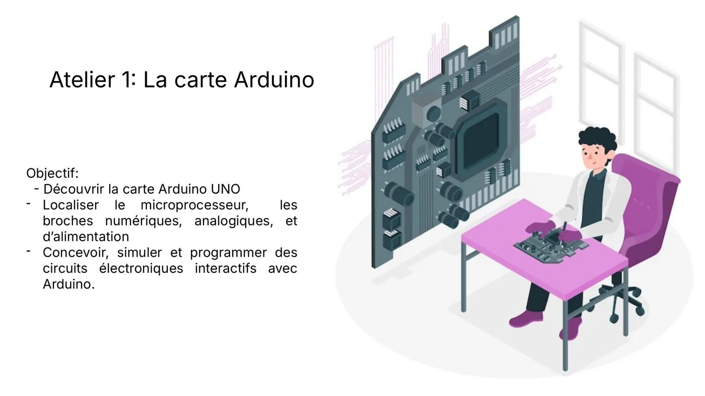

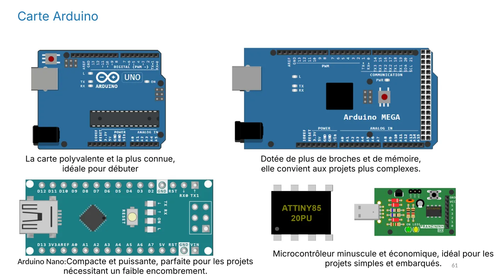

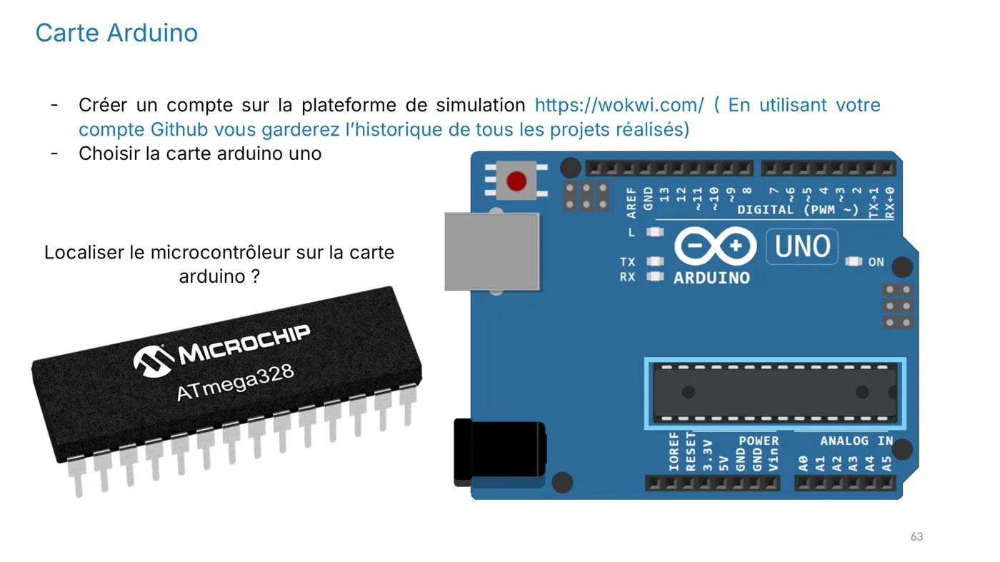

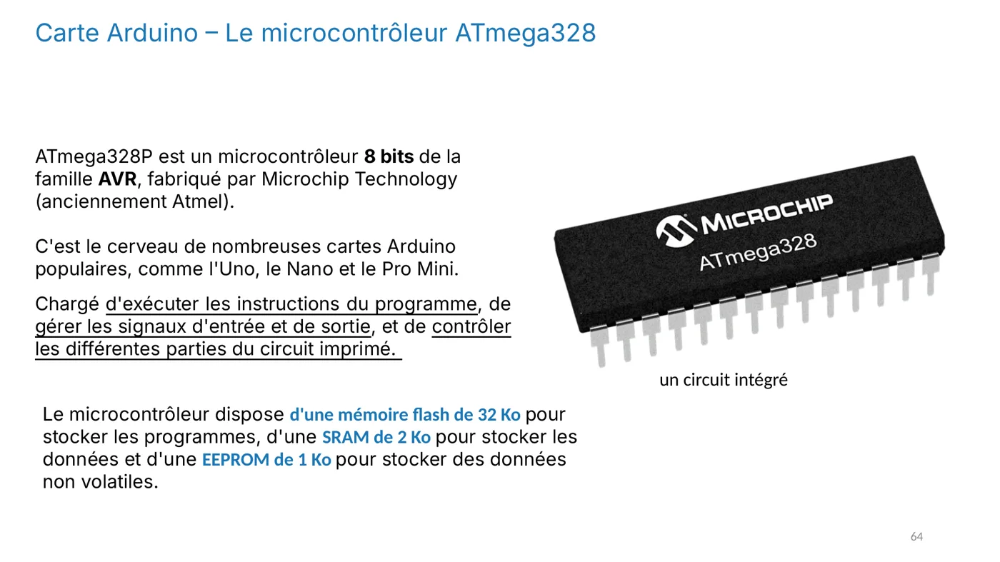

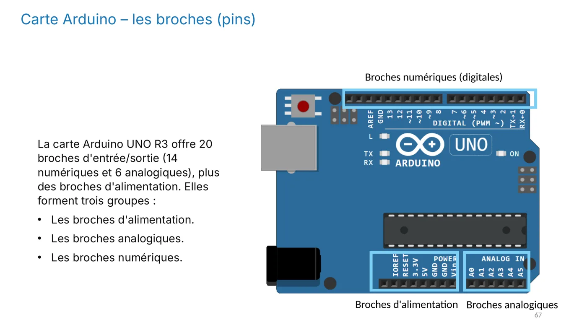

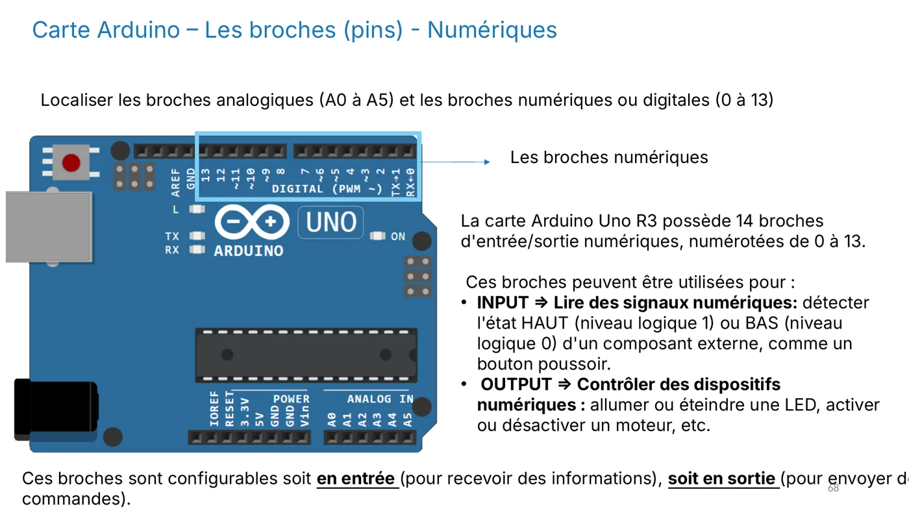

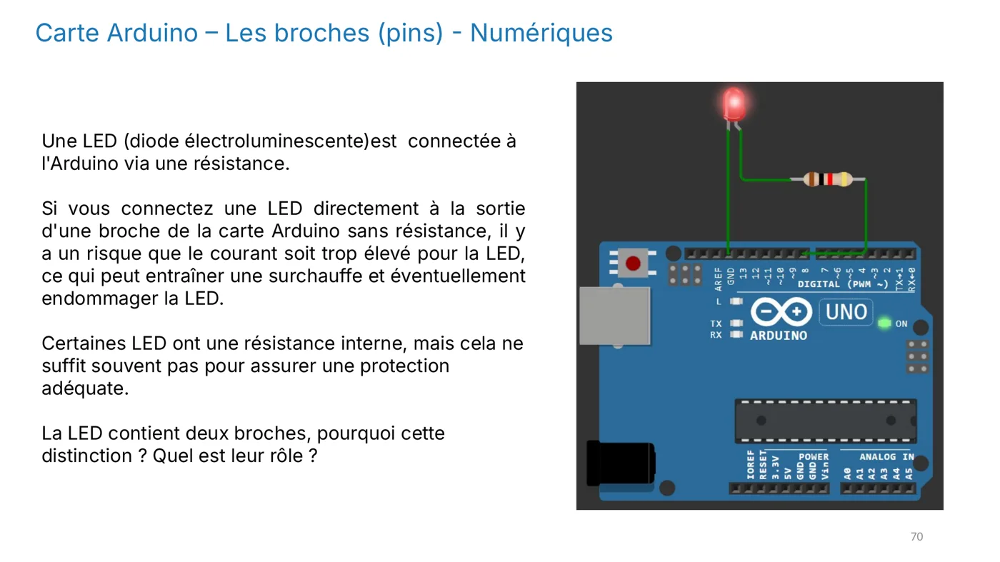

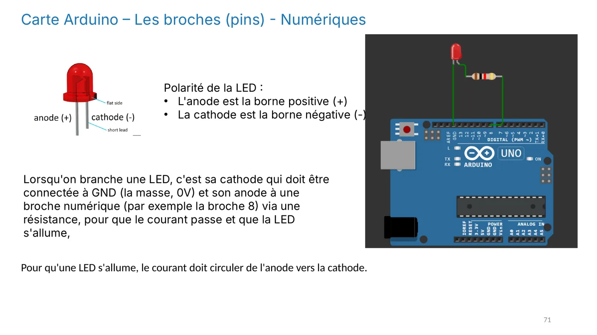

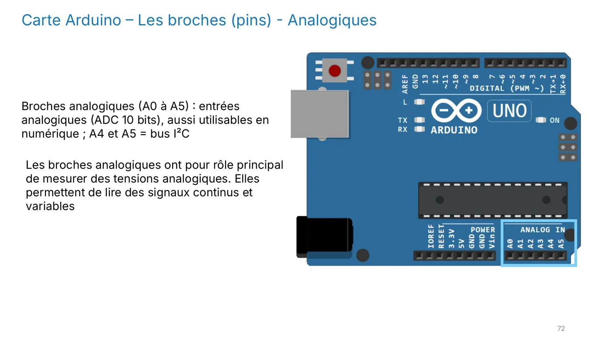

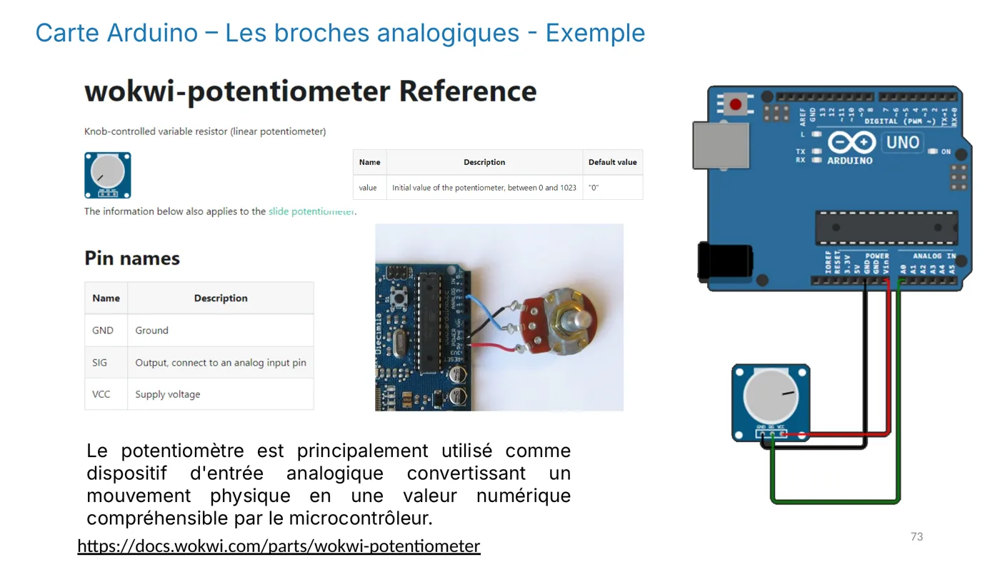

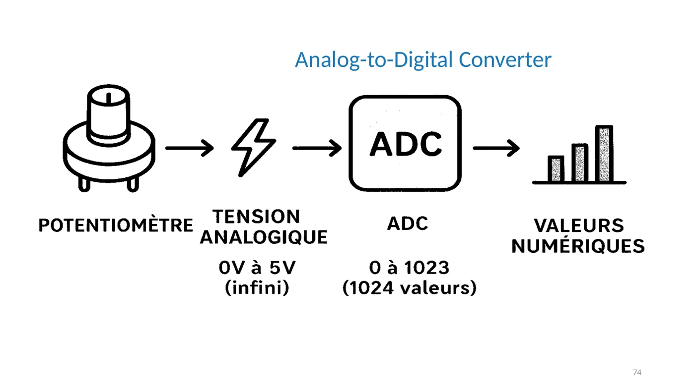

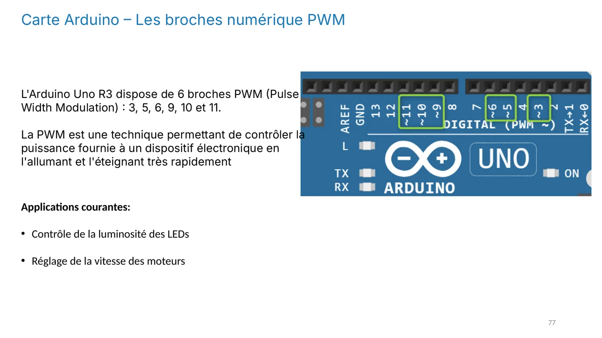

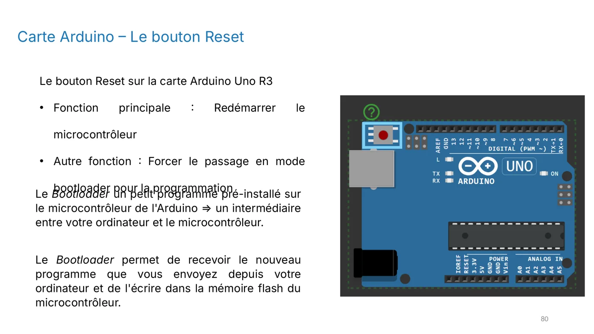

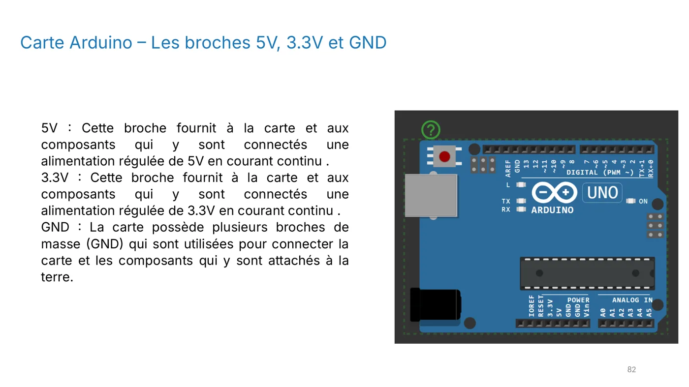

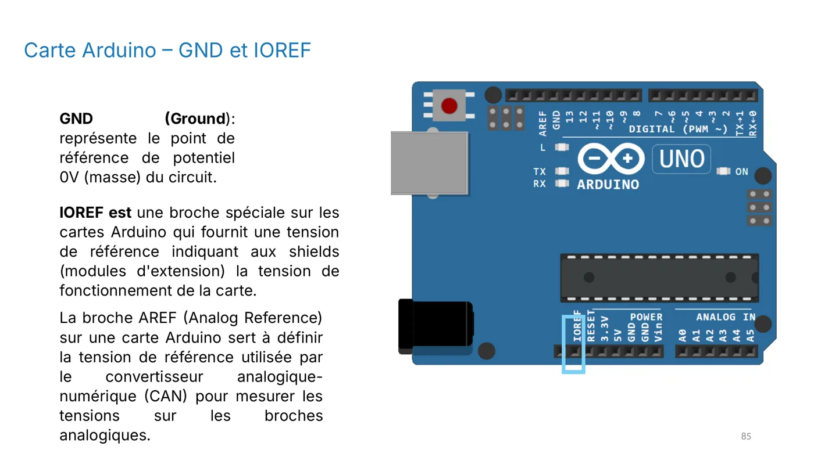


:::note
Quand tu as répondu à ces questions, valide cette leçon en bas de page.
:::
