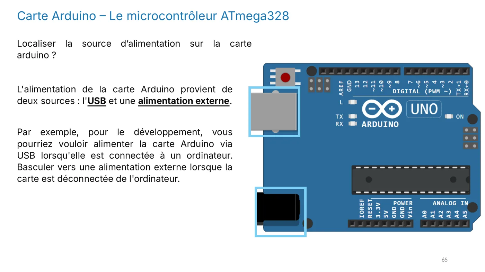

**Objectif :** savoir localiser le microcontrôleur, les broches numériques, analogiques et d'alimentation d'une Arduino UNO, et comprendre à quoi sert chacune.

## Une carte, un cerveau

L'Arduino UNO R3 est la carte de référence pour débuter. Son cœur est un **ATmega328P**, un microcontrôleur 8 bits fabriqué par Microchip. C'est lui qui exécute le programme et gère toutes les entrées-sorties.


*Diapositive 61 : la carte UNO est la plus connue, la Nano est plus compacte et le Mega dispose de plus de broches et de mémoire.*

Sur la carte, le microcontrôleur est le circuit intégré noir le plus visible, au centre.


*Diapositives 63 et 64 : le microcontrôleur ATmega328P, qui exécute le programme.*

Le ATmega328P possède 32 Ko de mémoire Flash pour le programme, 2 Ko de SRAM pour les variables et 1 Ko d'EEPROM pour les données qui doivent survivre à une coupure.

## Les caractéristiques à retenir

| Caractéristique | Valeur |
|---|---|
| Microcontrôleur | ATmega328P, CPU jusqu'à 16 MHz |
| Mémoire | 32 Ko de Flash, 2 Ko de SRAM, 1 Ko d'EEPROM |
| Entrées-sorties numériques | 14, dont 6 PWM |
| Entrées analogiques | 6 (ADC 10 bits) |
| Communication | 1 UART, 1 I²C, 1 SPI |
| Tension des E/S | 5 V, 20 mA par broche |
| Alimentation | VIN 7 à 12 V (jack) ou USB 5 V |

**Points forts :** robuste, fonctionne en 5 V, immense écosystème de shields et de bibliothèques.
**Limites :** 2 Ko de RAM, pas de Wi-Fi ni de Bluetooth.

## L'alimentation : deux sources possibles

La carte peut être alimentée par le **câble USB**, pendant le développement sur l'ordinateur, ou par une **alimentation externe** branchée sur le jack ou la broche VIN, quand elle fonctionne seule.



*Diapositive 65 : l'alimentation vient de l'USB ou d'une source externe.*

Les broches d'alimentation fournissent des tensions prêtes à l'emploi :

- **VIN** : entrée pour une alimentation externe, recommandée entre 7 et 12 V ;
- **5 V** et **3,3 V** : sorties régulées pour alimenter les composants ;
- **GND** : la masse, à 0 V. Toutes les broches GND sont reliées entre elles.


*Diapositive 82 : les broches 5 V, 3,3 V et GND.*

La broche **IOREF** indique aux shields la tension de fonctionnement de la carte, et **AREF** définit la tension de référence de la conversion analogique.


*Diapositive 85 : GND, IOREF et AREF.*

## Les broches numériques (0 à 13)

Une broche numérique ne connaît que deux états : **HAUT** (5 V, niveau logique 1) ou **BAS** (0 V, niveau logique 0). Elle se configure en **entrée** pour lire un bouton, ou en **sortie** pour allumer une LED.


*Diapositive 67 : la carte UNO compte 20 broches d'entrées-sorties (14 numériques et 6 analogiques), plus les broches d'alimentation.*


*Diapositive 68 : les broches numériques, configurables en entrée ou en sortie.*

Quelques broches ont des fonctions particulières :

- **D0 et D1** : communication série UART (RX et TX), utilisée aussi par le câble USB. Elles peuvent servir de broches classiques, mais il vaut mieux les réserver à la communication.
- **D2 et D3** : interruptions externes, pour réagir immédiatement à un événement.
- **D3, D5, D6, D9, D10 et D11** : sorties PWM, qui permettent de simuler une tension variable (voir la leçon 9).
- **D10 à D13** : bus SPI.
- **D13** : LED intégrée à la carte.

```cpp
void setup() {
  pinMode(8, OUTPUT);     // la broche 8 devient une sortie
}

void loop() {
  digitalWrite(8, HIGH);  // elle passe à 5 V : une LED branchée dessus s'allume
}
```

Une LED se branche toujours avec une **résistance** (par exemple 220 Ω) en série. L'**anode** (patte longue, +) va vers la broche de sortie, et la **cathode** (patte courte, −) vers la masse. Le courant doit circuler de l'anode vers la cathode pour que la LED s'allume.


*Diapositives 70 et 71 : une LED branchée sur une broche, et sa polarité. Sans résistance, le courant peut être trop fort et détruire la LED.*

## Les broches analogiques (A0 à A5)

Une entrée analogique lit une tension qui varie de façon continue. Le convertisseur 10 bits transforme cette tension en un nombre entre 0 et 1023. A4 et A5 servent aussi au bus I²C.


*Diapositive 72 : les broches analogiques, qui lisent des tensions continues.*

Le convertisseur fonctionne comme le montre ce schéma : une tension entre 0 et 5 V est transformée en une valeur numérique, qui peut ensuite être traitée par le programme.


*Diapositive 74 : le convertisseur analogique-numérique (ADC) transforme une tension en valeur numérique.*

Un potentiomètre permet de tester ce principe : en tournant le curseur, on modifie la tension lue sur A0.


*Diapositive 73 : le potentiomètre convertit un mouvement en tension, puis en valeur numérique.*

```cpp
void setup() {
  Serial.begin(9600);     // communication série à 9600 bits/s
}

void loop() {
  int valeur = analogRead(A0);   // lit la tension sur A0 : 0 à 1023
  Serial.println(valeur);
  delay(300);
}
```

La UNO R3 **n'a pas de sortie analogique native** : pour simuler une tension variable, on utilise la PWM, décrite dans la leçon 9.

## La PWM, une sortie qui imite une tension variable

Les broches 3, 5, 6, 9, 10 et 11 savent produire un signal **PWM** (modulation de largeur d'impulsion). Le signal alterne très vite entre HAUT et BAS, et c'est la proportion de temps à l'état HAUT, le **rapport cyclique**, qui détermine la puissance moyenne.


*Diapositive 77 : les six broches PWM de la carte UNO.*

## La broche RESET

Le bouton RESET redémarre le microcontrôleur. Il permet aussi de le forcer en mode **bootloader**, un petit programme préinstallé qui reçoit votre nouveau programme depuis l'ordinateur et l'écrit dans la mémoire Flash.


*Diapositive 80 : le bouton RESET de la carte UNO R3.*

## Pour vérifier ta compréhension

- Combien de broches d'entrées-sorties la UNO R3 possède-t-elle ? (Réponse : 20, soit 14 numériques et 6 analogiques, plus les broches d'alimentation.)
- Quelles broches permettent `analogWrite()` ?
- Pourquoi place-t-on une résistance en série avec une LED ?

:::note
Quand tu as répondu à ces questions, valide cette leçon en bas de page.
:::
