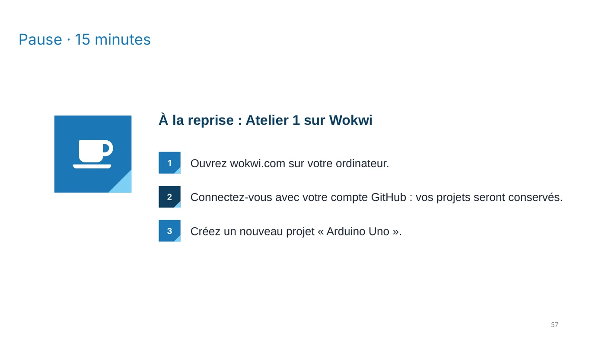
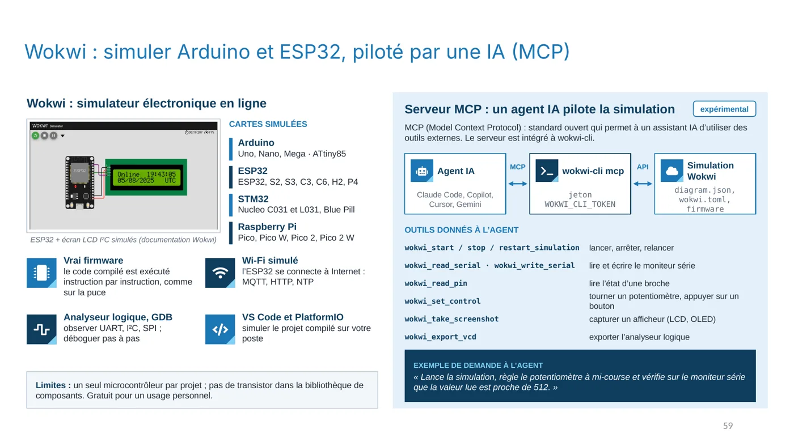
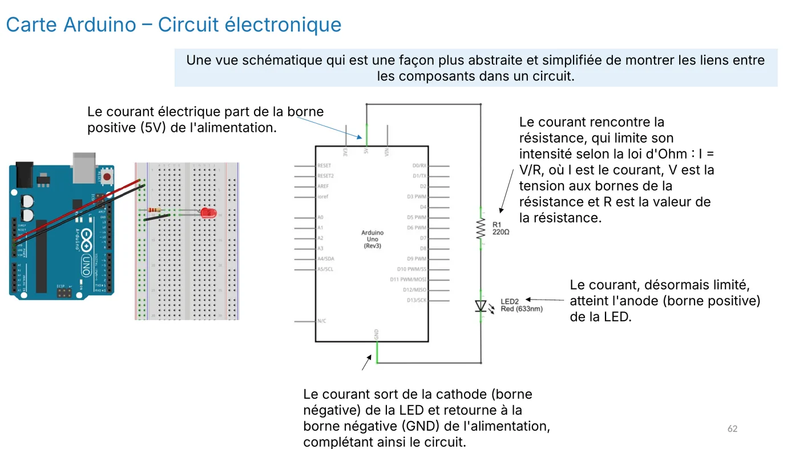
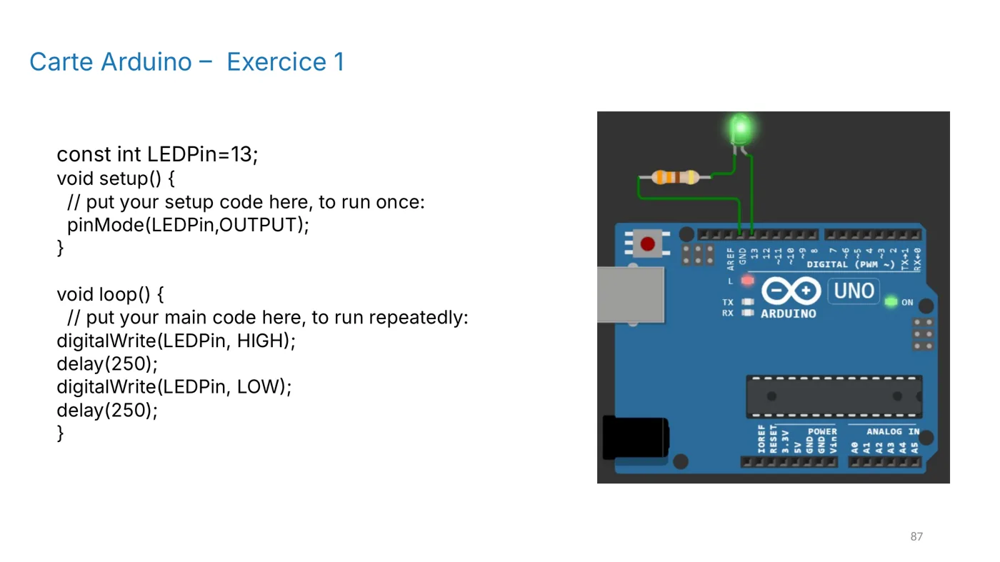
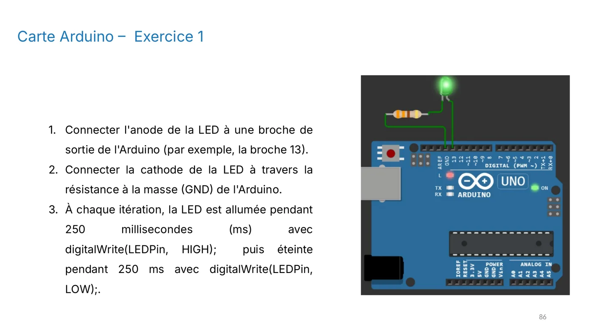

**Objectif :** concevoir, simuler et programmer un premier circuit avec une Arduino UNO, puis comprendre chaque ligne du programme.

## Pourquoi simuler ?

Avant de brancher un vrai circuit, on peut le simuler. Wokwi est un simulateur en ligne qui exécute le même programme que la vraie carte, instruction par instruction. Une erreur de câblage se corrige en un clic, sans risque de griller un composant.



*Diapositive 57 : pour commencer, ouvre wokwi.com, connecte-toi avec ton compte GitHub et crée un projet « Arduino Uno ». Ton travail sera conservé dans ton compte.*



*Diapositive 59 : l'interface de Wokwi, avec la carte, les composants et le moniteur série.*

## Le montage

Le montage est simple, mais il illustre une règle essentielle : une LED ne se branche jamais seule.

- Relie l'**anode** (patte longue) de la LED à la **broche 13**.
- Relie la **cathode** (patte courte) à la masse **GND**, à travers une **résistance de 220 Ω**.



*Diapositive 62 : le courant part de la broche 13, traverse la résistance puis la LED, et rejoint la masse.*

La résistance limite le courant. Selon la loi d'Ohm, I = U / R. Avec 5 V aux bornes de la résistance et une LED qui consomme environ 2 V, le courant est d'environ (5 − 2) / 220 ≈ 14 mA. Sans résistance, la LED recevrait un courant trop fort et pourrait être détruite.

## Le programme

Un programme Arduino a deux parties. La fonction `setup()` s'exécute une seule fois au démarrage. La fonction `loop()` se répète sans fin.

```cpp
const int LEDPin = 13;

void setup() {
  pinMode(LEDPin, OUTPUT);     // on configure la broche 13 en sortie
}

void loop() {
  digitalWrite(LEDPin, HIGH);  // la broche passe à 5 V : LED allumée
  delay(250);                  // on attend 250 ms
  digitalWrite(LEDPin, LOW);   // la broche passe à 0 V : LED éteinte
  delay(250);                  // on attend encore 250 ms
}
```

Le programme est le même que celui de la diapositive ci-dessous. Lance la simulation, puis observe la LED.



*Diapositive 87 : le code et la LED qui clignote dans la simulation.*

La diapositive 86 résume les étapes du câblage :



*Diapositive 86 : câblage de l'anode sur la broche 13, puis de la cathode vers GND à travers la résistance.*

## Questions

- Quelle est la durée d'un cycle complet (allumée puis éteinte) ? Réponse : 500 ms.
- Que se passe-t-il si tu remplaces `delay(250)` par `delay(50)` ? Le clignotement devient beaucoup plus rapide.
- Pourquoi la résistance de 220 Ω est-elle nécessaire ? (Indice : relis le calcul du courant ci-dessus.)

:::note
Quand la LED clignote comme prévu et que tu as répondu aux questions, valide cette leçon en bas de page.
:::
