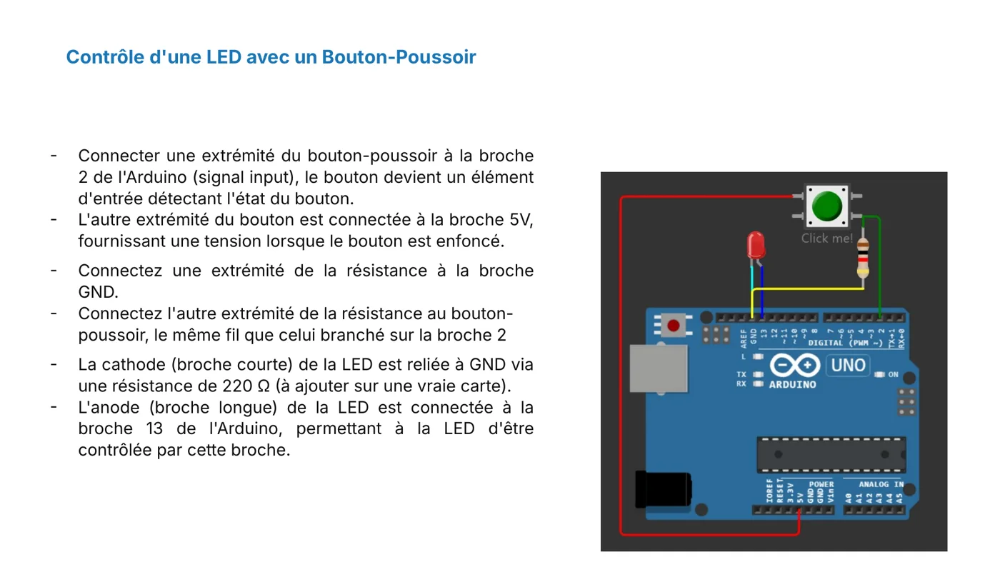
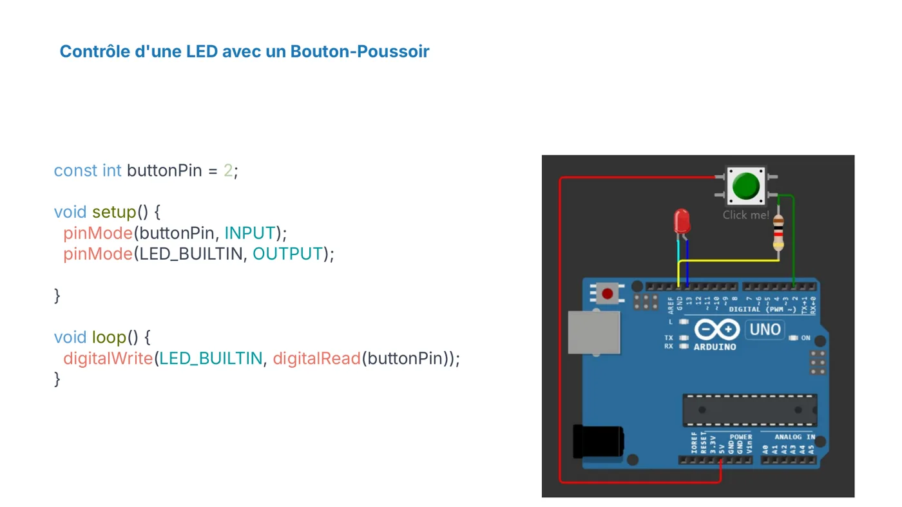

**Objectif :** utiliser une broche comme entrée numérique pour lire un bouton-poussoir.

## Le montage

- Une extrémité du **bouton-poussoir** est reliée à la **broche 2**.
- L'autre extrémité du bouton est reliée au **5 V**. Quand on appuie, la broche 2 reçoit 5 V.
- Une **résistance** relie la **broche 2** à la **masse GND**. Elle maintient la broche à 0 V quand le bouton est relâché.
- La **LED** reste branchée comme dans l'atelier précédent : anode sur la **broche 13**, cathode vers GND avec une résistance de 220 Ω.

:::tip[Pourquoi cette résistance ?]
Sans elle, la broche 2 n'est reliée à rien quand le bouton est relâché. Elle capte alors du bruit électrique et sa valeur devient imprévisible. La résistance fixe la valeur à LOW par défaut : on parle de résistance de **tirage bas** (pull-down).
:::

## Le programme

```cpp
const int buttonPin = 2;

void setup() {
  pinMode(buttonPin, INPUT);
  pinMode(LED_BUILTIN, OUTPUT);  // LED_BUILTIN correspond à la broche 13 sur la UNO
}

void loop() {
  digitalWrite(LED_BUILTIN, digitalRead(buttonPin));
}
```

Lance la simulation. Clique sur le bouton dans Wokwi et observe la LED.

## Questions

- Quelle valeur lit `digitalRead()` quand le bouton est appuyé ? Quand il est relâché ?
- Que se passe-t-il si tu retires la résistance ?
- Comment faire pour que la LED reste allumée après un appui ? (Indice : pense à une variable qui mémorise l'état.)

## Illustrations du cours






:::note
Quand le bouton allume la LED et que tu as répondu aux questions, valide cette leçon en bas de page.
:::
