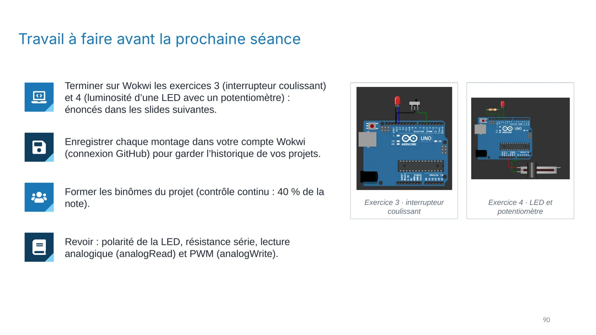
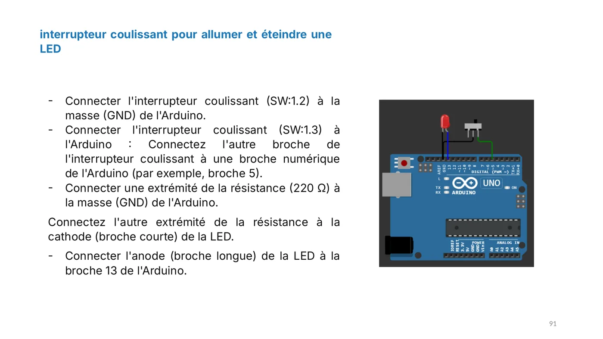
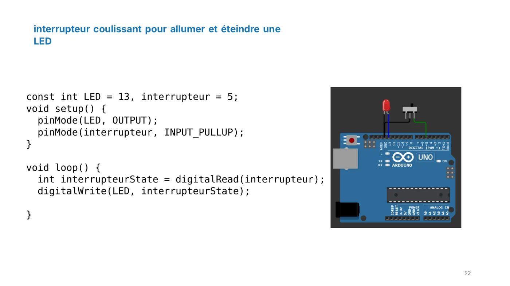
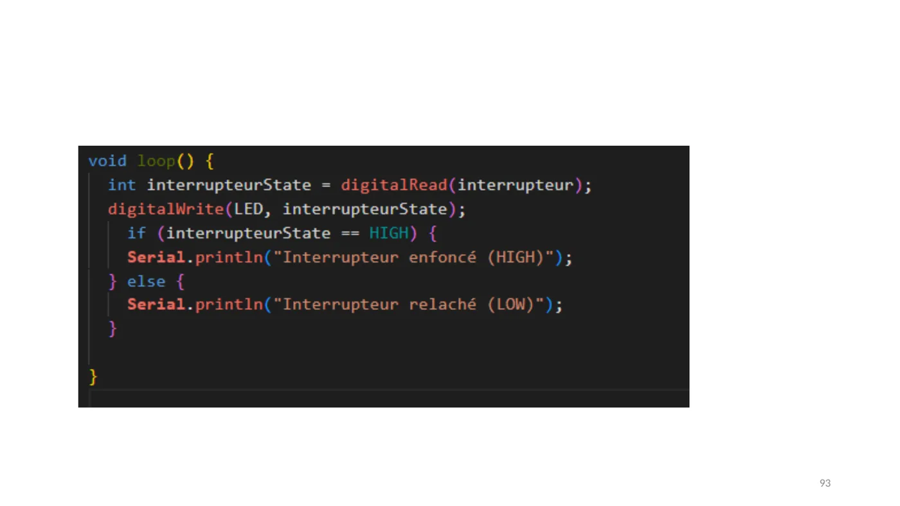

**Exercice à faire avant la séance suivante.**

**Objectif :** utiliser un interrupteur coulissant pour commander une LED.

## Le montage

- Une broche de l'**interrupteur coulissant** (SW:1.2) est reliée à la **masse GND**.
- L'autre broche (SW:1.3) est reliée à la **broche 5** de l'Arduino.
- La **LED** est branchée comme précédemment : anode sur la **broche 13**, cathode reliée à GND à travers une **résistance de 220 Ω**.

## Le programme

```cpp
const int LED = 13, interrupteur = 5;

void setup() {
  pinMode(LED, OUTPUT);
  pinMode(interrupteur, INPUT_PULLUP);  // résistance de tirage interne activée
}

void loop() {
  int interrupteurState = digitalRead(interrupteur);
  digitalWrite(LED, interrupteurState);
}
```

## Comprendre le tirage interne

`INPUT_PULLUP` active une résistance interne qui maintient la broche à **HAUT** (1) quand rien ne la relie à GND. Quand l'interrupteur relie la broche 5 à GND, elle lit **BAS** (0).

:::caution[À observer]
Avec ce programme, la LED s'allume quand l'interrupteur est **ouvert** et s'éteint quand il est **fermé** : la logique est inversée par rapport à ce qu'on attend souvent.

Question : comment modifier le programme pour que la LED s'allume quand l'interrupteur est fermé ?
:::

<details>
<summary>Voir une piste</summary>

Il suffit d'inverser la valeur lue : `digitalWrite(LED, !interrupteurState);`. Le symbole `!` signifie « non » : si la broche lit 0, la LED reçoit 1.

</details>

## Illustrations du cours










:::note
Quand la LED réagit à l'interrupteur et que tu as compris la logique inversée, valide cette leçon en bas de page.
:::
