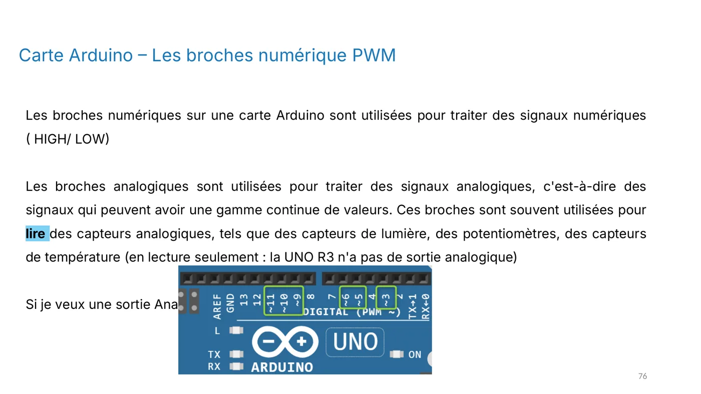
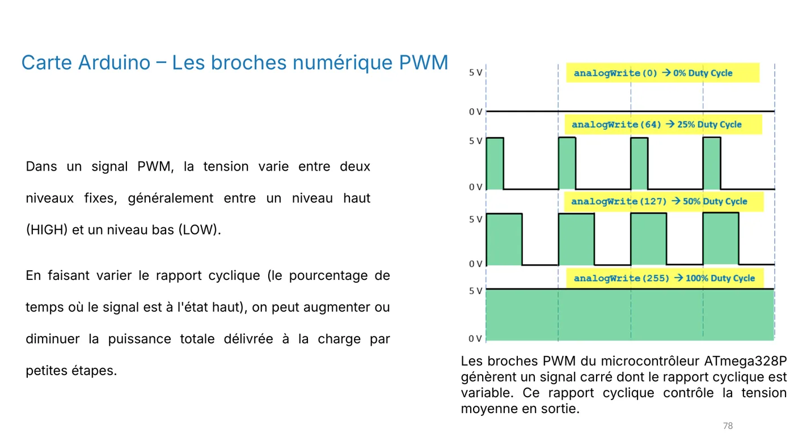
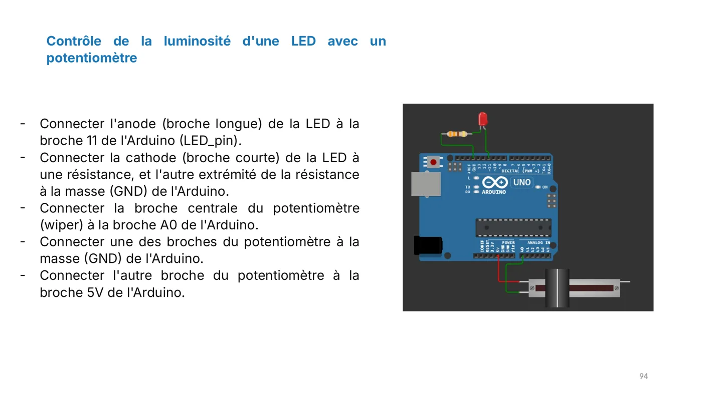
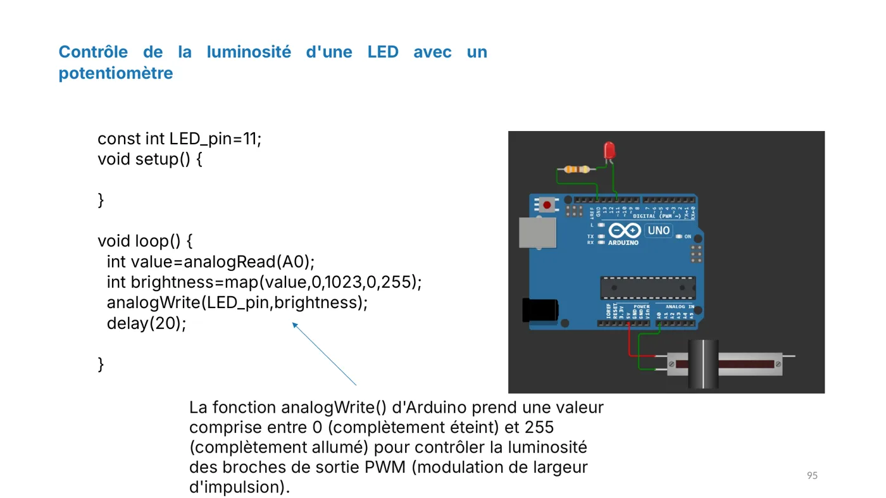

**Exercice à faire avant la séance suivante.**

**Objectif :** lire une valeur analogique avec un potentiomètre et l'utiliser pour régler la luminosité d'une LED en PWM.

## Le montage

- L'anode (patte longue) de la **LED** est reliée à la **broche 11**, une sortie PWM.
- La cathode (patte courte) est reliée à une **résistance**, puis à la **masse GND**.
- La broche centrale du **potentiomètre** (le curseur, ou wiper) est reliée à **A0**.
- Une des deux autres broches du potentiomètre est reliée à **GND**, l'autre au **5 V**.

## Le programme

```cpp
const int LED_pin = 11;

void setup() {
}

void loop() {
  int value = analogRead(A0);                 // valeur de 0 à 1023
  int brightness = map(value, 0, 1023, 0, 255); // convertie de 0 à 255
  analogWrite(LED_pin, brightness);           // luminosité en PWM
  delay(20);
}
```

## Ce qu'il faut comprendre

- `analogRead()` renvoie une valeur entre **0** et **1023** selon la position du curseur.
- `analogWrite()` attend une valeur entre **0** (éteinte) et **255** (allumée). Il faut donc convertir la première valeur dans la seconde : c'est le rôle de `map()`.
- `analogWrite()` ne fournit pas une vraie tension variable : il allume et éteint la broche très vite. C'est la **PWM**, dont le rapport cyclique règle la luminosité perçue.
- Seules certaines broches savent faire de la PWM sur la UNO : 3, 5, 6, 9, 10 et 11.

## Questions

- Que vaut `brightness` quand le curseur est à mi-course ?
- Que se passe-t-il si tu enlèves `delay(20)` ? Pourquoi ce délai peut-il être utile ?
- Pourquoi la broche 11 et non la broche 12 ?

## Illustrations du cours










:::note
Quand la luminosité de la LED varie avec le potentiomètre et que tu as répondu aux questions, valide cette leçon en bas de page.
:::
