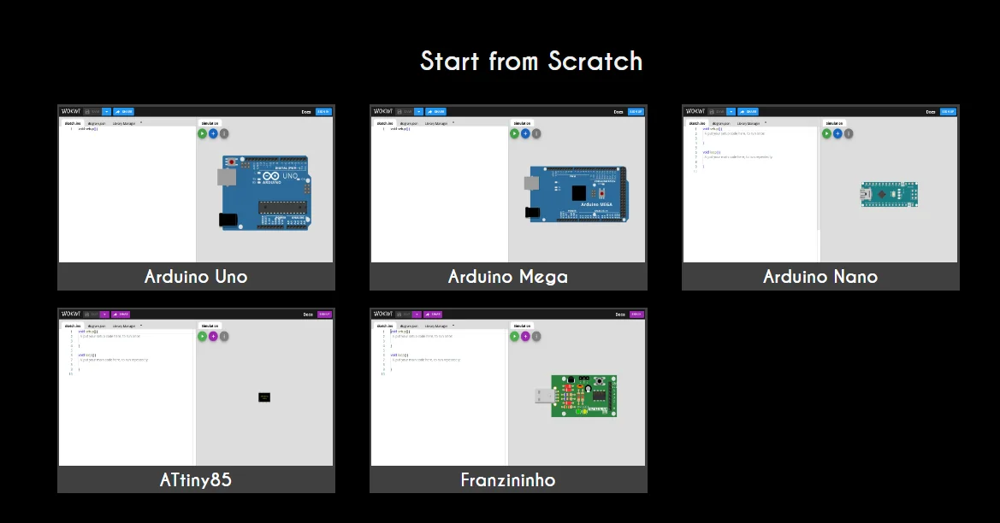

---
<<<<<<< HEAD
title: "TP1 — De la LED au contrôleur de température"
description: Présentation du TP1 — mise en situation, objectifs, onze exercices puis une partie sécurité, matériel, préparation de Wokwi et découverte de la carte Arduino UNO.
=======
title: "TP1 — Mise en route : entrées et sorties"
description: Présentation du TP1, préparation de l'environnement Wokwi et découverte de la carte Arduino UNO.
>>>>>>> 0bb7b8852d3da41e642573f946f09ed4ef5ee63f
---

import FicheTP from '../../../../../components/FicheTP.astro';
import ChaineInformation from '../../../../../components/ChaineInformation.astro';
import Question from '../../../../../components/Question.astro';

<FicheTP
<<<<<<< HEAD
	duree="15 h : exercices 1 à 5 (3 h), exercices 6 à 11 (6 h), partie sécurité (6 h)"
	modalite="Binôme"
	plateforme="Simulateur Wokwi, carte Arduino UNO"
	prerequis="Chapitre 1 (leçons 5 à 9) et leçons 1 et 2 du chapitre 2"
	livrables="Deux comptes rendus exportés (exercices 1 à 11, puis partie sécurité), liens Wokwi, programmes finaux"
=======
	duree="3 h (1 séance)"
	modalite="Binôme"
	plateforme="Simulateur Wokwi, carte Arduino UNO"
	prerequis="Chapitre 1 (leçons 5 à 9) et leçons 1 et 2 du chapitre 2"
	livrables="Compte rendu exporté, liens Wokwi des exercices 2 à 5 et du défi"
>>>>>>> 0bb7b8852d3da41e642573f946f09ed4ef5ee63f
/>

## Mise en situation

<<<<<<< HEAD
Vous rejoignez le bureau d'études d'une PME qui conçoit des **boîtiers de surveillance pour armoires électriques**. Les appareillages de ces armoires sont généralement prévus pour une température ambiante d'**au plus 40 °C**, et de 35 °C en moyenne sur 24 heures. Au-delà, ils vieillissent vite ou se déclenchent intempestivement.

Aujourd'hui, un agent relève un thermomètre à la main lors de ses rondes. Le client veut un **contrôleur de température automatique** qui :

- signale en permanence la **zone thermique** par un voyant de couleur : **bleu** quand il fait trop froid, **vert** quand la température est normale, **rouge** quand elle devient élevée ;
- affiche la **température** et l'**humidité** sur un petit écran ;
- **alerte les agents par un signal sonore** quand le seuil critique de 40 °C est dépassé.

Arduino est la plateforme de prototypage retenue. Une carte Arduino associe un **microcontrôleur** et un **circuit imprimé** qui l'alimente, donne accès à ses entrées-sorties et le relie à l'ordinateur par USB. Vous la programmerez en langage C/C++ et la simulerez avec **Wokwi**.

## Le déroulement du TP

Le TP suit la démarche du bureau d'études, en trois temps. Chaque exercice a sa propre page.

1. **Exercices 1 à 5 · Prise en main** : vous maîtrisez les briques de base de l'interface homme-machine, c'est-à-dire les voyants, les boutons, les interrupteurs, le réglage analogique et la liaison série.
2. **Exercices 6 à 11 · Le contrôleur de température** : vous ajoutez une fonction à chaque exercice (capteur, voyant de couleur, écran, avertisseur sonore, choix de l'unité). L'exercice 11 aboutit au **programme final** du contrôleur.
3. **Partie sécurité**, en dernier : vous **refaites la manipulation finale** de l'exercice 11 en y intégrant les aspects de sécurité importants.

=======
Vous rejoignez le bureau d'études d'une PME qui conçoit des **boîtiers de surveillance pour armoires électriques**. Avant de développer le produit (TP2) puis de le sécuriser (TP3), l'équipe vous confie la prise en main des briques de base de son interface homme-machine : **voyants, boutons, interrupteurs, réglage analogique** et **liaison série de diagnostic**.

Arduino est la plateforme de prototypage retenue. Une carte Arduino associe un **microcontrôleur** et un **circuit imprimé** qui l'alimente, donne accès à ses entrées-sorties et le relie à l'ordinateur par USB. Vous la programmerez en langage C/C++ et la simulerez avec **Wokwi**.

>>>>>>> 0bb7b8852d3da41e642573f946f09ed4ef5ee63f
## Objectifs

À l'issue de ce TP, vous serez capables de :

<ol class="objectifs-liste">
	<li><strong>Identifier</strong> les broches de la carte UNO et leur rôle : numériques, PWM, analogiques, alimentation.</li>
	<li><strong>Piloter</strong> une sortie numérique et <strong>dimensionner</strong> la résistance de protection d'une LED.</li>
	<li><strong>Lire</strong> une entrée numérique avec une résistance de tirage et <strong>filtrer</strong> les rebonds d'un bouton.</li>
	<li><strong>Convertir</strong> une tension analogique et <strong>commander</strong> une sortie PWM.</li>
<<<<<<< HEAD
	<li><strong>Acquérir</strong> une température et une humidité avec un capteur numérique et une bibliothèque.</li>
	<li><strong>Construire</strong> une interface homme-machine : LED RVB, écran LCD sur bus I²C, buzzer.</li>
	<li><strong>Structurer</strong> un programme non bloquant et le <strong>tester</strong> aux valeurs limites.</li>
	<li><strong>Sécuriser</strong> le contrôleur (partie sécurité) : analyser les risques, puis le rendre robuste face aux pannes et aux attaques.</li>
=======
	<li><strong>Diagnostiquer</strong> un programme grâce à la liaison série.</li>
	<li><strong>Appliquer</strong> le principe de sécurité positive à une entrée et à une commande.</li>
>>>>>>> 0bb7b8852d3da41e642573f946f09ed4ef5ee63f
</ol>

## Le système étudié

<ChaineInformation
<<<<<<< HEAD
	acquerir={['Capteur DHT22 : température et humidité (D2)', 'Bouton-poussoir (D6)', 'Interrupteur °C / °F (D7)']}
	traiter={['Microcontrôleur ATmega328P', 'Mesure toutes les 2 s', 'Comparaison aux seuils']}
	agir={['LED RVB (D11, D5, D3)', 'Écran LCD 16×2 I²C (A4, A5)', 'Buzzer (D8)', 'Moniteur série (USB)']}
	legende="Chaîne d'information du contrôleur de température, aboutissement de l'exercice 11. Les exercices 1 à 5 en construisent les briques de base."
/>

## Organisation du TP

### Exercices 1 à 5 · Prise en main (3 h)

| Exercice | Contenu | Durée indicative |
|---|---|---|
| Présentation | Préparation de Wokwi, découverte de la carte | 30 min |
| [1. LED intégrée](/Embedded-System-Course/parcours/chapitre-2/tp1/ex01-led-integree/) | Premier programme, sortie numérique | 20 min |
| [2. Clignotement](/Embedded-System-Course/parcours/chapitre-2/tp1/ex02-clignotement/) | LED externe, résistance, `delay()` puis `millis()` | 30 min |
| [3. Bouton-poussoir](/Embedded-System-Course/parcours/chapitre-2/tp1/ex03-bouton-poussoir/) | Entrée numérique, résistance de tirage, rebonds | 40 min |
| [4. Interrupteur et liaison série](/Embedded-System-Course/parcours/chapitre-2/tp1/ex04-interrupteur-serie/) | Tirage interne, moniteur série | 30 min |
| [5. Potentiomètre et PWM](/Embedded-System-Course/parcours/chapitre-2/tp1/ex05-potentiometre-pwm/) | Conversion analogique-numérique, PWM | 30 min |

### Exercices 6 à 11 · Le contrôleur de température (6 h)

| Exercice | Contenu | Durée indicative |
|---|---|---|
| [6. Capteur DHT22](/Embedded-System-Course/parcours/chapitre-2/tp1/ex06-capteur-dht22/) | Cahier des charges, acquisition de la température et de l'humidité | 1 h |
| [7. LED RVB](/Embedded-System-Course/parcours/chapitre-2/tp1/ex07-led-rvb/) | Plaque de prototypage, LED RVB à anode commune | 45 min |
| [8. Couleur selon la température](/Embedded-System-Course/parcours/chapitre-2/tp1/ex08-couleur-temperature/) | Zones thermiques, valeurs limites | 45 min |
| [9. Bouton et écran LCD](/Embedded-System-Course/parcours/chapitre-2/tp1/ex09-bouton-lcd/) | Affichage à la demande sur un écran I²C | 1 h 15 |
| [10. Avertisseur sonore](/Embedded-System-Course/parcours/chapitre-2/tp1/ex10-avertisseur-sonore/) | Buzzer au-delà de 40 °C, surveillance continue | 45 min |
| [11. Unités et programme final](/Embedded-System-Course/parcours/chapitre-2/tp1/ex11-unites-programme-final/) | °C ou °F, programme final du contrôleur, tests | 1 h 30 |

### Partie sécurité (6 h)

| Partie | Contenu | Durée indicative |
|---|---|---|
| [Partie sécurité](/Embedded-System-Course/parcours/chapitre-2/tp1/securite/01-consignes/) | Refaire la manipulation finale de l'exercice 11 en intégrant les aspects de sécurité : mise à l'épreuve, analyse de risques, sûreté de fonctionnement, cybersécurité, données et recette | 6 h |

## Matériel

| Composant | Quantité | Référence dans Wokwi | Exercices |
|---|---|---|---|
| Carte Arduino UNO | 1 | `wokwi-arduino-uno` | tous |
| Plaque de prototypage | 1 | `wokwi-breadboard` | 7 à 11 |
| LED rouge | 1 | `wokwi-led` | 2 à 5 |
| Résistances 220 Ω | 3 | `wokwi-resistor` | 2 à 5 (une), 7 à 11 (trois) |
| Résistance 10 kΩ | 1 | `wokwi-resistor` | 3 |
| Bouton-poussoir | 1 | `wokwi-pushbutton` | 3, 9 à 11 |
| Interrupteur coulissant | 1 | `wokwi-slide-switch` | 4, 11 |
| Potentiomètre | 1 | `wokwi-potentiometer` ou `wokwi-slide-potentiometer` | 5 |
| Capteur de température et d'humidité DHT22 | 1 | `wokwi-dht22` | 6 à 11 |
| LED RVB (anode commune) | 1 | `wokwi-rgb-led` | 7 à 11 |
| Écran LCD 16×2 avec interface I²C | 1 | `wokwi-lcd1602`, attribut `pins` réglé sur `i2c` | 9 à 11 |
| Buzzer | 1 | `wokwi-buzzer` | 10, 11 |
| Fils de connexion | — | — | tous |
=======
	acquerir={['Bouton-poussoir (D2)', 'Interrupteur coulissant (D5)', 'Potentiomètre (A0)']}
	traiter={['Microcontrôleur ATmega328P', 'Programme : setup() puis loop()']}
	agir={['LED intégrée « L » (D13)', 'LED externe (D13 puis D11 en PWM)', 'Moniteur série (USB)']}
	legende="Chaîne d'information du TP1 : chaque exercice ajoute un maillon."
/>

## Matériel

| Composant | Quantité | Référence dans Wokwi | Rôle |
|---|---|---|---|
| Carte Arduino UNO | 1 | `wokwi-arduino-uno` | Unité de traitement |
| LED rouge | 1 | `wokwi-led` | Voyant (actionneur) |
| Résistance 220 Ω | 1 | `wokwi-resistor` | Limite le courant de la LED |
| Résistance 10 kΩ | 1 | `wokwi-resistor` | Tirage (*pull-down*) du bouton |
| Bouton-poussoir | 1 | `wokwi-pushbutton` | Commande momentanée (capteur) |
| Interrupteur coulissant | 1 | `wokwi-slide-switch` | Commande à deux positions stables |
| Potentiomètre | 1 | `wokwi-potentiometer` ou `wokwi-slide-potentiometer` | Consigne analogique |

## Organisation du TP

| Partie | Contenu | Durée indicative |
|---|---|---|
| Présentation | Préparation de Wokwi, découverte de la carte | 30 min |
| [A. Sorties numériques](/Embedded-System-Course/parcours/chapitre-2/tp1/02-sorties-numeriques/) | Exercice 1 : LED intégrée ; exercice 2 : clignotement | 40 min |
| [B. Entrées numériques](/Embedded-System-Course/parcours/chapitre-2/tp1/03-entrees-numeriques/) | Exercice 3 : bouton-poussoir ; exercice 4 : interrupteur et liaison série | 50 min |
| [C. Analogique et PWM](/Embedded-System-Course/parcours/chapitre-2/tp1/04-analogique-pwm/) | Exercice 5 : luminosité réglée par un potentiomètre | 30 min |
| [D. Défi et rendu](/Embedded-System-Course/parcours/chapitre-2/tp1/05-defi-rendu/) | Variateur avec consignation de sécurité, livrables | 30 min |
>>>>>>> 0bb7b8852d3da41e642573f946f09ed4ef5ee63f

## Préparation : simulation dans le cloud avec Wokwi

1. Ouvrez [wokwi.com](https://wokwi.com/) et connectez-vous avec votre **compte GitHub**.
2. Créez un nouveau projet en choisissant la carte **Arduino Uno**.
<<<<<<< HEAD
3. Enregistrez-le aussitôt sous un nom explicite, par exemple `TP1-Ex01-Dupont-Martin`.

=======
3. Enregistrez-le aussitôt sous un nom explicite, par exemple `TP1-Ex1-Dupont-Martin`.

>>>>>>> 0bb7b8852d3da41e642573f946f09ed4ef5ee63f

*Dans Wokwi, un nouveau projet commence par le choix de la carte.*

:::caution[Important]
<<<<<<< HEAD
Créez **un projet par exercice** : vous pourrez ainsi rendre un lien par exercice et revenir à une version qui fonctionnait. À partir de l'exercice 8, chaque montage complète le précédent : enregistrez une **copie** du projet précédent (« Save a copy » dans Wokwi) avant de le modifier.
=======
Créez **un projet par exercice** : vous pourrez ainsi rendre un lien par exercice et revenir à une version qui fonctionnait.
>>>>>>> 0bb7b8852d3da41e642573f946f09ed4ef5ee63f
:::

## Découvrir la carte Arduino UNO

Ouvrez la page interactive [Présentation de la carte](/Embedded-System-Course/parcours/chapitre-2/02-presentation/) et le schéma de la carte dans Wokwi, puis répondez.

<Question id="tp1-q0.1" label="Q0.1">
Localisez le **microcontrôleur** sur la carte. Quelle est sa référence exacte ? Pourquoi dit-on que la carte UNO **contient** un microcontrôleur plutôt qu'elle **est** un microcontrôleur ?
</Question>

<Question id="tp1-q0.2" label="Q0.2">
Localisez les **sources d'alimentation** de la carte. Citez les deux façons de l'alimenter et la plage de tension acceptée par chacune.
</Question>

<Question id="tp1-q0.3" label="Q0.3">
Localisez les broches **numériques 0 à 13** et les broches **analogiques A0 à A5**. Quel est le rôle de chacun de ces deux groupes ? Quelle est la différence entre un signal numérique et un signal analogique ?
</Question>

<Question id="tp1-q0.4" label="Q0.4">
Pourquoi certaines broches portent-elles le symbole **~** ? Que signifie le sigle **PWM** ? Listez les broches concernées.
</Question>

<Question id="tp1-q0.5" label="Q0.5">
Quel est le rôle des broches du connecteur **POWER** (5V, 3V3, VIN, GND) ?
</Question>

<Question id="tp1-q0.6" label="Q0.6" categorie="ingenieur">
Une broche numérique de l'UNO fournit au plus **20 mA** en usage normal. Un petit moteur à courant continu consomme environ 200 mA. Pourquoi ne faut-il jamais le brancher directement sur une broche ? Proposez un moyen de le commander quand même.
</Question>

<Question id="tp1-q0.7" label="Q0.7" categorie="ingenieur">
Les broches D0 et D1 sont aussi notées RX et TX. Pourquoi est-il déconseillé d'y brancher un composant pendant le téléversement d'un programme ?
</Question>

:::note[Prochaine étape]
<<<<<<< HEAD
Quand Wokwi est prêt et que vous avez répondu aux questions de découverte, validez cette page et passez à l'[exercice 1](/Embedded-System-Course/parcours/chapitre-2/tp1/ex01-led-integree/).
=======
Quand Wokwi est prêt et que vous avez répondu aux questions de découverte, validez cette page et passez à la [partie A](/Embedded-System-Course/parcours/chapitre-2/tp1/02-sorties-numeriques/).
>>>>>>> 0bb7b8852d3da41e642573f946f09ed4ef5ee63f
:::
