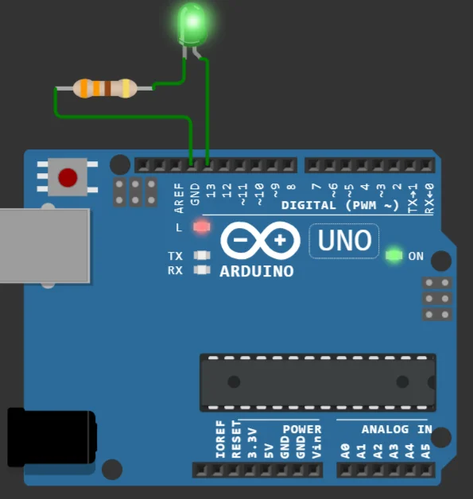

import Question from '../../../../../components/Question.astro';

:::note[Objectif de la partie]
Écrire un premier programme, piloter une **sortie numérique** et **dimensionner** la résistance d'une LED. Rappels de cours : leçons [5](/Embedded-System-Course/parcours/chapitre-1/05-arduino-uno/) et [6](/Embedded-System-Course/parcours/chapitre-1/06-atelier-led/) du chapitre 1.
:::

## Exercice 1 — Allumer la LED intégrée à la carte

Aucun montage n'est nécessaire : la carte possède une LED, repérée **L**, reliée à la broche 13.

Écrivez le programme suivant, exécutez-le et observez la LED **L**.

```cpp
int ledPin = 13;

void setup() {
  pinMode(ledPin, OUTPUT);
}

void loop() {
  digitalWrite(ledPin, HIGH);
}
```

- Le programme déclare d'abord une variable entière `ledPin`.
- `setup()` s'exécute **une seule fois**, au démarrage. Elle appelle `pinMode(broche, mode)`, qui configure une broche en entrée (`INPUT`) ou en sortie (`OUTPUT`). En sortie, la broche peut **envoyer** un signal électrique, ce qui est nécessaire pour commander une LED.
- `loop()` s'exécute ensuite **en boucle, sans fin**. C'est là qu'on lit les capteurs et qu'on commande les actionneurs.

<Question id="tp1-q1.1" label="Q1.1">
La LED reliée à la broche 13 est-elle un **capteur** ou un **actionneur** ? Justifiez.
</Question>

<Question id="tp1-q1.2" label="Q1.2">
Combien de fois `setup()` et `loop()` s'exécutent-elles ? Dans ce programme précis, pourrait-on placer `digitalWrite(ledPin, HIGH)` dans `setup()` ? Justifiez.
</Question>

<Question id="tp1-q1.3" label="Q1.3" categorie="ingenieur">
Remplacez `13` par la constante prédéfinie `LED_BUILTIN` et déclarez la variable avec `const`. Quel est l'intérêt d'une **constante nommée** plutôt qu'un nombre écrit directement dans le code ?
</Question>

## Exercice 2 — Faire clignoter une LED externe

Une LED externe est reliée à la carte à travers une **résistance**, qui limite le courant et évite de détruire la LED.

### Câblage

| Composant | Broche du composant | Relier à |
|---|---|---|
| LED | anode (patte longue) | broche **D13** de l'UNO |
| LED | cathode (patte courte) | une extrémité de la résistance 220 Ω |
| Résistance 220 Ω | autre extrémité | **GND** |



*La LED est reliée à la broche 13 et à la masse à travers sa résistance.*

### Programme

```cpp
const int LEDPin = 13;

void setup() {
  pinMode(LEDPin, OUTPUT);
}

void loop() {
  digitalWrite(LEDPin, HIGH);  // LED allumée
  delay(250);                  // attente de 250 ms
  digitalWrite(LEDPin, LOW);   // LED éteinte
  delay(250);
}
```

<Question id="tp1-q2.1" label="Q2.1">
Pourquoi les deux pattes de la LED ont-elles des longueurs différentes ? Quel est le rôle de l'**anode** et de la **cathode** ? Que se passe-t-il si l'on branche la LED à l'envers ?
</Question>

<Question id="tp1-q2.2" label="Q2.2" categorie="ingenieur">
**Dimensionnement.** La sortie fournit 5 V, la LED fait chuter environ 2 V et l'on vise un courant de 15 mA. Calculez la résistance nécessaire. Pourquoi choisit-on 220 Ω, une valeur de la série normalisée E12 ? Quel courant circule alors ?
</Question>

<Question id="tp1-q2.3" label="Q2.3">
Calculez la **période**, la **fréquence** et le **rapport cyclique** du clignotement.
</Question>

<Question id="tp1-q2.4" label="Q2.4">
Que remarquez-vous sur la LED **L** de la carte pendant l'exercice 2 ? Expliquez.
</Question>

:::caution[Important]
`delay()` **bloque** le microcontrôleur : pendant 250 ms, il ne lit aucun bouton et ne répond à rien. Dans un produit, on mesure le temps écoulé avec `millis()`, le nombre de millisecondes depuis le démarrage, sans jamais attendre.
:::

<Question id="tp1-q2.5" label="Q2.5" type="code" categorie="ingenieur">
Réécrivez le clignotement **sans `delay()`**, à l'aide de `millis()`. Collez votre programme, puis expliquez en commentaire pourquoi on écrit `millis() - instant >= PERIODE` plutôt que `millis() >= instant + PERIODE` (indice : que devient `millis()` au bout de 49,7 jours ?).
</Question>

<details>
<summary>Voir une piste pour Q2.5</summary>

```cpp
const unsigned long PERIODE = 250;  // ms
unsigned long instant = 0;          // date du dernier changement

void loop() {
  if (millis() - instant >= PERIODE) {
    instant += PERIODE;
    // à compléter : inverser l'état de la LED
  }
  // ici, le programme reste libre de faire autre chose
}
```

</details>

## Critères de validation

- [ ] La LED **L** s'allume avec le programme de l'exercice 1, écrit avec `LED_BUILTIN`.
- [ ] La LED externe clignote à 2 Hz ; le projet Wokwi est enregistré.
- [ ] La version sans `delay()` clignote au même rythme.
- [ ] Les questions Q1.1 à Q2.5 ont une réponse justifiée.

:::note[Prochaine étape]
Validez cette page, puis passez à la [partie B : entrées numériques](/Embedded-System-Course/parcours/chapitre-2/tp1/03-entrees-numeriques/).
:::
