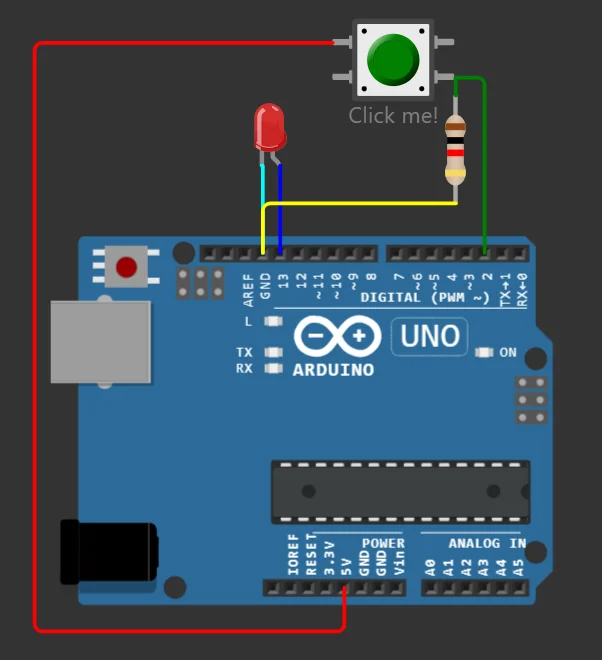
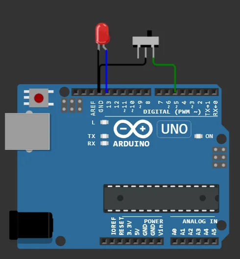

import Question from '../../../../../components/Question.astro';

:::note[Objectif de la partie]
Lire une **entrée numérique** de façon fiable : fixer son niveau au repos, **filtrer les rebonds** et choisir un câblage qui reste sûr en cas de panne. Rappels de cours : leçons [7](/Embedded-System-Course/parcours/chapitre-1/07-atelier-bouton/) et [8](/Embedded-System-Course/parcours/chapitre-1/08-exercice-interrupteur/) du chapitre 1.
:::

## Exercice 3 — Commander une LED avec un bouton-poussoir

Le bouton devient un **élément d'entrée** : la broche 2 détecte s'il est appuyé.

### Câblage

| Composant | Broche du composant | Relier à |
|---|---|---|
| Bouton-poussoir | une broche | **5V** |
| Bouton-poussoir | broche opposée | **D2** |
| Résistance 10 kΩ | entre D2 (côté bouton) et **GND** | tirage vers le bas (*pull-down*) |
| LED | anode → **D13** ; cathode → résistance 220 Ω → **GND** | voyant |



*Le bouton relie D2 au 5 V quand on appuie ; la résistance maintient D2 à 0 V au repos.*

### Programme

```cpp
const int buttonPin = 2;

void setup() {
  pinMode(buttonPin, INPUT);      // entrée, tirage assuré par la résistance externe
  pinMode(LED_BUILTIN, OUTPUT);   // LED_BUILTIN = broche 13 sur la UNO
}

void loop() {
  digitalWrite(LED_BUILTIN, digitalRead(buttonPin));  // la LED recopie l'état du bouton
}
```

<Question id="tp1-q3.1" label="Q3.1">
Quel est le rôle de la résistance de 10 kΩ ? Que lirait-on sur D2, bouton relâché, si on la retirait ?
</Question>

<Question id="tp1-q3.2" label="Q3.2">
Complétez : bouton relâché, D2 lit … ; bouton appuyé, D2 lit … . La logique est-elle **directe** ou **inversée** ?
</Question>

<Question id="tp1-q3.3" label="Q3.3" categorie="ingenieur">
On oublie la ligne `pinMode(LED_BUILTIN, OUTPUT)`. Sur un vrai ATmega328P, `digitalWrite(…, HIGH)` sur une broche restée **en entrée** ne la met pas à 5 V : il active sa résistance de tirage interne (20 à 50 kΩ). Expliquez, avec un ordre de grandeur du courant, pourquoi la LED ne s'allume alors qu'à peine.
</Question>

### Les rebonds du bouton

Un contact mécanique ne se ferme pas proprement : ses lames **rebondissent** et ouvrent puis ferment le circuit plusieurs fois en une fraction de milliseconde. Wokwi simule ce phénomène. Le programme suivant compte les appuis en détectant les **fronts montants**, c'est-à-dire les passages de BAS à HAUT.

```cpp
const int buttonPin = 2;
int etatPrecedent = LOW;
unsigned long nbAppuis = 0;

void setup() {
  pinMode(buttonPin, INPUT);
  Serial.begin(9600);
}

void loop() {
  int etat = digitalRead(buttonPin);
  if (etat == HIGH && etatPrecedent == LOW) {  // front montant : début d'un appui
    nbAppuis++;
    Serial.print("Appuis : ");
    Serial.println(nbAppuis);
  }
  etatPrecedent = etat;
}
```

<Question id="tp1-q3.4" label="Q3.4" categorie="surete">
Appuyez **dix fois** sur le bouton dans Wokwi. Combien d'appuis le programme compte-t-il ? Expliquez l'écart. Quelle conséquence aurait ce phénomène sur un bouton « marche / arrêt » ?
</Question>

<Question id="tp1-q3.5" label="Q3.5" type="code" categorie="ingenieur">
Ajoutez un **anti-rebond logiciel** : un changement d'état n'est pris en compte que s'il est resté stable pendant 30 ms (utilisez `millis()`, sans `delay()`). Collez votre programme et indiquez le nombre d'appuis comptés pour dix appuis réels.
</Question>

## Exercice 4 — Interrupteur coulissant et liaison série

L'interrupteur coulissant **garde sa position**. Il sert à choisir un mode de fonctionnement stable.

### Câblage

| Composant | Broche du composant | Relier à |
|---|---|---|
| Interrupteur coulissant | broche 2 (commun, au milieu) | **GND** |
| Interrupteur coulissant | broche 3 | **D5** |
| LED | anode → **D13** ; cathode → résistance 220 Ω → **GND** | voyant |



*Aucune résistance de tirage externe : la carte active sa résistance interne.*

### Programme

```cpp
const int LED = 13, interrupteur = 5;

void setup() {
  pinMode(LED, OUTPUT);
  pinMode(interrupteur, INPUT_PULLUP);  // résistance de tirage interne vers 5 V
  Serial.begin(9600);                   // démarrage de la communication série
}

void loop() {
  int interrupteurState = digitalRead(interrupteur);
  digitalWrite(LED, interrupteurState);
  if (interrupteurState == HIGH) {
    Serial.println("Interrupteur ouvert (HIGH)");
  } else {
    Serial.println("Interrupteur ferme (LOW)");
  }
}
```

Ouvrez le **moniteur série** de Wokwi (il s'affiche sous le schéma), puis basculez l'interrupteur.

<Question id="tp1-q4.1" label="Q4.1">
Quel est le rôle de `INPUT_PULLUP` ? Qu'est-ce qui remplace la résistance de 10 kΩ de l'exercice 3 ?
</Question>

<Question id="tp1-q4.2" label="Q4.2">
Dans quelle position de l'interrupteur la LED s'allume-t-elle ? Pourquoi dit-on que la logique est **inversée** ? Quelle modification d'une seule ligne allume la LED quand l'interrupteur relie D5 à GND ?
</Question>

<Question id="tp1-q4.3" label="Q4.3">
Déduisez le **rôle de la communication série** sur Arduino. Que signifie « 9600 bauds » ? Sachant qu'un caractère occupe 10 bits sur la ligne (8 bits de données, 1 bit de départ, 1 bit d'arrêt), combien de caractères par seconde peut-on transmettre au maximum ?
</Question>

<Question id="tp1-q4.4" label="Q4.4" type="code" categorie="ingenieur">
Le programme affiche l'état **à chaque tour de boucle** et inonde le moniteur série. Modifiez-le pour n'afficher un message **qu'au changement de position** de l'interrupteur. Collez votre programme.
</Question>

<Question id="tp1-q4.5" label="Q4.5" categorie="surete">
Avec `INPUT_PULLUP`, que lit la carte si le fil qui va à l'interrupteur **est coupé** ? Dans un équipement industriel, un arrêt d'urgence doit provoquer l'arrêt même si son câble est sectionné. Quelle position de l'interrupteur (D5 à HIGH ou à LOW) faut-il donc associer à l'état **sûr** ? On parle de **sécurité positive**.
</Question>

## Critères de validation

- [ ] La LED suit le bouton (exercice 3) ; le compteur d'appuis met en évidence les rebonds.
- [ ] Avec l'anti-rebond, dix appuis donnent dix incréments.
- [ ] Le moniteur série n'affiche un message qu'au changement de position de l'interrupteur.
- [ ] Les questions Q3.1 à Q4.5 ont une réponse justifiée.

:::note[Prochaine étape]
Validez cette page, puis passez à la [partie C : analogique et PWM](/Embedded-System-Course/parcours/chapitre-2/tp1/04-analogique-pwm/).
:::
