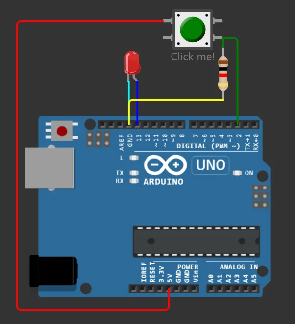

import Question from '../../../../../components/Question.astro';

:::note[Objectif de l'exercice]
Lire une **entrée numérique** de façon fiable : fixer son niveau au repos, puis **filtrer les rebonds** du bouton. Rappel de cours : leçon [7](/Embedded-System-Course/parcours/chapitre-1/07-atelier-bouton/) du chapitre 1.
:::

Le bouton devient un **élément d'entrée** : la broche 2 détecte s'il est appuyé.

## Câblage

| Composant | Broche du composant | Relier à |
|---|---|---|
| Bouton-poussoir | une broche | **5V** |
| Bouton-poussoir | broche opposée | **D2** |
| Résistance 10 kΩ | entre D2 (côté bouton) et **GND** | tirage vers le bas (*pull-down*) |
| LED | anode → **D13** ; cathode → résistance 220 Ω → **GND** | voyant |



*Le bouton relie D2 au 5 V quand on appuie ; la résistance maintient D2 à 0 V au repos.*

## Programme

```cpp
const int buttonPin = 2;

void setup() {
  pinMode(buttonPin, INPUT);      // entrée, tirage assuré par la résistance externe
  pinMode(LED_BUILTIN, OUTPUT);   // LED_BUILTIN = broche 13 sur la UNO
}

void loop() {
  digitalWrite(LED_BUILTIN, digitalRead(buttonPin));  // la LED recopie l'état du bouton
}
```

<Question id="tp1-q3.1" label="Q3.1">
Quel est le rôle de la résistance de 10 kΩ ? Que lirait-on sur D2, bouton relâché, si on la retirait ?
</Question>

<Question id="tp1-q3.2" label="Q3.2">
Complétez : bouton relâché, D2 lit … ; bouton appuyé, D2 lit … . La logique est-elle **directe** ou **inversée** ?
</Question>

## Les rebonds du bouton

Un contact mécanique ne se ferme pas proprement : ses lames **rebondissent** et ouvrent puis ferment le circuit plusieurs fois en une fraction de milliseconde. Wokwi simule ce phénomène. Le programme suivant compte les appuis en détectant les **fronts montants**, c'est-à-dire les passages de BAS à HAUT.

```cpp
const int buttonPin = 2;
int etatPrecedent = LOW;
unsigned long nbAppuis = 0;

void setup() {
  pinMode(buttonPin, INPUT);
  Serial.begin(9600);
}

void loop() {
  int etat = digitalRead(buttonPin);
  if (etat == HIGH && etatPrecedent == LOW) {  // front montant : début d'un appui
    nbAppuis++;
    Serial.print("Appuis : ");
    Serial.println(nbAppuis);
  }
  etatPrecedent = etat;
}
```

## Critères de validation

- [ ] La LED suit le bouton ; le compteur d'appuis met en évidence les rebonds.
- [ ] Avec l'anti-rebond, dix appuis donnent dix incréments.
- [ ] Les questions Q3.1 et Q3.2 ont une réponse justifiée.

:::note[Prochaine étape]
Validez cette page, puis passez à l'[exercice 4 : interrupteur coulissant et liaison série](/Embedded-System-Course/parcours/chapitre-2/tp1/ex04-interrupteur-serie/).
:::
