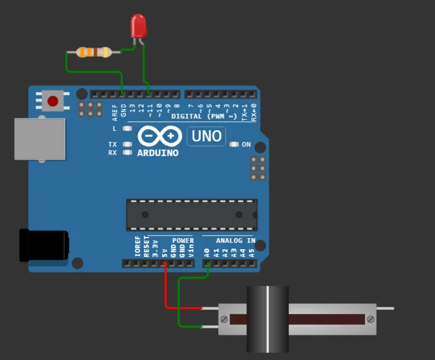

import Question from '../../../../../components/Question.astro';

:::note[Objectif de l'exercice]
Passer du « tout ou rien » à une **grandeur continue** : lire une tension avec le convertisseur analogique-numérique, puis commander une sortie en **PWM**. Rappel de cours : leçon [9](/Embedded-System-Course/parcours/chapitre-1/09-exercice-potentiometre/) du chapitre 1.
:::

Jusqu'ici, les entrées ne prenaient que deux valeurs. Un potentiomètre fournit une tension **réglable entre 0 et 5 V**, qui sert de consigne : luminosité d'une LED, vitesse d'un moteur, seuil d'alarme.

## Câblage

| Composant | Broche du composant | Relier à |
|---|---|---|
| LED | anode (patte longue) | **D11** (sortie PWM) |
| LED | cathode | résistance 220 Ω → **GND** |
| Potentiomètre | curseur (SIG, broche centrale) | **A0** |
| Potentiomètre | une extrémité | **GND** |
| Potentiomètre | autre extrémité | **5V** |



*La LED est sur la broche 11 (PWM) et le curseur du potentiomètre sur A0.*

## Programme

```cpp
const int LED_pin = 11;

void setup() {
  // analogWrite() configure elle-même la broche en sortie
}

void loop() {
  int value = analogRead(A0);                     // 0 à 1023
  int brightness = map(value, 0, 1023, 0, 255);   // mise à l'échelle 0 à 255
  analogWrite(LED_pin, brightness);               // rapport cyclique de la PWM
  delay(20);
}
```

- `analogRead(A0)` mesure la tension du curseur et la **convertit** en un nombre entier entre 0 et 1023.
- `map()` transforme **linéairement** la plage 0 à 1023 en plage 0 à 255.
- `analogWrite()` attend justement une valeur entre 0 (toujours éteint) et 255 (toujours allumé) : elle règle le **rapport cyclique** d'un signal PWM sur les broches marquées **~**.

<Question id="tp1-q5.1" label="Q5.1">
Pourquoi utilise-t-on la broche **A0** pour le potentiomètre plutôt qu'une broche numérique ?
</Question>

<Question id="tp1-q5.4" label="Q5.4">
Pourquoi la LED est-elle branchée sur la broche **11** ? Que se passerait-il si on la branchait sur la broche 12 en gardant `analogWrite()` ?
</Question>

## Critères de validation

- [ ] La luminosité de la LED varie continûment avec le potentiomètre, de éteinte à pleine puissance.
- [ ] Le moniteur série (ajoutez-le) affiche la valeur lue et la valeur envoyée à la LED.
- [ ] Les questions Q5.1 et Q5.4 ont une réponse justifiée.

## Bilan des exercices 1 à 5

- [ ] Je sais calculer la résistance de protection d'une LED.
- [ ] Je sais expliquer pourquoi une entrée doit avoir un niveau fixé au repos.
- [ ] Je sais filtrer les rebonds d'un bouton sans bloquer le programme.
- [ ] Je sais lire une tension avec `analogRead()` et commander une sortie avec `analogWrite()`.
- [ ] Je sais utiliser le moniteur série pour suivre le fonctionnement d'un programme.

:::note[Prochaine étape]
Validez cette page. Les exercices 6 à 11 réutilisent ces briques pour construire le contrôleur de température : commencez par l'[exercice 6 : le capteur DHT22](/Embedded-System-Course/parcours/chapitre-2/tp1/ex06-capteur-dht22/).
:::
