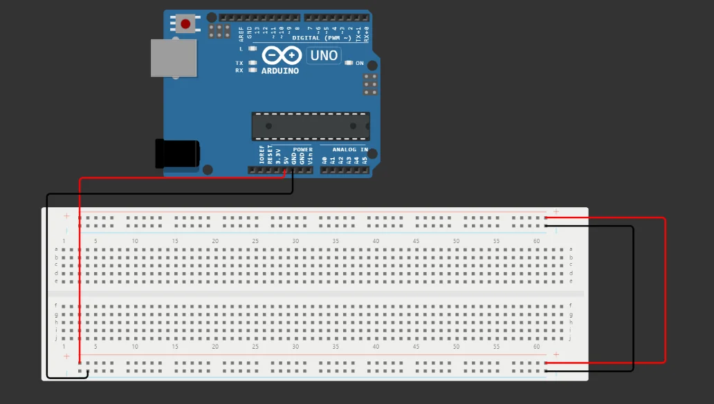
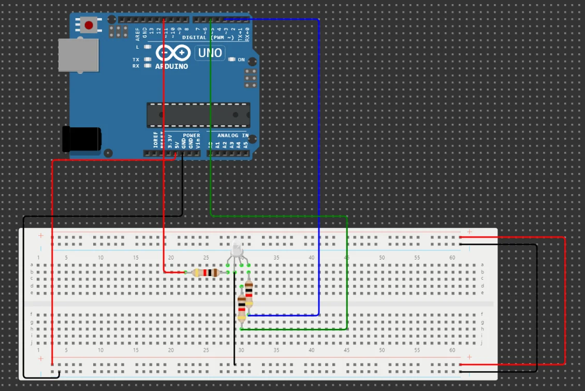
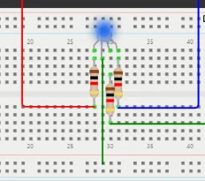
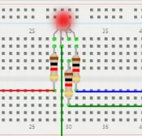
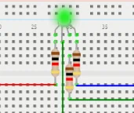

import Question from '../../../../../components/Question.astro';
import ConnexionAlimentation from '../../../../../components/ConnexionAlimentation.astro';
import PlaqueAnatomie from '../../../../../components/PlaqueAnatomie.astro';

:::note[Objectif de l'exercice]
Câbler une **LED RVB** sur une plaque de prototypage et comprendre la logique d'une **anode commune** : c'est le voyant de couleur du contrôleur (exigence EF2).
:::

## La plaque de prototypage

Commencez un **nouveau projet** Arduino Uno et ajoutez une plaque de prototypage (*breadboard*).

La plaque permet des **connexions temporaires sans soudure** : on ajoute, déplace et retire les composants en quelques secondes. C'est l'outil du prototypage rapide, avant de réaliser un circuit définitif.

### Comment les trous sont-ils reliés ?

Une plaque de prototypage se présente comme une grille de trous, mais ces trous ne sont pas indépendants : des **lamelles métalliques** cachées sous le plastique en relient certains. Pour câbler sans erreur, il faut savoir lesquels.

<PlaqueAnatomie />

| Zone de la plaque | Trous reliés entre eux | À quoi elle sert |
|---|---|---|
| **Une rangée** (5 trous : 8a à 8e, ou 8f à 8j) | les 5 trous du groupe | connecter des composants entre eux |
| **La rainure centrale** | aucun : les deux moitiés a–e et f–j sont indépendantes | séparer les deux parties de la plaque |
| **Un rail** (+ ou −) | tous les trous du rail, sur toute sa longueur | distribuer le **VCC** (+5V, +3,3V…) sur le rail rouge (+) ou le **GND** (masse) sur le rail bleu ou noir (−) |

Deux composants placés dans la **même rangée** sont donc reliés ; placés dans **deux rangées différentes**, ils ne le sont pas, sauf si vous ajoutez un fil. Cette organisation en rangées et en rails donne beaucoup de souplesse pour monter un circuit.

:::note[Rangées verticales ou horizontales ?]
Selon que la plaque est posée en long ou en large, les rangées apparaissent verticales ou horizontales. Dans Wokwi, comme sur le schéma ci-dessus, la plaque est en large : les rangées sont verticales et les rails horizontaux. Seul compte le groupe de 5 trous.
:::

:::caution[Un rail peut être coupé en sections]
Sur certaines plaques, un rail est interrompu par sections. Si des composants d'un côté sont alimentés et pas ceux de l'autre, vérifiez si le rail est coupé et, le cas échéant, reliez les deux sections par un fil.
:::

### Connexion de l'alimentation

Avant de placer le moindre composant, **alimentez la plaque** : reliez la broche **5V** de l'Arduino à un port d'alimentation positive (**+**) de la plaque, et la broche **GND** à un port de masse (**−**). Les **rails d'alimentation** ainsi alimentés fournissent le courant à tous les circuits que vous monterez ensuite sur la plaque.

<ConnexionAlimentation />

1. Placez un fil depuis la broche **5V** de la carte jusqu'à un trou du rail marqué **+** (trait rouge).
2. Placez un second fil depuis la broche **GND** de la carte jusqu'à un trou du rail marqué **−** (trait bleu).
3. Par convention, on utilise un fil **rouge** pour le **+** et un fil **noir** pour la **masse** : en un coup d'œil, on repère l'alimentation et on évite les erreurs. Dans Wokwi, cliquez sur une broche, puis sur sa destination, pour tracer un fil ; un clic sur le fil permet d'en changer la couleur.

:::caution[Ne reliez jamais le 5V directement au GND]
Un fil entre le **5V** et le **GND**, ou entre le rail **+** et le rail **−** sans composant, est un **court-circuit** : il n'y a plus rien pour limiter le courant. Sur un montage réel, cela peut endommager la carte ou le port USB. Vérifiez toujours qu'un composant, par exemple une résistance, se trouve entre les deux.
:::

Voici le résultat attendu dans le simulateur :



*Les rails d'alimentation de la plaque reliés au 5 V (fil rouge) et à la masse (fil noir).*

## La LED RVB à anode commune

Une LED RVB réunit trois LED, **rouge**, **verte** et **bleue**, dans un même boîtier. Dans le modèle de Wokwi, leurs **anodes sont reliées entre elles** (broche COM) : on dit qu'elle est à **anode commune**. La broche COM va au **5 V**, et chaque couleur s'allume quand sa broche est tirée **vers 0 V**.

## Câblage

| LED RVB | Relier à |
|---|---|
| R (rouge) | résistance 220 Ω → **D11** |
| COM (commune) | rail **+** (5 V) |
| G (vert) | résistance 220 Ω → **D5** |
| B (bleu) | résistance 220 Ω → **D3** |



*Chaque couleur a sa propre résistance de 220 Ω ; la broche commune est reliée au rail + de la plaque.*

## Programme

1. Associez chaque couleur à une broche :

```cpp
int red_led = 11;
int green_led = 5;
int blue_led = 3;
```

2. Configurez ces broches en **sorties** dans `setup()`. Ce sont des broches **PWM** (marquées ~) : on peut régler l'intensité de chaque couleur.

```cpp
void setup() {
  pinMode(red_led, OUTPUT);
  pinMode(green_led, OUTPUT);
  pinMode(blue_led, OUTPUT);
}
```

3. Écrivez une fonction qui règle les trois intensités en PWM :

```cpp
void led_color(int red_value, int green_value, int blue_value) {
  analogWrite(red_led, red_value);
  analogWrite(green_led, green_value);
  analogWrite(blue_led, blue_value);
}
```

4. Faites défiler trois couleurs dans `loop()` :

```cpp
void loop() {
  led_color(0, 255, 255);
  delay(2000);
  led_color(255, 0, 255);
  delay(2000);
  led_color(255, 255, 0);
  delay(2000);
}
```

Testez avant de continuer : vous devez obtenir successivement du **rouge**, du **vert** et du **bleu**.





*Les trois couleurs obtenues.*

<Question id="tp2-q2.1" label="Q7.1">
Sur une plaque de prototypage, quels trous sont reliés électriquement entre eux ? Distinguez les **rangées de la zone centrale** et les **rails d'alimentation**.
</Question>

<Question id="tp2-q2.2" label="Q7.2">
Pourquoi les trois couleurs sont-elles branchées sur les broches 3, 5 et 11 ?
</Question>

<Question id="tp2-q2.4" label="Q7.4">
Quelles valeurs faut-il passer à `led_color()` pour obtenir du **jaune**, du **magenta**, du **blanc**, puis pour **éteindre** la LED ?
</Question>

<Question id="tp2-q2.5" label="Q7.5" type="code">
Écrivez une fonction `couleur(int r, int v, int b)` qui reçoit des intensités en **logique directe** (255 = allumé à fond) et fonctionne avec une LED à anode **ou** à cathode commune selon une constante `ANODE_COMMUNE`. Quel est l'intérêt de cette couche d'abstraction si le fournisseur change de LED ?
</Question>

## Critères de validation

- [ ] La LED affiche successivement rouge, vert et bleu.
- [ ] Les questions Q7.1, Q7.2, Q7.4 et Q7.5 ont une réponse justifiée.

:::note[Prochaine étape]
Validez cette page, puis passez à l'[exercice 8 : couleur selon la température](/Embedded-System-Course/parcours/chapitre-2/tp1/ex08-couleur-temperature/).
:::
