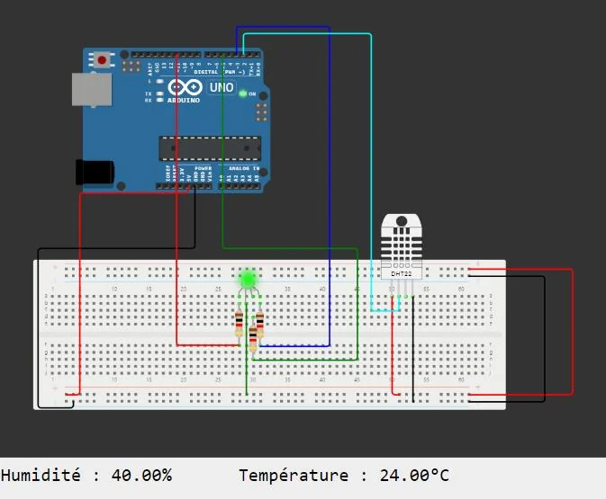
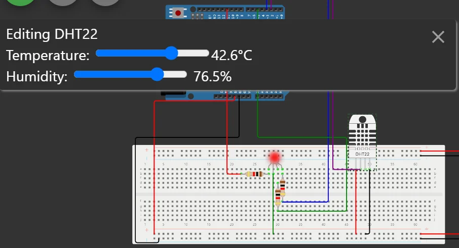

import Question from '../../../../../components/Question.astro';

:::note[Objectif de l'exercice]
Réunir le capteur de l'exercice 6 et la LED de l'exercice 7 pour afficher la **zone thermique** (exigence EF2), puis **tester** le programme aux valeurs limites.
:::

## Montage

Partez d'une copie du projet de l'exercice 7. Ajoutez le **DHT22** de l'exercice 6 à la plaque (VCC sur le rail +, GND sur le rail −, données sur **D2**), puis réunissez les programmes des deux exercices.



*La LED RVB et le DHT22 sur la même plaque. Le moniteur série affiche les mesures.*

## Programme

Modifiez `loop()` pour que la couleur dépende de la température mesurée. Les seuils sont des **constantes nommées**, conformes à l'exigence EF2 :

```cpp
const float SEUIL_FROID = 10.0;  // °C
const float SEUIL_CHAUD = 38.0;  // °C

// Dans loop(), après readSensorData() :
if (temperature > SEUIL_CHAUD) {
  led_color(0, 255, 255);    // rouge : température élevée
} else if (temperature < SEUIL_FROID) {
  led_color(255, 255, 0);    // bleu : température basse
} else {
  led_color(255, 0, 255);    // vert : température normale
}
```

Cliquez sur le capteur pendant la simulation et faites varier la température pour vérifier les **trois états**. Assurez-vous que les valeurs du moniteur série sont identiques à celles réglées sur le capteur.



*En cliquant sur le capteur, on règle la température : ici 42,6 °C, et la LED passe au rouge.*

<Question id="tp2-q3.1" label="Q8.1">
Complétez le **tableau de tests** : pour 5 °C, 24 °C et 39 °C, indiquez la couleur attendue d'après EF2 et la couleur observée.
</Question>

## Critères de validation

- [ ] La couleur suit la température réglée sur le capteur, dans les trois zones.
- [ ] Le comportement aux valeurs limites (10,0 °C et 38,0 °C) est vérifié et conforme à EF2.
- [ ] La question Q8.1 a une réponse justifiée.

:::note[Prochaine étape]
Validez cette page, puis passez à l'[exercice 9 : bouton et écran LCD](/Embedded-System-Course/parcours/chapitre-2/tp1/ex09-bouton-lcd/).
:::
