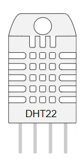

import FicheTP from '../../../../../components/FicheTP.astro';
import ChaineInformation from '../../../../../components/ChaineInformation.astro';
import Question from '../../../../../components/Question.astro';

<FicheTP
	duree="6 h (2 séances)"
	modalite="Binôme"
	plateforme="Wokwi, Arduino UNO, bibliothèques DHT sensor library et LiquidCrystal I2C"
	prerequis="TP1 terminé (sorties, entrées, anti-rebond, millis())"
	livrables="Compte rendu exporté, liens Wokwi des parties A à D, programme final"
/>

## Mise en situation

Le client de votre entreprise exploite des **armoires électriques** installées dans des locaux techniques. Les appareillages qu'elles contiennent sont généralement prévus pour une température ambiante d'**au plus 40 °C**, et de 35 °C en moyenne sur 24 heures. Au-delà, ils vieillissent vite ou se déclenchent intempestivement.

Aujourd'hui, un agent relève un thermomètre à la main lors de ses rondes. Le client veut un **contrôleur automatique** qui :

- signale en permanence la **zone thermique** par un voyant de couleur : **bleu** quand il fait trop froid, **vert** quand la température est normale, **rouge** quand elle devient élevée ;
- affiche la **température** et l'**humidité** sur un petit écran ;
- **alerte les agents par un signal sonore** quand le seuil critique de 40 °C est dépassé.

Il est recommandé de suivre l'ordre des parties : chacune ajoute une fonction au montage de la précédente.

## Objectifs

À l'issue de ce TP, vous serez capables de :

<ol class="objectifs-liste">
	<li><strong>Acquérir</strong> une température et une humidité avec un capteur numérique et une bibliothèque.</li>
	<li><strong>Détecter</strong> une lecture invalide et <strong>choisir</strong> un comportement sûr.</li>
	<li><strong>Commander</strong> une LED RVB en PWM et <strong>expliquer</strong> la logique d'une anode commune.</li>
	<li><strong>Construire</strong> une interface homme-machine : bouton, écran LCD sur bus I²C, buzzer.</li>
	<li><strong>Structurer</strong> un programme non bloquant qui surveille en continu.</li>
	<li><strong>Tester</strong> un système aux valeurs limites et <strong>justifier</strong> ses choix de conception.</li>
</ol>

## Le système étudié

<ChaineInformation
	acquerir={['Capteur DHT22 : température et humidité (D2)', 'Bouton-poussoir (D6)', 'Interrupteur °C / °F (D7)']}
	traiter={['Acquisition toutes les 2 s', 'Comparaison aux seuils', 'Gestion de l\'alarme et de l\'affichage']}
	agir={['LED RVB (D11, D5, D3)', 'Écran LCD 16×2 I²C (A4, A5)', 'Buzzer (D8)', 'Moniteur série']}
	legende="Chaîne d'information du contrôleur de température."
/>

## Cahier des charges

| Exigence | Description | Partie |
|---|---|---|
| EF1 | Mesurer la température et l'humidité **toutes les 2 secondes**. | A |
| EF2 | Signaler la zone thermique : **bleu** au-dessous de 10 °C, **vert** de 10 à 38 °C, **rouge** au-dessus de 38 °C. | B |
| EF3 | Afficher la température et l'humidité sur l'écran LCD **à la demande**, par un appui sur le bouton. | C |
| EF4 | Émettre un **signal sonore** dès que la température dépasse **40 °C**. | D |
| EF5 | Afficher la température en **°C ou en °F** selon la position de l'interrupteur. | D |
| EF6 | Signaler toute **lecture invalide** du capteur ; ne jamais afficher « normal » sans mesure valide. | A, B |

## Affectation des broches

Ce plan de câblage vaut pour tout le TP. Le respecter vous fera gagner du temps d'une partie à l'autre.

| Broche UNO | Composant | Partie |
|---|---|---|
| D2 | DHT22, broche de données (nommée **SDA** dans Wokwi) | A |
| D3 ~ | LED RVB, bleu (B), via 220 Ω | B |
| D5 ~ | LED RVB, vert (G), via 220 Ω | B |
| D11 ~ | LED RVB, rouge (R), via 220 Ω | B |
| 5V | DHT22 (VCC), broche commune de la LED RVB (COM), écran LCD (VCC) | A, B, C |
| D6 | Bouton-poussoir, l'autre broche vers GND | C |
| A4 / A5 | Écran LCD I²C : SDA / SCL | C |
| D8 | Buzzer (+), l'autre broche vers GND | D |
| D7 | Interrupteur coulissant : broche 1 sur D7, broche 2 (commun) sur GND | D |

## Matériel

| Composant | Quantité | Référence dans Wokwi |
|---|---|---|
| Carte Arduino UNO | 1 | `wokwi-arduino-uno` |
| Plaque de prototypage | 1 | `wokwi-breadboard` |
| Capteur de température et d'humidité DHT22 | 1 | `wokwi-dht22` |
| LED RVB (anode commune) | 1 | `wokwi-rgb-led` |
| Résistances 220 Ω | 3 | `wokwi-resistor` |
| Bouton-poussoir | 1 | `wokwi-pushbutton` |
| Écran LCD 16×2 avec interface I²C | 1 | `wokwi-lcd1602`, attribut `pins` réglé sur `i2c` |
| Buzzer | 1 | `wokwi-buzzer` |
| Interrupteur coulissant | 1 | `wokwi-slide-switch` |
| Fils de connexion | — | — |

## Organisation du TP

| Partie | Contenu | Durée indicative |
|---|---|---|
| Présentation | Cahier des charges, documentation du DHT22 | 30 min |
| [A. Acquisition](/Embedded-System-Course/parcours/chapitre-2/tp2/02-acquisition/) | Exercice 1 : lire et afficher le DHT22, fonction d'acquisition | 1 h |
| [B. Signalisation RVB](/Embedded-System-Course/parcours/chapitre-2/tp2/03-signalisation-rvb/) | Exercices 2 et 3 : plaque d'essai, LED RVB, couleur selon la température | 1 h 30 |
| [C. Bouton et écran LCD](/Embedded-System-Course/parcours/chapitre-2/tp2/04-bouton-lcd/) | Exercice 4 : acquisition à la demande, affichage I²C | 1 h 30 |
| [D. Alarme, unités et défi](/Embedded-System-Course/parcours/chapitre-2/tp2/05-alarme-defi/) | Exercices 5 et 6 : buzzer, °C / °F ; défi ingénieur | 1 h 30 |

## Préparation : la documentation du capteur

Le **DHT22** mesure la température et l'humidité relative. Il s'alimente en continu entre 3,3 V et 6 V ; avec une carte Arduino, on préfère le **5 V**. Consultez sa fiche dans la [documentation de Wokwi](https://docs.wokwi.com/parts/wokwi-dht22) et la fiche technique du fabricant, puis répondez.

*Le DHT22 : un boîtier ajouré et quatre broches.*

<Question id="tp2-q0.1" label="Q0.1">
Quelles sont les valeurs de température et d'humidité affichées par le DHT22 de Wokwi **au démarrage** de la simulation ?
</Question>

<Question id="tp2-q0.2" label="Q0.2">
Quelle **plage de température** le DHT22 peut-il mesurer, et avec quelle **précision** ? Même question pour l'humidité.
</Question>

<Question id="tp2-q0.3" label="Q0.3">
Combien de **broches** le DHT22 possède-t-il ? Donnez le rôle de chacune.
</Question>

<Question id="tp2-q0.4" label="Q0.4" categorie="ingenieur">
Quel **intervalle minimal** faut-il respecter entre deux lectures du DHT22 ? Quelle conséquence cela a-t-il sur la conception du programme ?
</Question>

:::note[Prochaine étape]
Validez cette page, puis commencez la [partie A : acquisition des données](/Embedded-System-Course/parcours/chapitre-2/tp2/02-acquisition/).
:::
