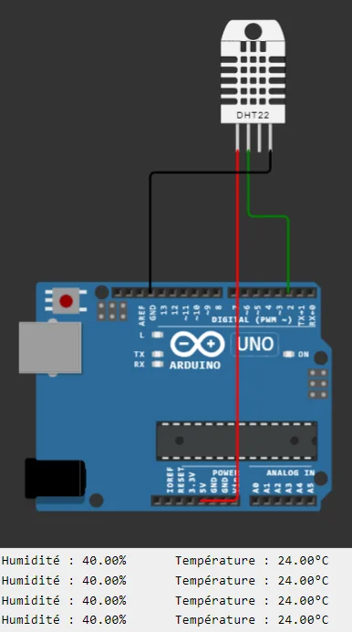
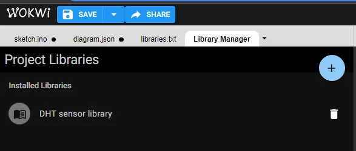

import Question from '../../../../../components/Question.astro';

:::note[Objectif de la partie]
Lire le capteur **DHT22** avec une bibliothèque, afficher les mesures sur la liaison série et **détecter une lecture invalide** (exigences EF1 et EF6).
:::

## Exercice 1 — Acquérir la température et l'humidité

Créez un nouveau projet Wokwi **Arduino Uno** et ajoutez un capteur **DHT22**.

### Câblage

| DHT22 | Relier à |
|---|---|
| VCC | **5V** |
| SDA (données) | **D2** |
| NC | rien (non connectée) |
| GND | **GND** |



*Le DHT22 câblé sur D2. Sous le montage, les mesures défilent dans le moniteur série.*

### Bibliothèque

Ajoutez la bibliothèque **DHT sensor library** depuis le gestionnaire de bibliothèques de Wokwi (onglet *Library Manager*, bouton **+**).



*La bibliothèque apparaît dans la liste des bibliothèques du projet.*

### Étape 1 : lire et afficher

Écrivez ces déclarations **avant** `setup()` :

```cpp
#include "DHT.h"

// Type de capteur (DHT22) et broche de données
#define DHTPIN 2
#define DHTTYPE DHT22

// Objet qui représente le capteur
DHT dht(DHTPIN, DHTTYPE);
```

- `#define DHTPIN 2` indique la broche numérique à laquelle le capteur est relié.
- `DHT dht(DHTPIN, DHTTYPE);` crée l'objet `dht`, qui sert ensuite à dialoguer avec le capteur.

Initialisez la liaison série et le capteur dans `setup()`, puis lisez les mesures dans `loop()` :

```cpp
void setup() {
  Serial.begin(9600);  // liaison série : débogage et supervision
  dht.begin();         // initialisation du capteur
}

void loop() {
  // Lire les données du capteur
  float humidity = dht.readHumidity();
  float temperature = dht.readTemperature();

  // Vérifier si la lecture a réussi
  if (isnan(humidity) || isnan(temperature)) {
    Serial.println("Erreur de lecture du capteur DHT !");
    return;
  }

  // Afficher les données
  Serial.print("Humidité : ");
  Serial.print(humidity);
  Serial.print("%\t");
  Serial.print("Température : ");
  Serial.print(temperature);
  Serial.println("°C");

  delay(2000);  // le DHT22 ne fournit pas plus d'une mesure toutes les 2 s
}
```

Lancez la simulation. Cliquez sur le capteur pendant la simulation : des curseurs permettent de **modifier la température et l'humidité**. Vérifiez que le moniteur série suit vos réglages.

<Question id="tp2-q1.1" label="Q1.1">
Pourquoi la broche de données du DHT22 est-elle reliée à une broche **numérique** plutôt qu'à une broche analogique ?
</Question>

<Question id="tp2-q1.2" label="Q1.2" categorie="ingenieur">
Dans Wokwi, la broche de données du DHT22 s'appelle **SDA**, comme une ligne du bus I²C. Le DHT22 utilise-t-il pour autant le bus I²C ? Justifiez à partir du câblage et de la documentation.
</Question>

<Question id="tp2-q1.3" label="Q1.3">
Que renvoie `isnan()` ? Modifiez temporairement `DHTPIN` à **3** (aucun capteur sur cette broche) : qu'affiche le moniteur série, et à quel rythme ?
</Question>

### Étape 2 : isoler l'acquisition dans une fonction

Un programme lisible sépare les responsabilités. Créez une fonction dédiée à l'acquisition :

```cpp
float temperature;
float humidity;

void readSensorData() {
  // Lire les données du capteur
  humidity = dht.readHumidity();
  temperature = dht.readTemperature();
  // Vérifier si la lecture a réussi
  if (isnan(humidity) || isnan(temperature)) {
    Serial.println("Erreur de lecture du capteur DHT !");
    return;
  }
}
```

- Les variables `temperature` et `humidity` deviennent **globales** : elles sont déclarées hors de toute fonction.
- `loop()` appelle `readSensorData()`, puis affiche les valeurs.

Réexécutez le programme, puis **enregistrez ce projet** : la partie B le réutilise.

<Question id="tp2-q1.4" label="Q1.4" categorie="surete">
Avec cette version de `readSensorData()`, que contiennent `temperature` et `humidity` après une lecture **échouée** ? Le reste du programme peut-il savoir que la mesure n'est pas valide ? Pourquoi est-ce dangereux pour un système d'alarme ?
</Question>

<Question id="tp2-q1.5" label="Q1.5" type="code" categorie="surete">
Réécrivez `readSensorData()` pour qu'elle renvoie un **booléen** : `true` si la lecture est valide, `false` sinon. En cas d'échec, les variables globales ne doivent pas être modifiées. Collez la fonction et la nouvelle `loop()`.
</Question>

## Critères de validation

- [ ] Le moniteur série affiche la température et l'humidité toutes les 2 secondes.
- [ ] Les valeurs suivent les réglages faits en cliquant sur le capteur.
- [ ] Une lecture impossible est signalée et détectée par le programme (fonction qui renvoie un booléen).
- [ ] Les questions Q1.1 à Q1.5 ont une réponse justifiée.

:::note[Prochaine étape]
Validez cette page, puis passez à la [partie B : signalisation par LED RVB](/Embedded-System-Course/parcours/chapitre-2/tp2/03-signalisation-rvb/).
:::
