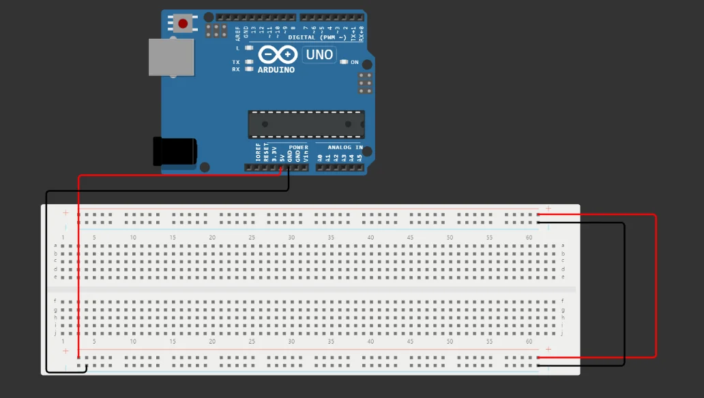
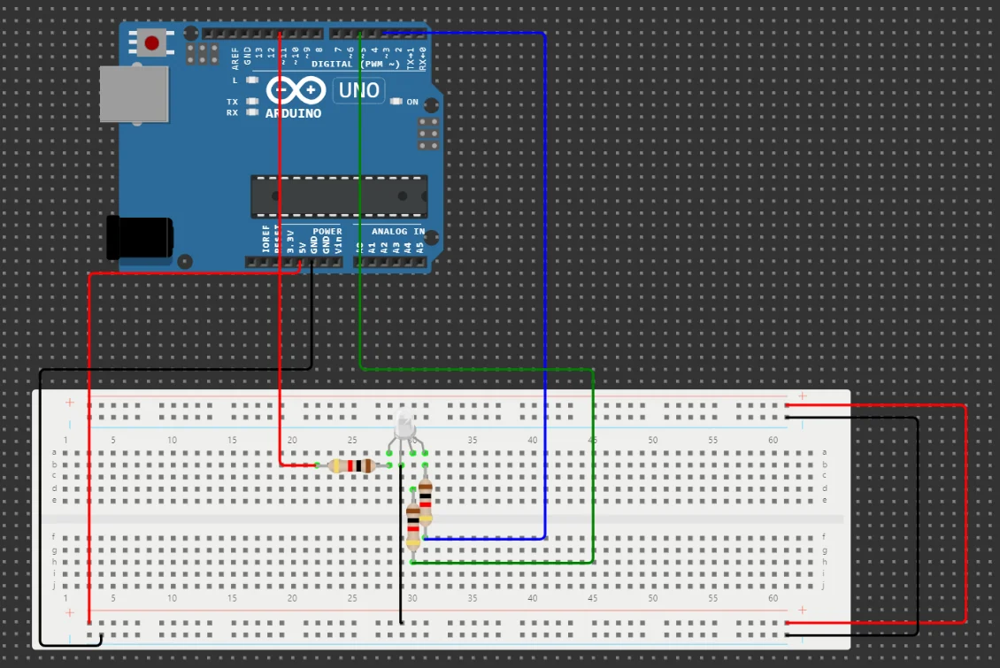
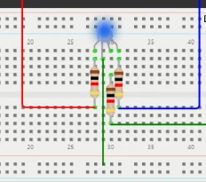
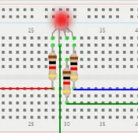
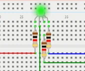
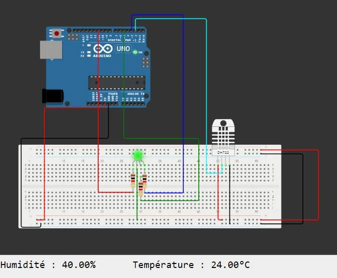
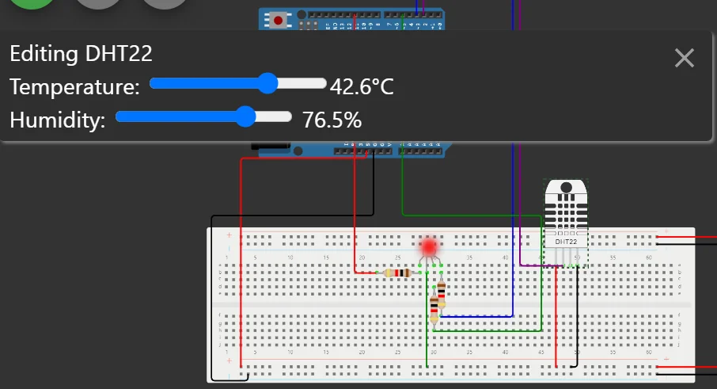

import Question from '../../../../../components/Question.astro';

:::note[Objectif de la partie]
Câbler une **LED RVB** sur une plaque de prototypage, comprendre la logique d'une **anode commune**, puis afficher la **zone thermique** mesurée par le DHT22 (exigences EF2 et EF6).
:::

## Exercice 2 — Plaque de prototypage et LED RVB

Commencez un **nouveau projet** Arduino Uno et ajoutez une plaque de prototypage (*breadboard*). Avant de placer les composants, reliez ses **rails d'alimentation** à la carte : rail **+** au **5V**, rail **−** au **GND**.



*Les rails d'alimentation de la plaque reliés au 5 V et à la masse.*

La plaque permet des **connexions temporaires sans soudure** : on ajoute, déplace et retire les composants en quelques secondes. C'est l'outil du prototypage rapide, avant de réaliser un circuit définitif.

### La LED RVB à anode commune

Une LED RVB réunit trois LED, **rouge**, **verte** et **bleue**, dans un même boîtier. Dans le modèle de Wokwi, leurs **anodes sont reliées entre elles** (broche COM) : on dit qu'elle est à **anode commune**. La broche COM va au **5 V**, et chaque couleur s'allume quand sa broche est tirée **vers 0 V**.

### Câblage

| LED RVB | Relier à |
|---|---|
| R (rouge) | résistance 220 Ω → **D11** |
| COM (commune) | rail **+** (5 V) |
| G (vert) | résistance 220 Ω → **D5** |
| B (bleu) | résistance 220 Ω → **D3** |



*Chaque couleur a sa propre résistance de 220 Ω ; la broche commune est reliée au rail + de la plaque.*

### Programme

1. Associez chaque couleur à une broche :

```cpp
int red_led = 11;
int green_led = 5;
int blue_led = 3;
```

2. Configurez ces broches en **sorties** dans `setup()`. Ce sont des broches **PWM** (marquées ~) : on peut régler l'intensité de chaque couleur.

```cpp
void setup() {
  pinMode(red_led, OUTPUT);
  pinMode(green_led, OUTPUT);
  pinMode(blue_led, OUTPUT);
}
```

3. Écrivez une fonction qui règle les trois intensités en PWM :

```cpp
void led_color(int red_value, int green_value, int blue_value) {
  analogWrite(red_led, red_value);
  analogWrite(green_led, green_value);
  analogWrite(blue_led, blue_value);
}
```

4. Faites défiler trois couleurs dans `loop()` :

```cpp
void loop() {
  led_color(0, 255, 255);
  delay(2000);
  led_color(255, 0, 255);
  delay(2000);
  led_color(255, 255, 0);
  delay(2000);
}
```

Testez avant de continuer : vous devez obtenir successivement du **rouge**, du **vert** et du **bleu**.





*Les trois couleurs obtenues.*

<Question id="tp2-q2.1" label="Q2.1">
Sur une plaque de prototypage, quels trous sont reliés électriquement entre eux ? Distinguez les **rangées de la zone centrale** et les **rails d'alimentation**.
</Question>

<Question id="tp2-q2.2" label="Q2.2">
Pourquoi les trois couleurs sont-elles branchées sur les broches 3, 5 et 11 ?
</Question>

<Question id="tp2-q2.3" label="Q2.3">
Expliquez pourquoi `led_color(0, 255, 255)` donne du **rouge** alors que la valeur 0 signifie habituellement « éteint ».
</Question>

<Question id="tp2-q2.4" label="Q2.4">
Quelles valeurs faut-il passer à `led_color()` pour obtenir du **jaune**, du **magenta**, du **blanc**, puis pour **éteindre** la LED ?
</Question>

<Question id="tp2-q2.5" label="Q2.5" type="code" categorie="ingenieur">
Écrivez une fonction `couleur(int r, int v, int b)` qui reçoit des intensités en **logique directe** (255 = allumé à fond) et fonctionne avec une LED à anode **ou** à cathode commune selon une constante `ANODE_COMMUNE`. Quel est l'intérêt de cette couche d'abstraction si le fournisseur change de LED ?
</Question>

## Exercice 3 — Couleur selon la température

Ajoutez le **DHT22** de la partie A à la plaque (données sur **D2**) et réunissez les programmes des deux exercices.



*La LED RVB et le DHT22 sur la même plaque. Le moniteur série affiche les mesures.*

Modifiez `loop()` pour que la couleur dépende de la température mesurée. Les seuils sont des **constantes nommées**, conformes à l'exigence EF2 :

```cpp
const float SEUIL_FROID = 10.0;  // °C
const float SEUIL_CHAUD = 38.0;  // °C

// Dans loop(), après readSensorData() :
if (temperature > SEUIL_CHAUD) {
  led_color(0, 255, 255);    // rouge : température élevée
} else if (temperature < SEUIL_FROID) {
  led_color(255, 255, 0);    // bleu : température basse
} else {
  led_color(255, 0, 255);    // vert : température normale
}
```

Cliquez sur le capteur pendant la simulation et faites varier la température pour vérifier les **trois états**. Assurez-vous que les valeurs du moniteur série sont identiques à celles réglées sur le capteur.



*En cliquant sur le capteur, on règle la température : ici 42,6 °C, et la LED passe au rouge.*

<Question id="tp2-q3.1" label="Q3.1">
Complétez le **tableau de tests** : pour 5 °C, 24 °C et 39 °C, indiquez la couleur attendue d'après EF2 et la couleur observée.
</Question>

<Question id="tp2-q3.2" label="Q3.2" categorie="ingenieur">
**Valeurs limites.** Quelle couleur s'affiche pour exactement 10,0 °C et pour exactement 38,0 °C ? Ce comportement est-il conforme à EF2 ? Pourquoi teste-t-on toujours les valeurs limites ?
</Question>

<Question id="tp2-q3.3" label="Q3.3" categorie="surete">
Reprenez la version de `readSensorData()` donnée dans la partie A et faites échouer la lecture (`DHTPIN` à 3). Quelle couleur la LED affiche-t-elle ? Expliquez ce résultat (indice : que vaut une comparaison avec `NaN` ?). En quoi est-ce un **défaut de sûreté** ? Proposez une correction conforme à EF6.
</Question>

<Question id="tp2-q3.4" label="Q3.4" categorie="ingenieur">
Quand la température oscille autour de 38 °C (37,9 puis 38,1 puis 37,9…), la LED change sans cesse de couleur. Proposez un mécanisme d'**hystérésis** de 1 °C : à quelles températures la LED doit-elle passer au rouge, puis revenir au vert ?
</Question>

## Critères de validation

- [ ] La LED affiche successivement rouge, vert et bleu (exercice 2).
- [ ] La couleur suit la température réglée sur le capteur, y compris aux valeurs limites (exercice 3).
- [ ] Un capteur en panne ne produit **jamais** la couleur verte.
- [ ] Les questions Q2.1 à Q3.4 ont une réponse justifiée.

:::note[Prochaine étape]
Validez cette page, puis passez à la [partie C : bouton et écran LCD](/Embedded-System-Course/parcours/chapitre-2/tp2/04-bouton-lcd/).
:::
