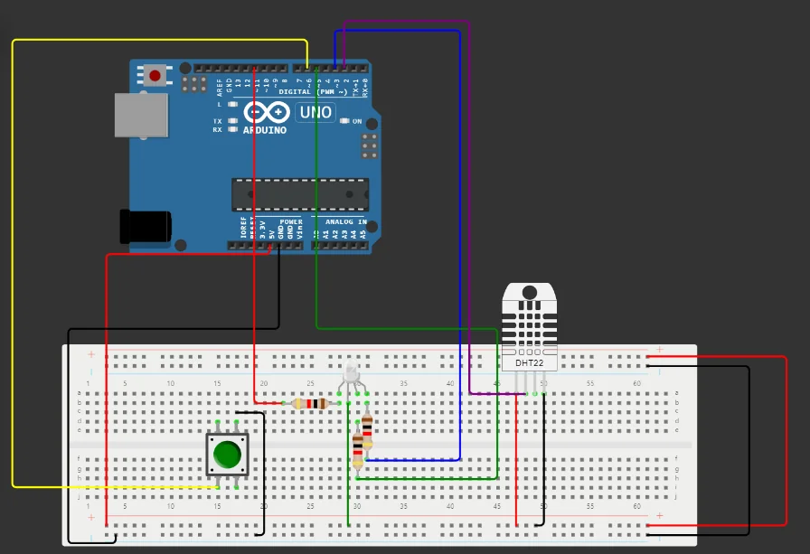

import Question from '../../../../../components/Question.astro';

:::note[Objectif de la partie]
Construire l'**interface homme-machine** du contrôleur : un bouton déclenche une acquisition et un **écran LCD 16×2** relié par le **bus I²C** affiche les mesures (exigence EF3).
:::

## Exercice 4 — Acquisition à la demande et affichage LCD

On souhaite que l'acquisition de la température et de l'humidité soit **déclenchée par un bouton-poussoir** : un appui provoque une mesure et son affichage. Sans appui, l'écran **conserve** la dernière mesure jusqu'à l'appui suivant.

### Câblage

Partez du montage de la partie B et ajoutez :

| Composant | Broche du composant | Relier à |
|---|---|---|
| Bouton-poussoir | une broche | **D6** |
| Bouton-poussoir | broche opposée | **GND** |
| Écran LCD 16×2 (`pins` = `i2c`) | GND | **GND** |
| Écran LCD | VCC | **5V** |
| Écran LCD | SDA | **A4** |
| Écran LCD | SCL | **A5** |



*Le bouton est relié à D6 et à la masse. Ajoutez l'écran LCD : quatre fils suffisent.*

Ajoutez la bibliothèque **LiquidCrystal I2C** au projet.

### Programme

Déclarations, avant `setup()` :

```cpp
#include <Wire.h>
#include <LiquidCrystal_I2C.h>

const int buttonPin = 6;

// Écran LCD à l'adresse I2C 0x27 : 16 colonnes, 2 lignes
LiquidCrystal_I2C lcd(0x27, 16, 2);
```

À ajouter dans `setup()` :

```cpp
pinMode(buttonPin, INPUT_PULLUP);  // bouton relié à la masse : appuyé = LOW
lcd.init();                        // initialisation de l'écran
lcd.backlight();                   // rétroéclairage allumé
```

Une fonction affiche les données sur l'écran :

```cpp
void displayDataOnLCD() {
  lcd.clear();
  lcd.setCursor(0, 0);         // colonne 0, ligne 0
  lcd.print("Humidite: ");
  lcd.print(humidity);
  lcd.print("%");
  lcd.setCursor(0, 1);         // colonne 0, ligne 1
  lcd.print("Temperature: ");
  lcd.print(temperature);
  lcd.print("C");
}
```

Une autre fonction lit le bouton et déclenche l'acquisition puis l'affichage :

```cpp
void checkButton() {
  int btnState = digitalRead(buttonPin);
  if (btnState == LOW) {
    readSensorData();
    displayDataOnLCD();
  }
}
```

Appelez `checkButton()` dans `loop()`, lancez la simulation et appuyez sur le bouton.

<Question id="tp2-q4.1" label="Q4.1">
Pourquoi le bouton est-il considéré comme appuyé quand la broche lit **LOW** ? Pourquoi n'a-t-on pas besoin de résistance externe ?
</Question>

<Question id="tp2-q4.2" label="Q4.2">
L'écran n'utilise que **deux fils de données**. Comment s'appelle ce bus ? Quelles broches de l'UNO portent SDA et SCL ? Que représente le nombre **0x27** ?
</Question>

<Question id="tp2-q4.3" label="Q4.3" categorie="ingenieur">
Comptez les caractères de la ligne `Temperature: 24.00C`. Tient-elle sur l'écran ? Proposez un format d'affichage qui tient sur **16 caractères**, avec une décimale et le symbole degré (`lcd.print((char)223)` affiche « ° » sur cet écran).
</Question>

<Question id="tp2-q4.4" label="Q4.4" type="code">
Avec `checkButton()` tel quel, l'écran est effacé et réécrit **tant que** le bouton reste enfoncé, et il clignote. Modifiez la fonction pour qu'**un appui = une seule acquisition** : détectez le **front descendant** du bouton et filtrez les rebonds. L'affichage reste figé jusqu'à l'appui suivant. Collez votre code.
</Question>

<Question id="tp2-q4.5" label="Q4.5" categorie="ingenieur">
Si `loop()` contient encore `delay(2000)`, certains appuis courts sont ignorés. Pourquoi ? Comment garantir à la fois une mesure toutes les 2 s **et** une réaction immédiate au bouton ?
</Question>

## Critères de validation

- [ ] Un appui sur le bouton affiche la température et l'humidité ; l'affichage reste stable jusqu'à l'appui suivant.
- [ ] Les deux lignes tiennent sur l'écran, avec une unité lisible.
- [ ] Un appui bref est toujours pris en compte.
- [ ] Les questions Q4.1 à Q4.5 ont une réponse justifiée.

:::note[Prochaine étape]
Validez cette page, puis passez à la [partie D : alarme sonore, unités et défi](/Embedded-System-Course/parcours/chapitre-2/tp2/05-alarme-defi/).
:::
