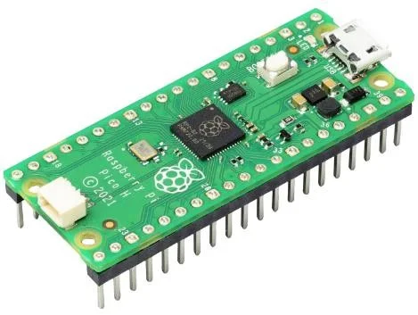
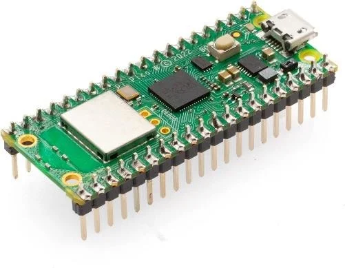

import Question from '../../../../components/Question.astro';

:::note[Objectif de l'exercice]
Identifier les caractéristiques des cartes **Pi Pico** et **Pi Pico W**, puis situer la Pico par rapport au **Raspberry Pi 5** : microcontrôleur ou microprocesseur ?
:::

## Deux cartes, un même microcontrôleur

La **Raspberry Pi Pico W** est une carte compacte, dotée d'une interface **WiFi**, et basée sur le microcontrôleur **RP2040** conçu par Raspberry Pi. La Pico « H » est la version sans WiFi. Les deux cartes se programment en C/C++ ou en **MicroPython** par leur port micro-USB.

*La Raspberry Pi Pico H.*

*La Raspberry Pi Pico W, avec WiFi (2022).*

Consultez la fiche technique de la Pico sur le site de Raspberry Pi ([documentation Pico](https://www.raspberrypi.com/documentation/microcontrollers/pico-series.html)), puis répondez.

<Question id="pico-q1.1" label="Q1.1">
Quel **microcontrôleur** équipe les deux cartes ? Donnez son nombre de cœurs, son architecture, sa fréquence maximale, sa mémoire vive (SRAM) et la taille de la mémoire flash de la carte.
</Question>

<Question id="pico-q1.2" label="Q1.2">
Comparez la **Pico H** et la **Pico W** : quel composant la Pico W ajoute-t-elle, et quelles connectivités apporte-t-il ? Que signifie la lettre **H** ?
</Question>

<Question id="pico-q1.3" label="Q1.3">
En vous appuyant sur la [chaîne IoT du chapitre 1](/Embedded-System-Course/parcours/chapitre-1/04-chaine-iot/), donnez **un exemple d'application** que la Pico W rend possible et que la Pico H ne permet pas seule.
</Question>

<Question id="pico-q1.4" label="Q1.4">
Combien de broches **GPIO** et combien d'**entrées analogiques** (ADC) la Pico met-elle à disposition ? Comparez avec l'Arduino UNO. Les broches de la Pico fonctionnent en **3,3 V** : quelle précaution faut-il prendre avec un capteur prévu pour 5 V ?
</Question>

## Comparer avec le Raspberry Pi 5

Revoyez les pages [la famille Raspberry Pi](/Embedded-System-Course/parcours/chapitre-3/01-famille-raspberry-pi/) et [la carte Raspberry Pi 5](/Embedded-System-Course/parcours/chapitre-3/02-carte-raspberry-pi-5/), ainsi que les diapositives du cours.

<Question id="pico-q1.5" label="Q1.5">
La Pico et le Raspberry Pi 5 portent le même nom de famille. Laquelle des deux cartes est construite autour d'un **microcontrôleur**, laquelle autour d'un **microprocesseur** ? Comparez-les sur quatre critères : processeur, mémoire, système d'exploitation, consommation.
</Question>

<Question id="pico-q1.6" label="Q1.6">
Pour chacun de ces projets, choisiriez-vous une **Pico W** ou un **Raspberry Pi 5** ? Justifiez.
1. Une station météo sur batterie qui envoie une mesure toutes les 10 minutes.
2. Une caméra qui reconnaît les visages et affiche le résultat sur un écran HDMI.
3. Une serre qui allume un ventilateur au-dessus de 30 °C.
</Question>

## Critères de validation

- [ ] Je sais présenter le RP2040 et ses principales caractéristiques.
- [ ] Je sais distinguer la Pico H, la Pico W et le Raspberry Pi 5.
- [ ] Les questions Q1.1 à Q1.6 ont une réponse justifiée.

:::note[Prochaine étape]
Validez cette page, puis passez à l'[exercice 2 : premier projet MicroPython](/Embedded-System-Course/parcours/chapitre-5/ex02-premier-projet/).
:::
