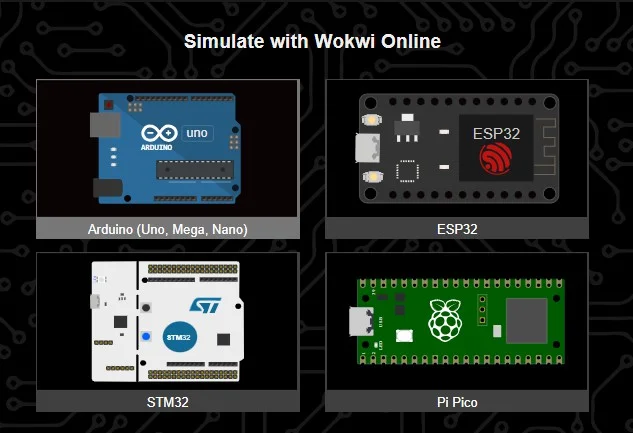
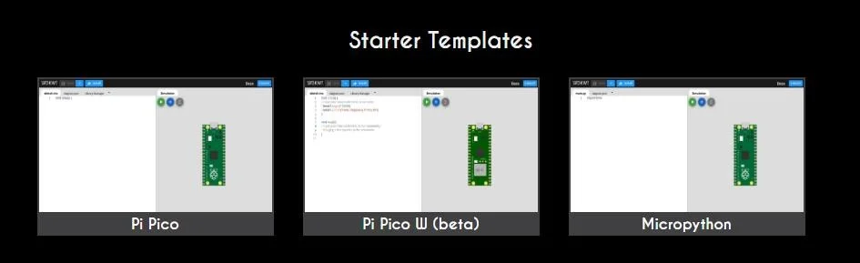

import Question from '../../../../components/Question.astro';

:::note[Objectif de l'exercice]
Créer un premier projet **Pi Pico** dans Wokwi, comparer un programme écrit en C++ et un programme écrit en **MicroPython**, puis faire clignoter la **LED intégrée** de la carte.
:::

## Étape 1 : créer le projet

Sur [wokwi.com](https://wokwi.com/), créez un nouveau projet et choisissez la carte **Pi Pico**.



*Dans Wokwi, choisissez la famille de cartes « Pi Pico ».*

Wokwi propose alors plusieurs modèles de départ (*starter templates*). Choisissez d'abord le modèle **Pi Pico**.



*Trois modèles de départ : Pi Pico, Pi Pico W et MicroPython.*

<Question id="pico-q2.1" label="Q2.1">
Analysez le code du modèle de départ **Pi Pico**. Que constatez-vous ? Dans quel langage est-il écrit ? Quelles fonctions y retrouvez-vous, déjà rencontrées avec l'Arduino UNO ?
</Question>

## Étape 2 : le modèle MicroPython

Revenez à la page d'accueil, puis choisissez le modèle **MicroPython**. Remplacez le contenu du fichier `main.py` par le code ci-dessous :

```python
from machine import Pin
import time

pin_led = Pin(25, mode=Pin.OUT)

while True:
    pin_led.on()
    time.sleep(1)
    pin_led.off()
    time.sleep(1)
```

Exécutez le code et observez le résultat sur la carte.

:::caution[L'indentation compte]
En Python, ce sont les **espaces en début de ligne** qui indiquent quelles instructions appartiennent à la boucle `while`. Il n'y a ni accolades ni points-virgules.
:::

<Question id="pico-q2.2" label="Q2.2">
Décrivez le résultat observé. Quelle est la **période** du clignotement ? Quelle ligne fixe la durée d'allumage ?
</Question>

<Question id="pico-q2.3" label="Q2.3">
Avons-nous besoin des fonctions `setup()` et `loop()` sur la Raspberry Pi Pico programmée en MicroPython ? Quelles lignes du programme jouent le rôle de `setup()`, et lesquelles celui de `loop()` ?
</Question>

<Question id="pico-q2.4" label="Q2.4">
Expliquez l'instruction `Pin(25, mode=Pin.OUT)` : que représente le nombre **25** ? Pourquoi le mode **OUT** ? Quelle instruction Arduino joue le même rôle ?
</Question>

<Question id="pico-q2.5" label="Q2.5">
Comparez ce programme avec le clignotement écrit en C++ au [TP1](/Embedded-System-Course/parcours/chapitre-2/tp1/ex02-clignotement/) : donnez l'équivalent MicroPython de `digitalWrite(13, HIGH)` et de `delay(1000)`. Attention à l'unité de `time.sleep()`.
</Question>

## Étape 3 : variantes

<Question id="pico-q2.6" label="Q2.6" type="code">
Modifiez le programme pour que la LED reste allumée **200 ms** et éteinte **800 ms**. Réécrivez ensuite la boucle avec la méthode `toggle()`, qui inverse l'état de la LED : est-ce encore possible avec deux durées différentes ? Collez vos deux versions.
</Question>

<Question id="pico-q2.7" label="Q2.7" type="code">
Sur la **Pico W**, la LED intégrée n'est pas reliée à la broche GP25 du RP2040, mais à une broche de la **puce WiFi**. En MicroPython, on la désigne par son nom : `Pin("LED", Pin.OUT)`. Créez un projet avec une carte **Pi Pico W**, adaptez le programme et collez-le. Pourquoi un nom plutôt qu'un numéro rend-il le code plus **portable** ?
</Question>

<Question id="pico-q2.8" label="Q2.8">
Collez le lien de votre projet Wokwi (version MicroPython).
</Question>

## Critères de validation

- [ ] La LED intégrée clignote avec une période de 2 s.
- [ ] Je sais expliquer le rôle de `while True` et de `time.sleep()`.
- [ ] Le programme fonctionne aussi sur une Pico W.
- [ ] Les questions Q2.1 à Q2.8 ont une réponse.

:::note[Prochaine étape]
Validez cette page, puis passez à l'[exercice 3 : température et humidité](/Embedded-System-Course/parcours/chapitre-5/ex03-temperature-humidite/).
:::
