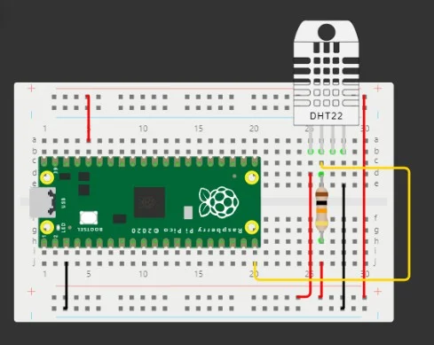
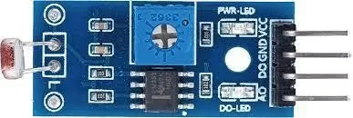

import Question from '../../../../components/Question.astro';

:::note[Objectif de l'exercice]
Câbler proprement sur une **plaque de prototypage**, puis ajouter un capteur **analogique** : une **photorésistance**, lue par le convertisseur analogique-numérique (ADC) de la Pico.
:::

## Étape 1 : passer sur la plaque de prototypage

Partez d'une copie du projet de l'exercice 3. Refaites le montage en ajoutant une **plaque de prototypage** (*breadboard*) et une **résistance**, comme le montre la figure ci-dessous.



*La Pico est enfichée à cheval sur la rainure centrale de la plaque ; le DHT22 et une résistance complètent le montage.*

Réexécutez le code pour vous assurer qu'il fonctionne toujours. Besoin d'un rappel sur l'organisation des trous de la plaque ? Revoyez l'[exercice 7 du TP1](/Embedded-System-Course/parcours/chapitre-2/tp1/ex07-led-rvb/).

<Question id="pico-q4.1" label="Q4.1">
Pourquoi enfiche-t-on la Pico **à cheval sur la rainure centrale** de la plaque ? Que se passerait-il si on la posait entièrement d'un seul côté ?
</Question>

<Question id="pico-q4.2" label="Q4.2">
Entre quelles broches du DHT22 la résistance est-elle placée ? Quel est son **rôle** ? Quelle valeur la fiche technique du DHT22 recommande-t-elle ?
</Question>

## Étape 2 : ajouter une photorésistance

Cherchez dans Wokwi le capteur représenté ci-dessous et ajoutez-le à votre plan de montage.



*Un module photorésistance (image : documentation SunFounder).*

Une **photorésistance** est un composant dont la **résistance électrique varie selon l'intensité lumineuse** qu'elle reçoit. On l'appelle aussi **LDR** (*Light-Dependent Resistor*), résistance dépendante de la lumière. On l'utilise couramment comme capteur de lumière, pour détecter l'obscurité ou réguler une luminosité.

| Module photorésistance | Relier à la Pico |
|---|---|
| VCC | **3V3** |
| GND | **GND** |
| AO (sortie analogique) | **GP26** (ADC0) |
| DO (sortie numérique) | rien pour l'instant |

<Question id="pico-q4.3" label="Q4.3">
Quel est le **rôle** de ce capteur ? Quelles **broches** sont utilisées dans cette manipulation ?
</Question>

<Question id="pico-q4.4" label="Q4.4">
Le module possède deux sorties, **AO** et **DO**. Quelle est la différence entre les deux ? Pourquoi la sortie AO doit-elle être reliée à **GP26, GP27 ou GP28**, et pas à n'importe quelle broche ?
</Question>

## Étape 3 : lire la luminosité

En MicroPython, une entrée analogique se lit avec la classe `ADC` :

```python
from machine import ADC

ldr = ADC(26)            # GP26 = entrée analogique ADC0
valeur = ldr.read_u16()  # valeur entière entre 0 et 65535
```

Lancez la simulation, cliquez sur le capteur et faites varier la luminosité avec le curseur.

<Question id="pico-q4.5" label="Q4.5">
Quand la lumière **augmente**, la valeur lue augmente-t-elle ou diminue-t-elle ? Proposez une explication.
</Question>

<Question id="pico-q4.6" label="Q4.6">
L'ADC du RP2040 est un convertisseur **12 bits**, mais `read_u16()` renvoie une valeur sur 16 bits (0 à 65 535). Quelle tension d'entrée correspond à la valeur 32 768 ? Écrivez la formule qui convertit la valeur lue en **pourcentage de luminosité** (100 % = lumière maximale).
</Question>

<Question id="pico-q4.7" label="Q4.7" type="code">
Complétez le programme de l'exercice 3 : toutes les 5 secondes, il affiche la **température**, l'**humidité** et la **luminosité en %**. Collez votre programme.
</Question>

<Question id="pico-q4.8" label="Q4.8">
Collez le lien de votre projet Wokwi.
</Question>

## Critères de validation

- [ ] Le montage fonctionne sur la plaque de prototypage.
- [ ] La console affiche la température, l'humidité et la luminosité en %.
- [ ] La luminosité affichée suit le curseur du capteur dans le bon sens.
- [ ] Les questions Q4.1 à Q4.8 ont une réponse.

:::note[Prochaine étape]
**Enregistrez ce projet** : l'exercice 5 le complète. Validez cette page, puis passez à l'[exercice 5 : écran LCD et LED de signalisation](/Embedded-System-Course/parcours/chapitre-5/ex05-lcd-signalisation/).
:::
