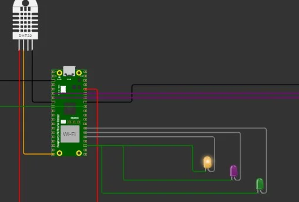
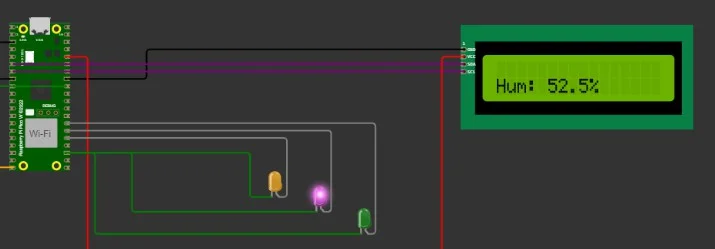
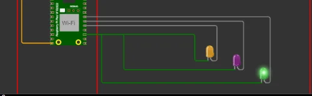

import Question from '../../../../components/Question.astro';

:::note[Objectif de l'exercice]
Une fois les données affichées dans la console avec `print()`, passez à l'étape suivante : afficher les **mêmes données sur un écran LCD**, et signaler par une **LED** la mesure en cours d'acquisition.
:::

## Le scénario

On ajoute **3 LED** qui servent de **signalétique**, synchronisées avec l'affichage sur l'écran LCD :

| Mesure en cours d'acquisition | LED allumée | Écran LCD |
|---|---|---|
| Température (DHT22) | **jaune** | `Temp: 24.0 C` |
| Humidité (DHT22) | **violette** | `Hum: 52.5%` |
| Luminosité (photorésistance) | **verte** | `Lum: 80%` |



*Acquisition de la température : la LED jaune s'allume.*



*Acquisition de l'humidité : la LED violette s'allume et l'écran affiche la mesure.*



*Acquisition de la luminosité : la LED verte s'allume.*

## Câblage

Partez d'une copie du projet de l'exercice 4 et ajoutez :

| Composant | Broche du composant | Relier à la Pico |
|---|---|---|
| Écran LCD 16×2 (attribut `pins` = `i2c`) | GND | **GND** |
| Écran LCD | VCC | **3V3** |
| Écran LCD | SDA | **GP0** |
| Écran LCD | SCL | **GP1** |
| LED jaune | anode, via 220 Ω | **GP10** |
| LED violette | anode, via 220 Ω | **GP11** |
| LED verte | anode, via 220 Ω | **GP12** |
| Les trois LED | cathode | **GND** |

<Question id="pico-q5.1" label="Q5.1">
Quel **protocole** l'écran utilise-t-il pour communiquer avec la Pico ? Combien de fils de données faut-il ? Nommez-les et donnez leur rôle (revoir la page [I2C du chapitre 3](/Embedded-System-Course/parcours/chapitre-3/05-synchrone-i2c/)).
</Question>

<Question id="pico-q5.2" label="Q5.2">
Dans Wokwi, une LED branchée sans résistance s'allume quand même. Pourquoi faut-il **toujours** une résistance en série sur une vraie carte ? Que risquent la LED et la broche de la Pico ?
</Question>

## Le pilote de l'écran

MicroPython ne contient pas de pilote pour l'écran LCD : il faut l'ajouter au projet. Dans Wokwi, ouvrez le menu **▾** à droite des onglets de fichiers, choisissez **New file…**, puis créez les deux fichiers du pilote [python_lcd](https://github.com/dhylands/python_lcd/tree/master/lcd) :

- `lcd_api.py` : les fonctions communes à tous les écrans (effacer, placer le curseur, écrire) ;
- `machine_i2c_lcd.py` : la communication avec l'écran par le bus I2C.

Copiez le contenu de chaque fichier depuis GitHub. Vous pouvez ensuite utiliser l'écran dans `main.py` :

```python
from machine import Pin, I2C
from machine_i2c_lcd import I2cLcd

# Bus I2C n° 0 : SDA sur GP0, SCL sur GP1
i2c = I2C(0, sda=Pin(0), scl=Pin(1), freq=400000)

# Écran à l'adresse I2C 0x27 : 2 lignes, 16 colonnes
lcd = I2cLcd(i2c, 0x27, 2, 16)

lcd.clear()
lcd.putstr("Bonjour !")
lcd.move_to(0, 1)          # colonne 0, ligne 1 (la deuxième)
lcd.putstr("Pi Pico")
```

<Question id="pico-q5.3" label="Q5.3">
Que représente la valeur **0x27** ? Que se passerait-il si deux composants du même bus I2C avaient la même adresse ?
</Question>

<Question id="pico-q5.4" label="Q5.4">
Ajoutez la ligne `print(i2c.scan())` après la création du bus. Qu'affiche-t-elle ? Convertissez la valeur affichée en hexadécimal.
</Question>

## Étape 1 : afficher les mesures sur l'écran

<Question id="pico-q5.5" label="Q5.5" type="code">
Modifiez votre programme pour afficher sur l'écran LCD les mêmes données que dans la console : température, humidité et luminosité. Collez votre programme.
</Question>

## Étape 2 : ajouter la signalisation

Allumez la LED **jaune** pendant l'acquisition et l'affichage de la température, la LED **violette** pour l'humidité, la LED **verte** pour la luminosité. Une seule LED est allumée à la fois, et l'écran affiche la mesure correspondante.

<Question id="pico-q5.6" label="Q5.6" type="code">
Collez votre programme final. Organisez-le en **fonctions**, par exemple `signaler(led)` et `afficher(ligne1, ligne2)`.
</Question>

<Question id="pico-q5.7" label="Q5.7">
Combien de temps dure un **cycle complet** de trois mesures dans votre programme ? À quelle fréquence la température est-elle donc rafraîchie ? Est-ce compatible avec le DHT22 ?
</Question>

<Question id="pico-q5.8" label="Q5.8">
Collez le lien de votre projet Wokwi.
</Question>

## Critères de validation

- [ ] L'écran LCD affiche successivement la température, l'humidité et la luminosité.
- [ ] Une seule LED est allumée à la fois, et sa couleur correspond à la mesure affichée.
- [ ] Le programme est organisé en fonctions.
- [ ] Les questions Q5.1 à Q5.8 ont une réponse.

:::note[Prochaine étape]
Validez cette page, puis passez à l'[exercice de synthèse : détecteur de fuite de gaz](/Embedded-System-Course/parcours/chapitre-5/synthese-detecteur-gaz/).
:::
