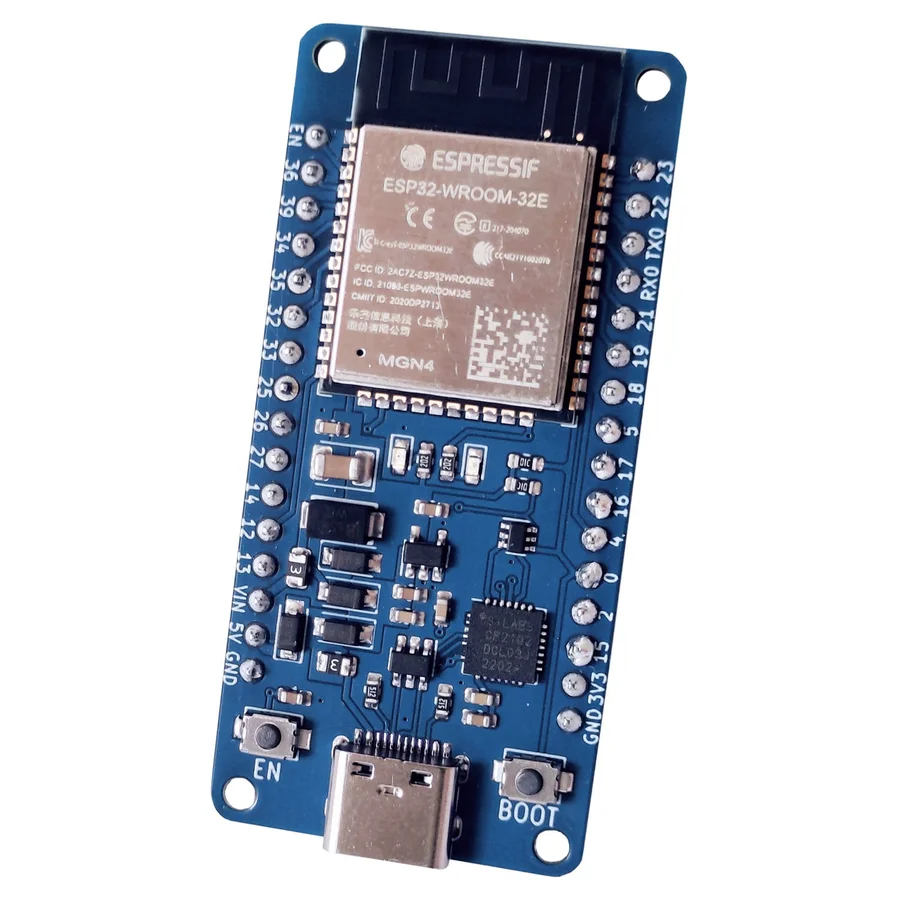
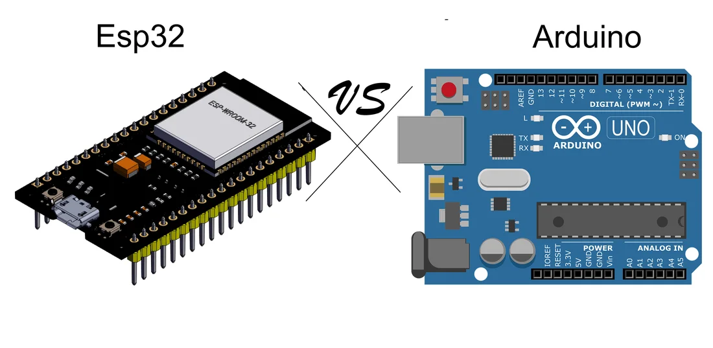
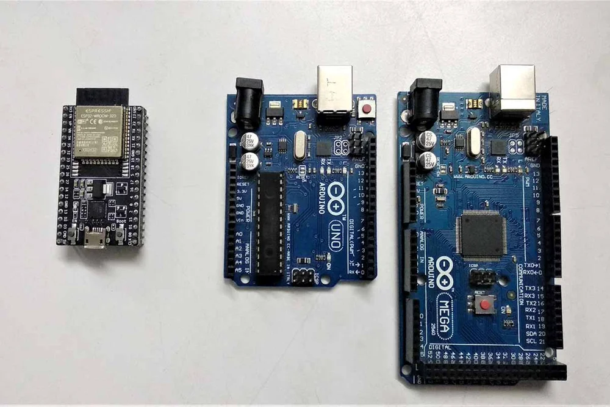

import Esp32VsArduino from '../../../../components/Esp32VsArduino.astro';
import Question from '../../../../components/Question.astro';

:::note[Objectifs]
À la fin de ce chapitre, consacré à la dernière carte du cours, vous serez capables de :
- expliquer les **limites** de l'Arduino classique et ce que l'**ESP32** apporte ;
- repérer les composants de la carte ESP32 et ses **broches** : GPIO, ADC, DAC, PWM, tactiles, I2C, SPI, UART ;
- choisir la **bonne broche** pour un capteur ou un actionneur.
:::

*À la découverte de l'ESP32.*

## Les limites de l'Arduino classique

L'Arduino doit sa **popularité historique** (depuis 2005) à sa simplicité, mais sa technologie est **vieillissante**. Ses limitations techniques :

- une fréquence d'horloge de **16 MHz** ;
- une connectivité sans fil qui nécessite des **modules externes** ;
- des capacités de traitement limitées ;
- une mémoire RAM restreinte (**2 à 8 Ko**).

Son écosystème est principalement orienté **débutants**.

## L'ESP32 en bref

L'**ESP32** est un **microcontrôleur 32 bits**, conçu par **Espressif** (Chine).

:::caution[À retenir]
L'ESP32 est un microcontrôleur à **très faible consommation et à très faible coût**.

Son avantage : il offre à la fois une connectivité **Bluetooth** et une connectivité **Wi-Fi embarquées**.
:::

Il intègre aussi des **ADC**, des **DAC**, des broches **tactiles** (Touch) et la **PWM**. Il est particulièrement adapté aux projets **embarqués** ou **IoT**.

## ESP32 ou Arduino UNO ?

*ESP32 contre Arduino UNO.*

Faites défiler jusqu'au comparatif : les barres s'animent pour comparer les deux cartes.

<Esp32VsArduino />

:::tip[En trois chiffres]
- **15 fois plus rapide** : 240 MHz contre 16 MHz.
- **Environ 250 fois plus de RAM** : 520 Ko contre 2 Ko.
- **Connectivité native** : Wi-Fi et Bluetooth, sans module externe.
:::

## La miniaturisation

*Miniaturisation extrême pour un projet embarqué ou IoT : l'ESP32, une Arduino UNO et une Arduino Mega.*

## Vérifiez vos acquis

<Question id="esp32-q6.1" label="Q6.1">
Citez **trois limites** de l'Arduino UNO que l'ESP32 dépasse.
</Question>

<Question id="esp32-q6.2" label="Q6.2">
Retrouvez par le calcul les chiffres « 15 fois plus rapide » et « 250 fois plus de RAM ». Le rapport des fréquences suffit-il à dire qu'un programme tournera **15 fois plus vite** sur l'ESP32 ? Quelles autres différences du tableau jouent aussi sur la puissance de calcul ?
</Question>

<Question id="esp32-q6.3" label="Q6.3">
Une station météo doit envoyer ses mesures sur Internet. Que faut-il **ajouter** à une Arduino UNO pour y parvenir ? Et à une ESP32 ? Quelles conséquences sur le coût, la taille et la consommation du montage ?
</Question>

## Critères de validation

- [ ] Je sais citer les limites de l'Arduino classique.
- [ ] Je sais comparer l'ESP32 et l'Arduino UNO sur la fréquence, la mémoire et la connectivité.

:::note[Prochaine étape]
Validez cette page, puis passez à [la famille ESP32 et ses usages](/Embedded-System-Course/parcours/chapitre-6/02-presentation-esp32/).
:::
