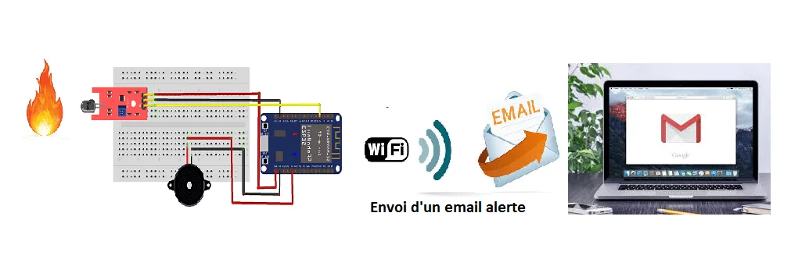
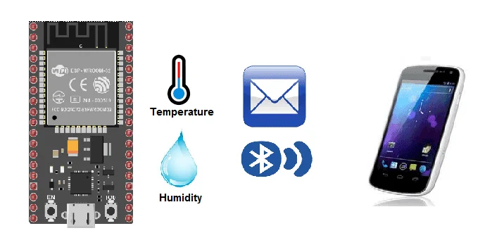
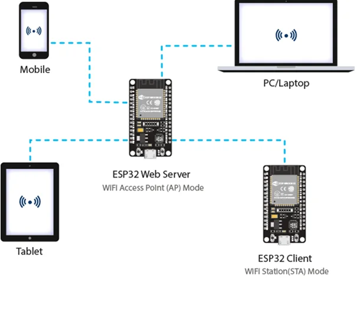

import Question from '../../../../components/Question.astro';

:::note[Objectifs]
À la fin de cette page, vous serez capables de :
- citer les caractéristiques principales de l'ESP32 ;
- distinguer la **puce**, le **module** et la **carte** ESP32 ;
- décrire deux usages typiques : l'**objet connecté** et le **serveur web embarqué**.
:::

## L'ESP32, successeur low cost de l'Arduino

**ESP32** est le nom de référence d'une **famille de cartes** basées sur la puce (*chip*) ESP32, le cœur du système : un **microcontrôleur 32 bits double cœur**, conçu par **Espressif Systems**.

| Caractéristique | ESP32 |
|---|---|
| Processeur | **Xtensa 32 bits**, double cœur, jusqu'à **240 MHz** |
| Mémoire vive | **520 Ko** de SRAM |
| Wi-Fi | **802.11 b/g/n** intégré |
| Bluetooth | **Classic** et **BLE** (Bluetooth Low Energy) |
| GPIO | multiples : **34 broches programmables** |
| Interfaces | **SPI, I²C, UART, ADC, DAC, PWM** |

### Les modules ESP32

La puce n'est jamais utilisée seule : elle est montée dans un **module**, qui porte aussi sa mémoire et son antenne.

| Module | Contient |
|---|---|
| **ESP32-WROOM-32** | la puce ESP32-D0WDQ6 |
| **ESP32-WROOM-32D** | la puce ESP32-D0WD |
| **ESP32-WROVER-IB** | la puce ESP32-D0WD + une **PSRAM** additionnelle |

:::note[Puce, module, carte : trois niveaux]
- La **puce** ESP32 : le microcontrôleur lui-même.
- Le **module** (ESP32-WROOM-32, par exemple) : la puce, sa mémoire flash et son antenne, sous un capot métallique.
- La **carte de développement** (ESP32 DevKit) : le module, plus un port USB, un régulateur de tension, des boutons et des broches faciles à câbler. C'est elle que vous utilisez en TP, et que présente la [page suivante](/Embedded-System-Course/parcours/chapitre-6/03-carte-esp32/).
:::

## Construire des objets connectés

*Un détecteur d'incendie : le capteur de flamme est lu par l'ESP32, qui envoie un e-mail d'alerte par Wi-Fi.*

*Construction d'objets connectés basés sur l'ESP32 : capteurs de température et d'humidité, e-mail, Bluetooth, smartphone.*

## Un serveur web dans un microcontrôleur

*L'ESP32 peut héberger un **serveur web** accessible par tous les appareils connectés.*

Le schéma montre les deux façons dont l'ESP32 se connecte au Wi-Fi :

- en **mode point d'accès** (*Access Point*, **AP**) : l'ESP32 crée **son propre réseau Wi-Fi**, auquel se connectent le téléphone, la tablette ou l'ordinateur ;
- en **mode station** (*Station*, **STA**) : l'ESP32 **rejoint un réseau existant**, comme n'importe quel appareil. Ici, un second ESP32 client se connecte au serveur.

Une simple page web, ouverte dans un navigateur, permet alors de lire les mesures d'un capteur ou de commander une LED à distance.

## Vérifiez vos acquis

<Question id="esp32-q6.4" label="Q6.4">
Quelle différence faites-vous entre la **puce** ESP32-D0WDQ6, le **module** ESP32-WROOM-32 et la **carte** ESP32 DevKit ?
</Question>

<Question id="esp32-q6.5" label="Q6.5">
Le module ESP32-WROVER-IB ajoute une **PSRAM**. Qu'est-ce que cela apporte ? Citez un type d'application qui en a besoin.
</Question>

<Question id="esp32-q6.6" label="Q6.6">
Décrivez le détecteur d'incendie de la première figure avec la [chaîne IoT du chapitre 1](/Embedded-System-Course/parcours/chapitre-1/04-chaine-iot/) : quel est le capteur, le traitement, le moyen de communication, et qui reçoit l'alerte ?
</Question>

<Question id="esp32-q6.7" label="Q6.7">
**Point d'accès** ou **station** : quel mode choisiriez-vous pour une serre isolée au fond d'un jardin, sans box Internet ? Et pour un capteur de température qui doit publier ses mesures sur un site web ? Justifiez.
</Question>

## Critères de validation

- [ ] Je sais citer les caractéristiques de l'ESP32 : processeur, mémoire, Wi-Fi, Bluetooth, interfaces.
- [ ] Je sais distinguer la puce, le module et la carte.
- [ ] Je sais expliquer les modes point d'accès et station.

:::note[Prochaine étape]
Validez cette page, puis passez à [la carte ESP32](/Embedded-System-Course/parcours/chapitre-6/03-carte-esp32/) pour l'explorer composant par composant.
:::
