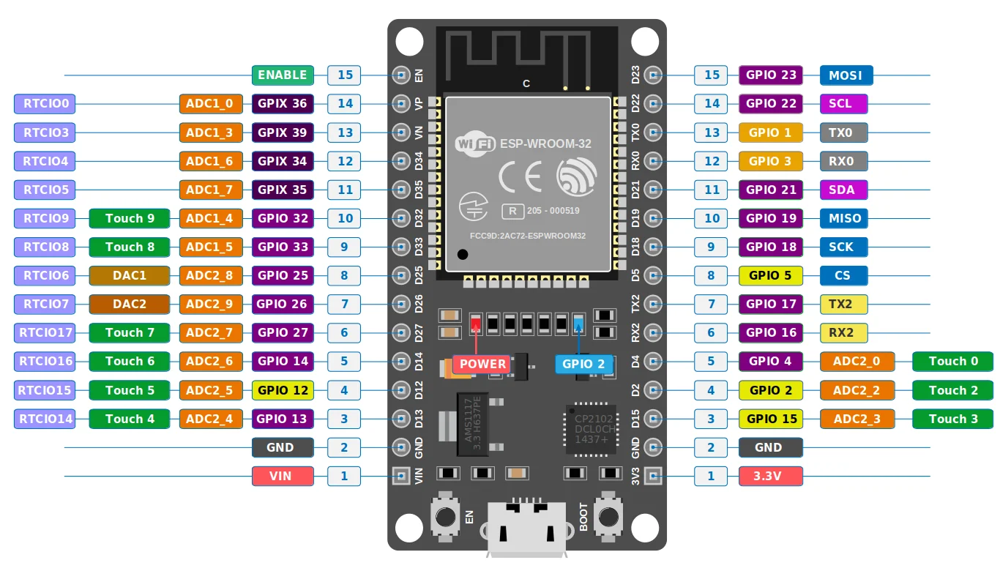

import Esp32Gpio from '../../../../components/Esp32Gpio.astro';
import Question from '../../../../components/Question.astro';

:::note[Objectifs]
À la fin de cette page, vous serez capables de :
- lire le **brochage** de la carte ESP32 ;
- distinguer les GPIO d'**entrée/sortie** et les broches en **lecture seule** ;
- dire ce que **chaque broche** sait faire, et choisir la bonne pour un composant.
:::

## Explorez le brochage

La carte compte **30 broches**, 15 de chaque côté, numérotées de 15 (côté antenne) à 1 (côté port USB).

- **Cliquez sur une broche** pour afficher sa fiche : ce qu'elle sait faire (✓ ou ✗) et un exemple de code.
- Les **boutons de couleur** mettent une famille en évidence : les étiquettes s'animent pour afficher le canal ADC, le numéro Touch, la ligne SPI…
- Le **mode défi** vous demande de trouver la bonne broche pour huit situations.

<Esp32Gpio />

## Le brochage du cours



*Le brochage complet de la carte ESP32 DevKit (30 broches).*

## Les broches GPIO

Les **GPIO** sont des broches d'**entrée/sortie numérique programmables**. Toutes les broches GPIO, sauf les quatre broches en lecture seule, peuvent être utilisées comme **entrée** ou **sortie numérique**.

Utilisations :
- **lire un bouton** (entrée) ;
- **commander une LED ou un relais** (sortie).

| Type de broche | Valeur | Exemple | Niveaux |
|---|---|---|---|
| **Numérique** (GPIO classique) | 0 ou 1 | lire un bouton, allumer une LED | `LOW` ou `HIGH` |

## Les broches en lecture seule (GPI)

Les broches **GPIO 34, 35, 36 et 39** sont uniquement des **entrées** : elles ne peuvent **pas fonctionner comme sorties**. Sur le brochage du cours, elles sont notées **GPIX**.

:::danger[À retenir]
Ces broches ne peuvent **jamais** être configurées en sortie : `pinMode(pin, OUTPUT)` ✗

Elles peuvent lire :
- des **signaux numériques** → `digitalRead()` ;
- des **signaux analogiques** → `analogRead()`, car elles sont reliées à l'**ADC1**.
:::

```cpp
const int CAPTEUR = 34;            // entrée seule, ADC1 canal 6

void setup() {
  Serial.begin(115200);
  pinMode(CAPTEUR, INPUT);         // ✓ en entrée
  // pinMode(CAPTEUR, OUTPUT);     // ✗ impossible
}

void loop() {
  Serial.println(analogRead(CAPTEUR));   // de 0 à 4095
  delay(500);
}
```

Ces quatre broches n'ont pas non plus de **résistance de tirage interne** : `INPUT_PULLUP` est sans effet. Pour y brancher un bouton, il faut ajouter une résistance externe.

## Les broches de démarrage

Sur le brochage, **GPIO 2, 5, 12 et 15** sont en jaune. Ce sont des **broches de démarrage** (*strapping pins*) : au moment du reset, l'ESP32 lit leur niveau pour choisir son mode de démarrage.

:::caution[Important]
Ces broches sont utilisables dans un programme, mais un composant qui les force à un niveau au démarrage peut **empêcher la carte de démarrer** ou **bloquer le téléversement**. Par exemple, GPIO 12 doit être à l'état bas au démarrage. Choisissez-les en dernier.
:::

## Alimentation et masse

| Broche | Rôle |
|---|---|
| **VIN** | entrée d'alimentation 5 V, quand la carte n'est pas alimentée par l'USB |
| **3V3** | sortie 3,3 V du régulateur, pour alimenter un capteur |
| **GND** | masse (0 V), une de chaque côté |
| **EN** | remise à zéro (reset), comme le bouton EN |

## Vérifiez vos acquis

<Question id="esp32-q6.12" label="Q6.12">
Pourquoi ne peut-on pas commander une LED avec **GPIO 34** ? Que peut-on faire avec cette broche ?
</Question>

<Question id="esp32-q6.13" label="Q6.13">
Un élève branche un bouton entre **GPIO 35** et GND, avec `pinMode(35, INPUT_PULLUP)`. La lecture est instable, même sans appui. Expliquez pourquoi et proposez **deux solutions**.
</Question>

<Question id="esp32-q6.14" label="Q6.14">
Faites le **mode défi** du brochage. Quel score obtenez-vous ? Pour chaque erreur, expliquez pourquoi la broche choisie ne convenait pas.
</Question>

## Critères de validation

- [ ] Je sais lire le brochage : position, numéro GPIO, sérigraphie.
- [ ] Je sais citer les quatre broches en lecture seule.
- [ ] Je sais pourquoi on choisit les broches de démarrage en dernier.

:::note[Prochaine étape]
Validez cette page, puis passez à [l'ADC : lire une tension](/Embedded-System-Course/parcours/chapitre-6/05-adc/).
:::
