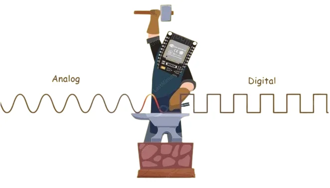
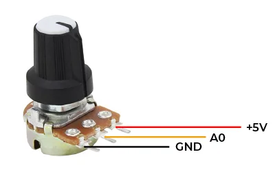
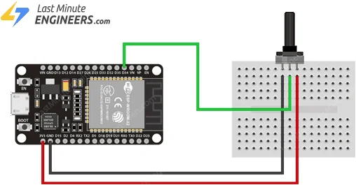
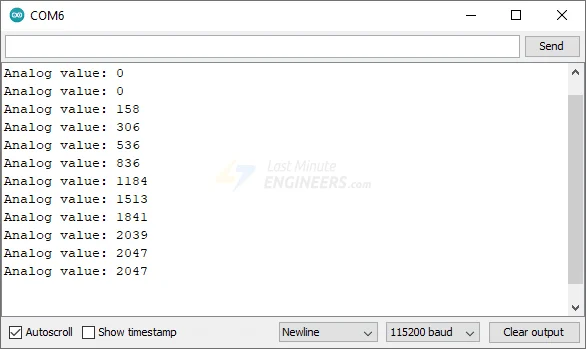

import Esp32Signal from '../../../../components/Esp32Signal.astro';
import Question from '../../../../components/Question.astro';

:::note[Objectifs]
À la fin de cette page, vous serez capables de :
- expliquer ce que fait un **ADC** et calculer la valeur lue pour une tension ;
- choisir entre **ADC1** et **ADC2** ;
- lire un **potentiomètre** avec `analogRead()`.
:::

## Deux convertisseurs : ADC1 et ADC2

L'ESP32 possède deux **convertisseurs analogique-numérique** internes, **ADC1** et **ADC2**, disponibles sur plusieurs broches.

:::caution[À retenir]
Les ADC **convertissent une tension analogique en valeur numérique**.
:::



*L'ADC « forge » un signal analogique en valeurs numériques.*

Ils servent à lire des **capteurs analogiques** : température, luminosité, potentiomètre… Sur la carte du cours, on compte **15 canaux** (ADC1 et ADC2).

| Type de broche | Valeur | Exemple | Valeur lue |
|---|---|---|---|
| **Analogique** (ADC) | tension variable entre **0 V et 3,3 V** | lire un capteur (température, lumière, potentiomètre) | de **0 à 4095** (valeur numérique sur **12 bits**) |

| Convertisseur | Broches de la carte |
|---|---|
| **ADC1** (6 canaux) | GPIO 36, 39, 34, 35, 32, 33 |
| **ADC2** (9 canaux) | GPIO 4, 2, 15, 13, 12, 14, 27, 25, 26 |

Pour les voir sur la carte, ouvrez le [brochage interactif](/Embedded-System-Course/parcours/chapitre-6/04-broches-gpio/) et cliquez sur les boutons **ADC1** et **ADC2** : chaque broche affiche son canal.

:::danger[ADC2 et Wi-Fi]
L'**ADC2** est utilisé par le pilote **Wi-Fi**. Quand le Wi-Fi est actif, `analogRead()` ne fonctionne plus sur les broches de l'ADC2. Pour un objet connecté, branchez vos capteurs analogiques sur l'**ADC1**.
:::

## Exemple : lire un potentiomètre

Un **potentiomètre** transforme un **mouvement physique** (on tourne le bouton) en **tension électrique**. Ses deux broches extrêmes sont reliées à l'alimentation et à la masse ; la broche du milieu, le **curseur**, fournit une tension entre les deux.



*Un potentiomètre et ses trois broches. Ce schéma vient de l'Arduino (+5 V, A0) : sur l'ESP32, reliez l'extrémité au **3V3**, jamais au 5 V.*



*Le potentiomètre relié à l'ESP32 : 3V3, GND et une entrée analogique.*

| Potentiomètre | Relier à l'ESP32 |
|---|---|
| Une extrémité | **3V3** |
| Curseur (milieu) | **GPIO 34** (ADC1, canal 6) |
| Autre extrémité | **GND** |

```cpp
const int POT = 34;   // curseur du potentiomètre

void setup() {
  Serial.begin(115200);
}

void loop() {
  int valeur = analogRead(POT);   // de 0 à 4095
  Serial.print("Analog value: ");
  Serial.println(valeur);
  delay(500);
}
```



*Dans le moniteur série, les valeurs augmentent quand on tourne le potentiomètre.*

## Essayez le simulateur

Tournez le potentiomètre avec le curseur : la tension sur GPIO 34 et la valeur lue changent en direct. Lancez le **moniteur série** pour voir défiler les valeurs, comme dans l'IDE Arduino. Le choix **Résolution** correspond à l'instruction `analogReadResolution()`.

<Esp32Signal type="adc" />

## Vérifiez vos acquis

<Question id="esp32-q6.15" label="Q6.15">
Pourquoi la valeur maximale lue est-elle **4095** ? Quelle valeur maximale obtiendrait-on avec un ADC de **10 bits**, comme celui de l'Arduino UNO ?
</Question>

<Question id="esp32-q6.16" label="Q6.16">
Calculez la valeur renvoyée par `analogRead()` (12 bits) pour une tension de **1,1 V**, puis de **2,5 V**. Vérifiez vos résultats avec le simulateur.
</Question>

<Question id="esp32-q6.17" label="Q6.17">
Un objet connecté envoie par **Wi-Fi** la mesure d'un capteur de lumière. Le capteur est branché sur **GPIO 4** et `analogRead()` ne renvoie rien d'exploitable. Expliquez pourquoi, et proposez une broche qui convient.
</Question>

<Question id="esp32-q6.18" label="Q6.18" type="code">
Écrivez un programme qui lit le potentiomètre sur GPIO 34 et **allume la LED intégrée** (GPIO 2) quand la valeur dépasse la **moitié** de la plage. Collez votre programme.
</Question>

## Critères de validation

- [ ] Je sais ce que fait un ADC et je sais calculer la valeur lue pour une tension.
- [ ] Je sais pourquoi on préfère l'ADC1 quand le Wi-Fi est actif.
- [ ] Je sais câbler et lire un potentiomètre.

:::note[Prochaine étape]
Validez cette page, puis passez à [produire une tension : DAC et PWM](/Embedded-System-Course/parcours/chapitre-6/06-dac-pwm/).
:::
