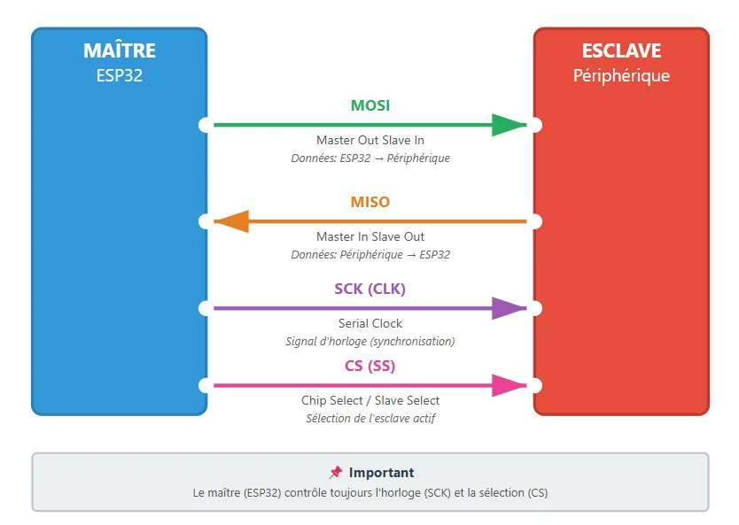

import BusProtocole from '../../../../components/BusProtocole.astro';
import Question from '../../../../components/Question.astro';

:::note[Objectifs]
À la fin de cette page, vous serez capables de :
- repérer les broches **I2C**, **SPI** et **UART** de l'ESP32 ;
- câbler un périphérique sur chacun de ces bus.
:::

Les trois protocoles ont été présentés au chapitre 3 avec le Raspberry Pi : [I2C](/Embedded-System-Course/parcours/chapitre-3/05-synchrone-i2c/), [SPI](/Embedded-System-Course/parcours/chapitre-3/06-synchrone-spi/) et [UART](/Embedded-System-Course/parcours/chapitre-3/07-asynchrone-uart/). Le principe est le même sur l'ESP32 : seules les broches changent.

## I2C

L'ESP32 dispose de broches dédiées pour la communication **I2C** (*Inter-Integrated Circuit*), qui utilise **deux fils** : un pour le **transfert des données**, l'autre pour la **synchronisation de l'horloge**.

- **GPIO 21** est la broche **SDA** (*Serial Data*), utilisée pour le transfert des données.
- **GPIO 22** est la broche **SCL** (*Serial Clock*), utilisée pour la synchronisation de l'horloge.

<BusProtocole type="i2c" carte="esp32" />

## SPI

Le protocole **SPI** (*Serial Peripheral Interface*) est une méthode de communication **série synchrone** entre un **maître** (*Master*) et un **esclave** (*Slave*).



*Le maître (ESP32) contrôle toujours l'horloge (SCK) et la sélection de l'esclave (CS).*

Par défaut, l'ESP32 dispose de **deux canaux** de communication SPI : **VSPI** et **HSPI**.

| Canal SPI | MOSI | MISO | SCK/CLK | CS/SS |
|---|---|---|---|---|
| **VSPI** | GPIO 23 | GPIO 19 | GPIO 18 | GPIO 5 |
| **HSPI** | GPIO 13 | GPIO 12 | GPIO 14 | GPIO 15 |

L'animation montre le bus VSPI avec deux périphériques : ils partagent MOSI, MISO et SCK, et chacun a sa **propre broche CS**.

<BusProtocole type="spi" carte="esp32" />

## UART : TX et RX

L'**UART** est une interface de communication **série asynchrone** (TX/RX). **Pas de signal d'horloge partagé**, contrairement au SPI !

Les deux appareils doivent juste s'accorder sur :
- la **vitesse** (*baud rate*) : 9600, 115200 bauds, etc. ;
- le **format** : 8 bits de données, 1 bit de stop.

Usages : communication avec un **PC**, un **GPS**, un module **Bluetooth**, un module **GSM**, etc.

L'ESP32 de la carte dispose de deux UART accessibles :
- **UART0** : TX0 (GPIO 1) et RX0 (GPIO 3), reliée au port USB : c'est elle qu'utilisent le téléversement et `Serial` ;
- **UART2** : TX2 (GPIO 17) et RX2 (GPIO 16), **libre** pour un module, avec `Serial2`.

<BusProtocole type="uart" carte="esp32" />

```cpp
void setup() {
  Serial.begin(115200);                       // UART0 : moniteur série (USB)
  Serial2.begin(9600, SERIAL_8N1, 16, 17);    // UART2 : RX2 = GPIO 16, TX2 = GPIO 17
}

void loop() {
  while (Serial2.available()) {               // ce que le module envoie (un GPS, par exemple)…
    Serial.write(Serial2.read());             // …est recopié dans le moniteur série
  }
}
```

`SERIAL_8N1` signifie : **8** bits de données, **N**o parity (pas de bit de parité), **1** bit de stop.

## Vérifiez vos acquis

<Question id="esp32-q6.23" label="Q6.23">
Donnez le câblage complet d'un **écran LCD I2C** (broches GND, VCC, SDA, SCL) sur l'ESP32. Peut-on brancher un capteur I2C sur les **mêmes fils** ? Qu'est-ce qui permet de les distinguer ?
</Question>

<Question id="esp32-q6.24" label="Q6.24">
Deux périphériques SPI sont reliés au bus **VSPI**. Quels fils partagent-ils ? Lequel doit être **séparé** ? Comment l'ESP32 choisit-il à quel périphérique il parle ?
</Question>

<Question id="esp32-q6.25" label="Q6.25">
On relie un **GPS** à l'ESP32 par UART. À quelle broche de l'ESP32 relie-t-on la broche **TX du GPS** ? Pourquoi utiliser l'UART2 plutôt que l'UART0 ? Que se passe-t-il si les deux appareils n'ont pas la **même vitesse** ?
</Question>

## Critères de validation

- [ ] Je connais les broches I2C de l'ESP32 : SDA = GPIO 21, SCL = GPIO 22.
- [ ] Je connais les broches des bus VSPI et HSPI.
- [ ] Je sais pourquoi on réserve l'UART0 au port USB et comment croiser TX et RX.

:::note[Prochaine étape]
Validez cette page, puis passez aux [broches tactiles](/Embedded-System-Course/parcours/chapitre-6/08-broches-tactiles/).
:::
