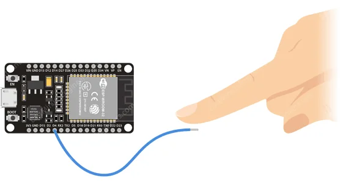

import Esp32Touch from '../../../../components/Esp32Touch.astro';
import Question from '../../../../components/Question.astro';

:::note[Objectifs]
À la fin de cette page, vous serez capables de :
- expliquer le principe d'une broche **tactile capacitive** ;
- lire une broche tactile avec `touchRead()` et choisir un **seuil** ;
- réaliser un **bouton tactile** qui allume une LED.
:::

## Toucher sans bouton

Certaines broches de l'ESP32 sont **tactiles** (*Touch*) : elles détectent le contact d'un **doigt**, sans aucun bouton mécanique. Il suffit d'y relier un fil, une pastille métallique ou une surface conductrice.



*Un simple fil relié à une broche tactile devient un bouton.*

Le corps humain se comporte comme un **condensateur** : quand le doigt touche le fil, il modifie la **capacité** mesurée par l'ESP32 sur cette broche. La fonction `touchRead()` renvoie alors une valeur **plus faible**.

| Broche tactile | Touch 0 | Touch 2 | Touch 3 | Touch 4 | Touch 5 | Touch 6 | Touch 7 | Touch 8 | Touch 9 |
|---|---|---|---|---|---|---|---|---|---|
| **GPIO** | 4 | 2 | 15 | 13 | 12 | 14 | 27 | 33 | 32 |

Touch 1 (GPIO 0) n'est pas accessible sur la carte du cours. Le bouton **Tactile (Touch)** du [brochage interactif](/Embedded-System-Course/parcours/chapitre-6/04-broches-gpio/) les met en évidence.

## Un bouton tactile pour allumer une LED

Un bouton tactile pour allumer une LED sans appuyer physiquement : parfait pour les **projets éco-conçus** !


*Le doigt touche le fil : la LED s'allume.*

```cpp
const int TOUCH = 4;    // Touch 0 → GPIO 4
const int LED = 2;      // LED intégrée
const int SEUIL = 30;   // à ajuster selon le montage

void setup() {
  Serial.begin(115200);
  pinMode(LED, OUTPUT);
}

void loop() {
  int valeur = touchRead(TOUCH);
  Serial.println(valeur);             // pour choisir le seuil
  if (valeur < SEUIL) {
    digitalWrite(LED, HIGH);          // doigt posé : LED allumée
  } else {
    digitalWrite(LED, LOW);
  }
  delay(100);
}
```

## Essayez le simulateur

**Maintenez le clic** (ou le doigt, sur téléphone) sur la pastille au bout du fil : la valeur de `touchRead(4)` baisse et la courbe plonge. Quand elle passe **sous le seuil**, la LED GPIO 2 s'allume. Déplacez le seuil pour voir son effet. Les valeurs affichées sont des ordres de grandeur : sur une vraie carte, elles dépendent du fil et du montage.

<Esp32Touch />

## Vérifiez vos acquis

<Question id="esp32-q6.26" label="Q6.26">
Pourquoi la valeur de `touchRead()` **baisse-t-elle** quand on touche le fil ?
</Question>

<Question id="esp32-q6.27" label="Q6.27">
Comment choisir le **seuil** sur une vraie carte ? Que se passe-t-il s'il est trop haut ? trop bas ?
</Question>

<Question id="esp32-q6.28" label="Q6.28" type="code">
Modifiez le programme pour réaliser un **interrupteur tactile** : un toucher allume la LED, le toucher suivant l'éteint. Indice : il faut détecter le **moment** où le doigt se pose, pas seulement le fait qu'il soit posé. Collez votre programme.
</Question>

## Critères de validation

- [ ] Je sais citer des broches tactiles de la carte.
- [ ] Je sais lire une broche tactile et choisir un seuil.
- [ ] Je sais réaliser un bouton tactile qui commande une LED.

:::note[Prochaine étape]
Validez cette page, puis passez à la [synthèse du chapitre](/Embedded-System-Course/parcours/chapitre-6/09-retenir/).
:::

